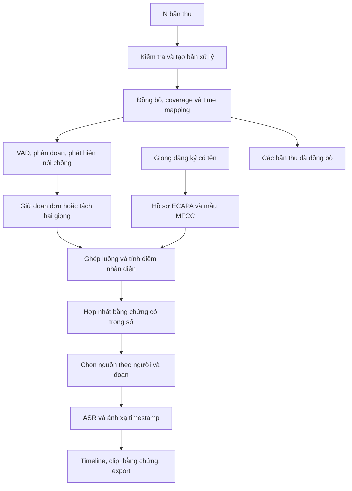

# Đặc tả triển khai: nhận diện người nói và chép lời cuộc họp từ nhiều điện thoại

**Phiên bản:** 1.0 — 16/09/2026  
**Loại tài liệu:** đặc tả sản phẩm, kiến trúc, thuật toán và kế hoạch giao việc cho agent.  
**Trạng thái:** kế hoạch triển khai; chưa có kết quả mô hình hoặc chất lượng đầu ra được xác nhận.  
**Ngôn ngữ sản phẩm:** tiếng Việt. Tên biến, API và code dùng tiếng Anh.

**Đọc nhanh:** mục 1 chốt sản phẩm; mục 3 chốt công nghệ; mục 5 chốt dữ liệu; mục 6–8 quy định thuật toán; mục 9 mô tả giao diện; mục 10–12 là hợp đồng tích hợp; mục 13–16 là chuẩn code, phân công và nghiệm thu. Mục 17 là bộ lệnh agent phải cung cấp khi hoàn tất.

## 0. Cách sử dụng tài liệu

- Trưởng dự án giữ tài liệu này làm chuẩn chung; agent đọc toàn bộ mục 1–5 và các hợp đồng ở mục 10 trước khi nhận việc.
- `BẮT BUỘC` là điều kiện nghiệm thu. Tham số ghi `khởi điểm` phải được kiểm chứng trên tập phát triển, không coi là kết quả tối ưu.
- Không đổi phạm vi sản phẩm, bỏ xử lý nói chồng, thay thuật toán bằng dữ liệu giả hoặc vượt ngân sách dữ liệu để hoàn thành một đầu việc.
- Agent được quyết định chi tiết triển khai trong phạm vi mô-đun; thay đổi hợp đồng liên mô-đun phải được trưởng dự án duyệt và cập nhật schema/tài liệu.
- Ưu tiên một pipeline chạy xuyên suốt với mô hình thật, sau đó đo và cải thiện từng điểm yếu. Giao diện đẹp không thay thế kết quả xử lý thật.
- Các ID mô hình và nguồn chính thức ở mục 18 đã được đối chiếu khi soạn tài liệu. Milestone M0 phải kiểm tra phiên bản thư viện, quyền truy cập và tương thích thực tế trước khi khóa môi trường.

## 1. Bài toán, phạm vi và kết quả mong muốn

### 1.1. Bài toán

N người tham gia một cuộc họp. Nhiều điện thoại đặt ở các vị trí khác nhau cùng ghi âm, có thể bắt đầu/kết thúc khác nhau và có đồng hồ lấy mẫu khác nhau. Mỗi bản thu chứa hỗn hợp tiếng nói của nhiều người, nhiễu và vang phòng.

Trước cuộc họp, mỗi người cung cấp vài đoạn giọng có tên xác nhận. Hệ thống nhận những mẫu đăng ký và nhiều bản thu, trả lời:

1. Ai nói ở khoảng thời gian nào?
2. Người đó nói gì?
3. Khi hai người nói đồng thời, lời và giọng của từng người là gì?
4. Kết quả của mỗi đoạn dựa trên nguồn nào, với trọng số ra sao?
5. Có thể nghe lại âm thanh gốc và âm thanh thực sự dùng chép lời để kiểm tra không?

**Tên file và vị trí điện thoại không phải nhãn người đang nói.** Ví dụ `Thien_1.aac` nghĩa là nguồn đặt gần Thiên trong cuộc họp 1; không được gán toàn bộ file cho Thiên.

### 1.2. Phạm vi phiên bản đầu

- Xử lý offline sau cuộc họp; không yêu cầu thời gian thực.
- Tiếng Việt là ngôn ngữ chính; dữ liệu tiếng Anh chỉ dùng với cấu hình đánh giá phù hợp.
- Tối đa hai người nói đồng thời. Tổng số người tham gia có thể lớn hơn hai.
- Dùng mô hình huấn luyện sẵn; few-shot nằm ở việc đăng ký một người mới bằng ít mẫu.
- Nhận diện chính: speaker embedding và so khớp hồ sơ. Đối chứng: MFCC + KNN và embedding + KNN.
- Nhiều nguồn thu; có trường hợp nguồn thiếu một phần cuộc họp.
- Demo web local, minimalist, không yêu cầu tài khoản ứng dụng hoặc triển khai cloud.
- Cấu hình demo ban đầu: 1–8 nguồn, tối đa 8 hồ sơ tham gia, tối đa 20 phút/file. Đây là giới hạn bảo vệ tài nguyên có thể cấu hình, không phải giới hạn lý thuyết của thuật toán. Phải hiển thị trước khi upload.
- Ghi nhận trường hợp chưa xác định danh tính, tách giọng kém, nguồn không đồng bộ được hoặc lời chưa đáng tin.

### 1.3. Ngoài phạm vi bắt buộc

Huấn luyện mạng lớn từ đầu; streaming trực tiếp; xử lý được cam kết cho ba người nói đồng thời trở lên; tóm tắt cuộc họp; suy luận cảm xúc; định vị người theo tọa độ thực; ứng dụng điện thoại riêng; đa người dùng qua Internet; beamforming hoặc cộng sóng âm theo trọng số.

### 1.4. Sản phẩm bàn giao

| Đầu ra | Nội dung bắt buộc |
|---|---|
| Hồ sơ giọng | Tên, mẫu đăng ký, thời lượng tiếng nói hợp lệ, embedding, phiên bản hồ sơ |
| Bản thu đồng bộ | Mỗi nguồn một file trên trục thời gian chung; vùng có/không có dữ liệu; ánh xạ về file gốc |
| Timeline | Bắt đầu/kết thúc, tên hoặc chưa xác định, lời nói, dấu nói chồng, trạng thái cần kiểm tra |
| Đoạn âm thanh | Clip gốc của nguồn được chọn; clip thực sự đưa vào ASR; clip nguồn khác để so sánh |
| Bằng chứng | Điểm nhận diện, trọng số, nguồn được chọn, thành phần chất lượng, phiên bản mô hình |
| Xuất kết quả | JSON, CSV, TXT, ZIP gồm âm thanh và manifest; RTTM cho đánh giá nếu có |
| Báo cáo thực nghiệm | Cấu hình, dữ liệu, phương pháp chia tập, metric, runtime, ví dụ lỗi, giới hạn |
| Mã nguồn | CLI và web dùng chung pipeline; môi trường khóa phiên bản; kiểm thử và hướng dẫn chạy |

Hai dòng timeline được phép trùng thời gian khi hai người nói đồng thời. Không ép toàn cuộc họp thành một chuỗi chỉ có một người hoạt động.

## 2. Bối cảnh dự án và dữ liệu hiện có

Thư mục dự án đã được người dùng đổi sang `/Users/thien/Documents/School/Luận văn`. Tên thư mục trên macOS có thể dùng Unicode tổ hợp; dùng `pathlib`, không tự chuẩn hóa tên đường dẫn đang tồn tại. Không hardcode đường dẫn này trong ứng dụng.

Chỉ dùng `dataset/`; không đọc hoặc xử lý thư mục tài liệu tham khảo vì đó là notes riêng của người dùng. Giữ nguyên các file ban đầu.

| File trong `dataset/voices/` | Cuộc họp | Điện thoại gần | Thời lượng giải mã | Tần số lấy mẫu |
|---|---:|---|---:|---:|
| `Nhan_1.aac` | 1 | Nhân | 26,752 s | 16.000 Hz |
| `Phi_1.aac` | 1 | Phi | 36,416 s | 16.000 Hz |
| `Thien_1.aac` | 1 | Thiên | 33,576 s | 44.100 Hz |
| `Nguyen_2.aac` | 2 | Nguyên | 75,456 s | 16.000 Hz |
| `Thien_2.aac` | 2 | Thiên | 73,932 s | 44.100 Hz |

Đã kiểm tra kỹ thuật: năm file AAC mono giải mã được, không báo lỗi giải mã. Đối chiếu tín hiệu ban đầu cho thấy nhóm 1 có khoảng 24,95 s chung giữa ba nguồn; nhóm 2 có khoảng 73,93 s chung. Các quan sát này không phải nhãn người nói, nhãn nói chồng hoặc bản chép lời.

**Hai cuộc họp này chỉ dùng kiểm thử thực tế sau cùng**, không dùng chọn ngưỡng hoặc tối ưu trọng số. Việc đã xem metadata/độ lệch ban đầu phải được ghi trong báo cáo; không gọi đây là tập hoàn toàn chưa từng được quan sát. Không hardcode các độ lệch đã biết vào thuật toán.

Chưa có bộ giọng đăng ký độc lập được xác nhận. Trước demo cá nhân hóa, cần người dùng cung cấp hoặc xác nhận mẫu của đúng người tham gia. Nếu phải lấy đăng ký từ một đoạn trong cuộc họp kiểm thử, loại đúng khoảng đó trên mọi nguồn khỏi phần chấm điểm và báo cáo đây là giao thức đăng ký trong phiên.

## 3. Quyết định kiến trúc và công nghệ

### 3.1. Stack ứng dụng

| Thành phần | Chọn cho v1 | Ghi chú |
|---|---|---|
| Runtime | Python 3.11, môi trường riêng bằng `uv` | Máy hiện tại macOS arm64; không dùng Python hệ thống 3.14 cho stack ML trước khi kiểm chứng |
| Web | FastAPI + Uvicorn | Web không chạy inference nặng trong request |
| HTML | Jinja2 + HTMX vendored + JavaScript/CSS thuần | Không cần Node, React hoặc CDN cho demo này |
| Metadata | SQLite + SQLAlchemy 2 + Alembic | DB local, transaction ngắn, WAL; một worker ML |
| Schema/config | Pydantic 2, pydantic-settings, YAML | Validate config; snapshot vào từng run |
| Tác vụ nền | Tiến trình Python worker riêng, hàng đợi trong SQLite | Không Redis/Celery; không dùng FastAPI BackgroundTasks để chạy toàn pipeline |
| Audio I/O | FFmpeg/ffprobe, NumPy, SoundFile | Giải mã FFmpeg; xử lý array có sample rate rõ ràng |
| DSP | SciPy, librosa | Correlation, resampling, MFCC, phổ/năng lượng |
| ML | PyTorch, torchaudio tương thích, SpeechBrain, pyannote.audio, Transformers | Adapter tách biệt; khóa phiên bản sau smoke test |
| ML cổ điển | scikit-learn | KNN, chuẩn hóa đặc trưng, đánh giá |
| Dữ liệu | huggingface-hub, PyArrow khi cần, httpx | Tải có ngân sách; không tải model khi import module |
| CLI | Typer | Cùng application service/pipeline với web |
| Kiểm thử | pytest, httpx/TestClient, Playwright Python | Tách test nhanh khỏi test model/dataset |
| Chất lượng code | Ruff, mypy | Có cấu hình chung và lệnh kiểm tra trong README |

M0 giải quyết tương thích `torch`/`torchaudio`/`speechbrain`/`pyannote.audio`/`transformers`, chạy inference thật rồi commit `uv.lock`. Không ghi một tổ hợp phiên bản chưa thử thành “đã hỗ trợ”. `pyannote/segmentation-3.0` là checkpoint legacy; thử nhánh thư viện hỗ trợ checkpoint này, không tự nâng major và coi API cũ vẫn đúng.

CPU là đường chạy bắt buộc để kiểm chứng chức năng. MPS/CUDA là tùy chọn theo từng adapter sau smoke test. Nếu một toán tử không hỗ trợ MPS, chuyển adapter đó sang CPU với log rõ ràng. Không giả định có GPU NVIDIA trên máy người dùng.

### 3.2. Mô hình và thuật toán chốt làm mặc định

| Bước | Lựa chọn | Điều kiện |
|---|---|---|
| VAD | Silero VAD, bản 16 kHz | Chỉ phát hiện tiếng nói, không xác định danh tính [S01] |
| Phân đoạn cục bộ/nói chồng | `pyannote/segmentation-3.0` | 16 kHz mono, context 10 s, tối đa 3 nhãn cục bộ/chunk và 2 người/frame; cần quyền tải [S02] |
| Embedding | `speechbrain/spkrec-ecapa-voxceleb` | 16 kHz mono; cosine với hồ sơ đăng ký [S03] |
| Few-shot chính | Trung bình embedding chuẩn hóa + cosine + ngưỡng từ chối | Giữ embedding từng mẫu để phân tích outlier và so sánh KNN |
| Đối chứng | MFCC + KNN; ECAPA embedding + KNN | Cùng support/query và cùng dữ liệu đầu vào |
| Tách hai người | `speechbrain/sepformer-whamr` | 8 kHz mono, hai đầu ra; dùng làm ứng viên triển khai đầu tiên [S04] |
| ASR tiếng Việt | `vinai/PhoWhisper-small` qua Transformers | 16 kHz; kiểm tra timestamp trên checkpoint thật [S05] |
| Tách giọng thay thế | WeSep target speaker extraction | Chỉ mở khi SepFormer không đạt cổng thử nghiệm; không thêm cả hai vào v1 mặc định [S06] |
| Metric | NumPy/scikit-learn, jiwer, pyannote.metrics, meeteval khi cần | Ghi rõ định nghĩa, chế độ ánh xạ và phiên bản |

Không cam kết chất lượng giọng Việt bằng điểm benchmark tiếng Anh của checkpoint. M0/M4 phải đo trên dữ liệu phù hợp. Nếu model tách giọng không đạt, trưởng dự án cập nhật quyết định kỹ thuật; không âm thầm bỏ tách giọng.

**Quyền truy cập:** pyannote segmentation và VoxVietnam có điều kiện truy cập. Khi chưa có quyền/token, các công việc độc lập tiếp tục; chế độ pipeline đầy đủ báo thiếu thành phần. Không biến “VAD-only” thành “đã xử lý nói chồng”. Token đọc từ môi trường, không lưu vào config snapshot, JSON hay log. Không tự chấp nhận chia sẻ thông tin liên hệ thay người dùng.

## 4. Luồng tổng thể



Các mô-đun chạy được từ CLI. Web chỉ tạo input, gửi job và hiển thị artifact; không có bản thuật toán thứ hai nằm trong route hoặc JavaScript.

## 5. Kế hoạch dữ liệu và ngân sách

### 5.1. Phân bổ

| Nguồn | Ngân sách ban đầu | Cách dùng |
|---|---:|---|
| VIVOS | Toàn bộ gói khoảng 1,5 GB | ASR Việt, thử nghiệm ít mẫu ban đầu, nguồn sạch tạo hội thoại mô phỏng [S07] |
| LibriWASN | Khoảng 1 GB | Các bản thu điện thoại cùng phiên, đồng bộ, chọn nguồn, nói chồng [S08] |
| VoxVietnam | Khoảng 1 GB | Nhận diện người Việt với 1/3/5 mẫu đăng ký [S09] |
| Hai cuộc họp của người dùng | Giữ nguyên | Kiểm thử thực tế, không tuning |

**Quy ước kế hoạch:** đang hiểu 1 GB cho mỗi bộ LibriWASN và VoxVietnam, tổng dữ liệu mạng dự kiến khoảng 3,5 GB. Đây là giả định làm việc từ trao đổi, không phải mức tổng 1 GB đã được xác nhận. Downloader phải có cả giới hạn từng nguồn và giới hạn tổng để có thể chuyển sang 600 MB LibriWASN + 400 MB VoxVietnam nếu người dùng chốt ngân sách gộp. Dùng GB thập phân: 1 GB = 1.000.000.000 byte. Không tự vượt mức đã cấu hình.

Giới hạn tải và giới hạn dữ liệu lưu sau xử lý là hai đại lượng riêng. Ghi riêng dung lượng model, cache, bản giải nén và dữ liệu mô phỏng. Không thông báo “dự án chỉ chiếm 3,5 GB” dựa vào kích thước gói tải.

### 5.2. Thu thập có kiểm soát

1. Tạo manifest metadata trước, chưa tải audio lớn: URL/phiên bản/license, file dự kiến, kích thước mạng, phiên, người, kênh, vai trò split.
2. Chạy `data plan` in ra kế hoạch và phần chưa biết. Kích thước chưa biết không được mặc định bằng 0.
3. Downloader kiểm tra byte thực nhận; tính cả tải lại và phần dư do server gửi. Hỗ trợ resume với checksum/ETag phù hợp.
4. Lưu checksum và nguồn gốc; ghi tạm rồi đổi tên khi tải xong; không dùng file nửa chừng.
5. Với LibriWASN, ZIP chính thức khoảng 4–5 GB/gói. Trước khi tải audio, kiểm tra HTTP Range/206 bằng request rất nhỏ và giới hạn đọc. Nếu server trả 200 toàn file, đóng kết nối, không nhận cả gói.
6. Chỉ tải entry ZIP cần thiết nếu range và cấu trúc archive cho phép; tính cả metadata/central directory vào ngân sách. Nếu không thể, báo `DATA_BUDGET_BLOCKED` với phương án nguồn phân phối chọn lọc khác hoặc thay đổi ngân sách. Không tải 5 GB rồi xóa bớt để tuyên bố đạt 1 GB.
7. VoxVietnam cần quyền tải. Chọn theo người và phát ngôn, không lấy các shard đầu tiên rồi mặc định đủ đa dạng. Tôn trọng split gốc và ghi mọi subset tự tạo.
8. Với dataset công khai dùng speaker ID; không suy đoán danh tính đời thực từ giọng.

### 5.3. Tiêu chí lấy mẫu

**LibriWASN:** giữ ít nhất 3 điện thoại trong mỗi phiên được chọn; ưu tiên có không chồng và chồng, nhiều phiên độc lập; cố gắng có hai điều kiện phòng nếu ngân sách cho phép. Lấy cả nhãn và phần tham chiếu cần cho metric. Không cắt mỗi nguồn tại các khoảng khác nhau rồi gọi là cùng một ví dụ. Nếu buộc rút thời lượng, cắt theo cùng khoảng vật lý với ánh xạ và ngữ cảnh đủ để ước lượng đồng bộ.

Nhãn LibriWASN neo theo nguồn Soundcard; không được áp trực tiếp cùng timestamp lên điện thoại chưa bù STO/SRO. Tài liệu tác giả ghi nhãn diarization có thể thiếu thời lượng hoạt động. Dùng cấu hình tham chiếu tác giả mô tả và lưu giới hạn của nhãn; không gọi mọi timestamp là chân lý chính xác đến mẫu [S08].

**VoxVietnam:** mục tiêu nhỏ ban đầu 20–50 người, mỗi người tối thiểu khoảng 10 đoạn khác nhau nếu subset truy cập được đáp ứng. Chọn nhiều điều kiện phát ngôn; cân bằng số mẫu/người. Mỗi episode thử 3–5 người, K = 1/3/5 support/người, query khác support. Lặp ít nhất 30 episode có seed lưu lại khi lượng dữ liệu cho phép. Khi dùng tập đánh giá công bố, ưu tiên VoxVietnam-O theo khuyến nghị tác giả; không mặc định E/H có nhãn hoàn hảo [S09].

### 5.4. Hội thoại tiếng Việt mô phỏng

- Nguồn: các câu VIVOS có speaker ID và transcript. Support đăng ký là các câu riêng, không đưa vào hội thoại query.
- Tạo 3–4 người/cuộc, tối đa 2 hoạt động đồng thời; cấu hình có/không chồng và mức chồng khác nhau. Ban đầu tạo theo nhu cầu, không xuất hàng loạt hàng chục GB.
- Mô phỏng từng đường truyền người → micro bằng đáp ứng xung phòng, độ trễ và suy hao riêng; dùng `pyroomacoustics` hoặc tập RIR có nguồn/license được ghi. Nhiễu nền có seed và mức rõ ràng.
- Sau khi tạo hỗn hợp cho từng thiết bị, áp offset bắt đầu và sampling-rate drift riêng; xuất time mapping chuẩn. Không chỉ nhân gain cho các bản sao của một hỗn hợp mono.
- Lưu nguồn sạch từng người, lịch đặt câu, transcript, speaker ID, microphone ID, RIR/noise provenance, offsets/drifts, seed.
- Nhãn hoạt động âm thanh cần xử lý khoảng lặng đầu/cuối của câu nguồn; không gán toàn độ dài câu chứa silence thành speech thật.
- Chia tập theo người/nguồn câu trước khi tạo biến thể. Mọi biến thể của cùng câu/sự kiện thuộc cùng split.
- Dùng dữ liệu mô phỏng để biết lỗi từng bước; báo cáo riêng với thu thật. Không gọi kết quả trên giọng đọc mô phỏng là chất lượng họp tự nhiên.

### 5.5. Chống rò rỉ dữ liệu

Phân biệt `development`, `validation`, `public_test`, `real_test`, và trong từng episode có `support/query`. Người mới của tập đánh giá few-shot không được dùng chọn ngưỡng, fit scaler hoặc train classifier tổng quát. Support/query vẫn phải cùng danh tính mục tiêu nhưng khác phát ngôn, ưu tiên khác phiên.

Giữ mọi kênh của cùng cuộc họp trong một split. LibriCSS và LibriWASN tái sử dụng câu/người gốc; nhóm theo `underlying_utterance_id`, không coi tên corpus khác là độc lập. Kiểm tra nguồn huấn luyện công bố của checkpoint; phân biệt “chưa dùng để tuning dự án” với “chắc chắn chưa từng được pretrained model nhìn thấy”. Không có đủ thông tin thì ghi chưa xác minh.

## 6. Pipeline âm thanh: hợp đồng và cách thực hiện

### 6.1. Ingest và chuẩn bị âm thanh

**Input:** file upload hoặc đường dẫn nội bộ đã được phép; danh sách người tham gia và hồ sơ đã sẵn sàng.  
**Output:** `SourceRecord`, bản gốc bất biến, audio xử lý và báo cáo kiểm tra.

1. Cấp `source_id` UUID, lưu tên người dùng gửi chỉ làm nhãn. Kiểm tra dung lượng trước/đang nhận; đọc từng chunk.
2. FFprobe đọc container/codec/sample rate/channel; FFmpeg giải mã toàn bộ để phát hiện lỗi và đếm sample thật. Thời lượng AAC từ header có thể là ước lượng.
3. Lưu SHA-256; file trùng không được tạo thêm một nguồn độc lập để tăng số phiếu.
4. Giữ original. Audio dùng phân tích là mono float32 16 kHz; audio phát/tải có thể WAV PCM16 hoặc FLAC. Tệp stereo phải ghi rõ quy tắc chọn/downmix; không gộp các điện thoại khác nhau thành mono.
5. Stereo: kiểm tra tương quan/pha và chất lượng hai kênh; chọn một kênh nếu trộn gây triệt tiêu. Lưu channel map. Với v1, mỗi file điện thoại được đại diện bởi một kênh phân tích.
6. Lưu raw RMS, peak, tỷ lệ sample gần trần, DC offset, coverage; không coi không chạm trần số là bằng chứng không méo micro.
7. Không peak-normalize từng nguồn trước khi lưu đặc trưng mức âm. Bản model-normalized, nếu cần, là artifact khác có gain log.
8. Không khử nhiễu mạnh mặc định. Bật enhancement sau khi có ablation chứng minh không làm xấu nhận diện/ASR.

File hỏng hoặc không có tiếng nói được báo bằng lỗi/cảnh báo cụ thể. Thiếu một nguồn không tự làm hỏng mọi nguồn khác; trường hợp loại nguồn phải xuất hiện trong kết quả.

### 6.2. Enrollment: giọng đăng ký

**Input:** `speaker_id`, tên hiển thị, một hoặc nhiều mẫu được xác nhận.  
**Output:** `SpeakerProfile` bất biến theo phiên bản, các embedding support và thống kê mẫu.

- Mục tiêu hướng dẫn người dùng: 3–5 phát ngôn riêng, mỗi đoạn khoảng 5–10 s tiếng nói rõ. Cho phép 1 mẫu để đúng thí nghiệm one-shot; hiển thị cảnh báo dữ liệu ít.
- VAD loại phần không có tiếng nói khỏi tính embedding nhưng lưu mọi ánh xạ đoạn. Mẫu hợp lệ cần tổng tiếng nói tối thiểu 3 s ở cấu hình khởi điểm; ngưỡng này có thể điều chỉnh có báo cáo.
- Không coi việc đọc tên mình là cơ chế xác nhận danh tính tự động. Người dùng gán đúng tên cho mẫu. Đoạn nghi nhiều người hoặc có nói chồng phải yêu cầu kiểm tra, không âm thầm đưa vào hồ sơ.
- ECAPA nhận waveform mono 16 kHz; L2-normalize embedding từng đoạn. Vector đại diện `p_s = normalize(mean(e_s1, ..., e_sK))`. Phiên bản đầu dùng trung bình đều của các mẫu được duyệt, không thêm trọng số bí mật.
- Lưu pairwise similarity giữa mẫu của cùng người để phát hiện outlier; cảnh báo, không tự xóa mẫu chỉ vì khác giọng. Không tự bổ sung query đã dự đoán vào support.
- Hồ sơ lưu model revision, sample hash, các đoạn tiếng nói được dùng, preprocessing version, embeddings và prototype. Một run cuộc họp tham chiếu profile version cố định.
- Khi thêm/xóa mẫu, tạo profile version mới. Những run đã hoàn thành vẫn truy cập được bản profile cũ để tái lập.

**MFCC đối chứng:** `librosa`, 16 kHz, cửa sổ 25 ms, bước 10 ms, 40 mel bins, 20 MFCC, delta và delta-delta; lấy mean/std theo các frame tiếng nói thành vector cố định. Đây là cấu hình khởi điểm. Scaler fit trên development, không fit query/test. KNN distance-weighted, thử `n_neighbors` = 1/3/5 khi số support cho phép; chọn trên validation. Nêu rõ K trong K-shot khác số hàng xóm của KNN. Giữ cùng budget giây/mẫu và cùng query với phương pháp embedding.

### 6.3. Đồng bộ: offset, drift, coverage

**Input:** các bản thu độc lập.  
**Output:** audio aligned, `TimeMapping`, `Coverage`, chất lượng căn chỉnh.

Quy ước duy nhất trong toàn hệ thống:

```text
u = thời gian tính từ đầu file nguồn đã giải mã, đơn vị giây
t = thời gian trên timeline cuộc họp, đơn vị giây
t = a_i * u + b_i
u = (t - b_i) / a_i
```

`a_i > 0`; `b_i > 0` nghĩa là nguồn bắt đầu muộn hơn mốc cuộc họp. Chỉ dùng offset thì `a_i = 1`. Tính toán/cắt audio bằng sample indices; seconds dùng trình bày và interchange. Drift phi tuyến cần ánh xạ piecewise đơn điệu, có phân đoạn rõ ràng; không dùng một offset để cắt clip sau khi đã bù drift.

Thuật toán:

1. Chọn reference bằng coverage dự kiến, thời lượng và chất lượng có tiếng nói; không dùng tên thiết bị/người. Lưu lý do chọn.
2. Ước lượng coarse lag bằng tương quan envelope log-energy, giảm mẫu envelope để tìm khoảng rộng. Yêu cầu đủ khoảng có tín hiệu chung; tìm lag theo dấu quy ước bằng test tín hiệu tổng hợp trước.
3. Tinh chỉnh bằng normalized cross-correlation hoặc GCC-PHAT trên nhiều cửa sổ hoạt động. Có band-pass ở nhánh tìm alignment nếu hữu ích, không ghi đè audio gốc.
4. Cửa sổ khởi điểm 5–10 s, lấy ở đầu/giữa/cuối vùng chung; với file dài thêm mỗi 30 s. Bỏ cửa sổ quá ít năng lượng, gần tuần hoàn hoặc peak mơ hồ. Chất lượng gồm peak ratio và độ nhất quán giữa cửa sổ.
5. Fit tuyến tính robust các cặp thời điểm bằng RANSAC/Huber. Chỉ bật drift khi có ít nhất 3 inlier trải đủ dài và sai số cải thiện rõ trên cửa sổ kiểm tra riêng. File ngắn hoặc bằng chứng yếu dùng offset-only, ghi `drift_unresolved` thay vì fit đường chính xác giả.
6. Nếu đường nối trực tiếp reference yếu, thử đường nối qua nguồn trung gian; kiểm tra tính nhất quán vòng của graph. Không ép ghép các file thuộc cuộc họp khác.
7. Dịch origin chung để toàn bộ nguồn bắt đầu tại `t >= 0`, xuất union timeline. Nguồn bắt đầu muộn/kết thúc sớm được zero-pad trong aligned file nhưng kèm availability mask. Padding không được dùng làm noise reference hoặc một nguồn bỏ phiếu im lặng.
8. Resample thật để bù `a_i`; lưu số sample trước/sau và phiên bản thuật toán. Không chỉ sửa sample-rate metadata.
9. Kiểm tra residual alignment trên nhiều khoảng. Acoustic time-of-flight thay đổi theo người/vị trí và vang có thể gây lag vài ms; không coi mọi biến động lag là clock drift.

Nếu không đủ bằng chứng, đánh dấu nguồn `alignment_failed` hoặc `needs_review`, cho phép nhập offset thủ công được ghi trong provenance. Không tự ép nguồn đó vào weighted fusion. Báo cáo đồng bộ luôn chỉ rõ nguồn đã bị loại và coverage còn lại.

### 6.4. VAD và phân đoạn người nói

- Chạy Silero trên từng nguồn đủ coverage; threshold khởi điểm 0,5, speech tối thiểu 250 ms, silence tối thiểu 200 ms, pad 100 ms. Không dùng những giá trị này như chất lượng đã được xác minh.
- Tạo vùng speech chung từ các nguồn có chất lượng, ưu tiên recall nhưng không lấy union vô điều kiện của mọi false positive. Lưu quyết định và điểm từng nguồn.
- Chạy pyannote segmentation theo cửa sổ có context 10 s và bước khoảng 2,5 s; đọc powerset qua utility của phiên bản đã khóa. Không tự xem 7 output class là 7 danh tính.
- Hợp nhất VAD/OSD giữa nguồn sau đồng bộ. Dùng nguồn tốt thứ hai hoặc evidence bất đồng để giảm bỏ sót người nói nhỏ. Một số lượng source prediction không phải số người.
- Dùng hoạt động local speaker của segmentation và thay đổi embedding trên cửa sổ tiếng nói để đề xuất ranh giới đổi người. VAD đơn thuần không đủ vì hai lượt nói có thể sát nhau.
- Local speaker slots thay đổi giữa chunk; không gán `local_speaker_1 = Thiên` xuyên suốt file. Giới hạn 3 local slots/10 s phải được đo ở tình huống đổi lượt nhanh; không tự hiểu là tối đa 3 người/cuộc họp.
- Giữ speech dưới 1–2 s; có thể dùng context cùng track để nhận diện. Không xóa câu chen ngắn để làm đẹp metric. Nếu quá ít bằng chứng, để unknown.
- Output của bước này là vùng có ứng viên một/hai người cùng boundary uncertainty, chưa phải tên cuối cùng.

### 6.5. Tách hai giọng

1. Chỉ chạy separator trên vùng nghi nói chồng hoặc vùng có bằng chứng mâu thuẫn cần kiểm tra. Không chạy separator hai đầu ra lên toàn bộ silence/đoạn đơn rồi gán hai người giả.
2. Tạo chunk liên tục có ngữ cảnh hai đầu; khởi điểm chunk tối đa 8 s, context 1 s, overlap 1 s giữa chunk khi phải chia dài. Tất cả tọa độ chunk tính trên thời gian cuộc họp.
3. Với các nguồn đủ điều kiện, resample 16 kHz → 8 kHz trước SepFormer; output hai waveform 8 kHz. Resample thật lại 16 kHz trước ECAPA/PhoWhisper. Việc nâng sample rate không phục hồi thông tin đã mất; ghi giới hạn này.
4. Giữ độ dài, offset, padding/cropping và model latency mapping. Nếu mô hình có trễ đầu ra, đo trên fixture và bù/lưu; không mặc định bằng 0 khi chưa thử.
5. Hai output không có thứ tự danh tính cố định. So sánh embedding, khoảng thời gian hoạt động và sự liên tục để thử hai hoán vị; có thể dùng Hungarian assignment cho việc nối track, không dùng để đổi tên khi chấm danh tính.
6. Nối chunk chỉ sau khi khớp permutation; dùng crossfade trong vùng giao nhau cho đúng cùng track. Lưu span provenance của từng chunk.
7. VAD lại từng output; đánh dấu empty, too_short, duplicate/leakage_suspected hoặc failed. Hai output giống cùng người không được ép nhận hai tên khác nhau.
8. Trong v1, xử lý mọi nguồn đủ điều kiện trong giới hạn tài nguyên. Nếu giảm số nguồn separator, phải cấu hình và báo nguồn bị bỏ; không chọn một nguồn chung trước tách rồi đánh mất người nhỏ tiếng ở nguồn đó.

Giữ bản nguyên gốc song song. Không gọi output tách là “giọng sạch hoàn hảo”. Nếu không tách được giọng có thể sử dụng, giữ đoạn nguồn gốc để nghe và ghi `separation_failed/needs_review`; không chép hai bản sao cùng một câu rồi báo hai người.

### 6.6. Nhận diện và nối track giữa nguồn

- Trích ECAPA trên đoạn ứng viên đủ speech; cửa sổ nhận diện khởi điểm 2 s, bước 0,5 s, điều chỉnh theo ranh giới người nói. Không lấy một embedding dài chứa hai người làm đại diện cho một người.
- Tính `c_i,k,s = cosine(e_i,k, p_s)` cho candidate track k của nguồn i và speaker s. Điểm cosine nằm trong [-1, 1], không phải phần trăm xác suất đúng.
- Nối candidate giữa nguồn bằng thời gian chung + toàn bộ vector điểm tên + similarity embedding. Không chỉ ghép theo top-1 hoặc số thứ tự output. Mỗi track global nhận tối đa một candidate của một thiết bị tại một thời điểm.
- Track nói chồng phải có joint assignment: một tên không được nhận đồng thời hai luồng trùng lặp trong cùng nguồn, trừ khi thực sự cần đánh dấu lỗi mô hình. Cho phép một/ cả hai luồng unknown thay vì cưỡng ép assignment.
- Chọn tên khi điểm tổng hợp vượt `identity_threshold` và chênh top-1/top-2 vượt `identity_margin`. Hai ngưỡng chọn từ validation; cấu hình sản xuất phải chứa giá trị số và nguồn thí nghiệm tạo ra chúng. Không lấy ngưỡng verification của một model card áp mặc định cho mọi phòng họp.
- Temporal smoothing chỉ sửa nhãn khi có evidence liền kề; không xóa câu chen ngắn hoặc khóa toàn bộ cuộc họp theo người gần điện thoại.
- Giữ `track_id` ổn định kể cả unknown, `speaker_id` có thể null. Không tự suy đoán tên dựa vào nội dung câu ASR.

### 6.7. Trọng số và lựa chọn nguồn có thể giải thích

Tách hai đại lượng để tránh vòng lặp “đã đoán là A nên tăng trọng số, rồi dùng trọng số đó chứng minh là A”:

**A. Trọng số hợp nhất nhận diện `identity_weight`:** phụ thuộc chất lượng candidate/nguồn, chưa phụ thuộc danh tính được chọn.

```text
q_i,k = weighted_mean(các đặc trưng chất lượng có sẵn)
alpha_i,k = softmax(q_i,k / temperature) trên các nguồn hợp lệ của track k
score_k(s) = sum_i alpha_i,k * c_i,k,s
```

Đặc trưng khởi điểm đưa về [0, 1]: mức hiện diện tiếng nói, độ tương phản tiếng nói/nền ước lượng và mức tránh clipping. Hệ số khởi điểm 0,4 / 0,4 / 0,2; temperature khởi điểm 0,25. Đây là heuristic cần ablation/tuning, không phải công thức vật lý về khoảng cách.

- Noise proxy lấy từ vùng non-speech thật gần thời điểm xét; không lấy zero-padding. Không có vùng nền đáng tin thì đặc trưng là null; tính lại trọng số các đặc trưng còn lại.
- Độ tương phản năng lượng không phải true SNR/SIR khi không có nguồn sạch. Hiển thị đúng tên `speech_noise_contrast_estimate_db`.
- Clipping dựa vào nguồn trước normalization; ngưỡng và công thức penalty nằm trong config. Không dùng biên độ output separator tùy ý làm thước đo khoảng cách.
- Nguồn không có coverage, giải mã lỗi, alignment thất bại hoặc candidate không có speech nhận weight 0. Nếu tất cả không hợp lệ, trả `insufficient_evidence`, không tạo softmax đều giả.

**B. Trọng số chọn nguồn ASR `selection_weight`:** sau khi đã có tên/track, kết hợp alpha với độ khớp của chính candidate đó với tên được chọn và trạng thái output tách.

```text
g_i,k = clip((c_i,k,s_selected - candidate_match_floor) /
             (1 - candidate_match_floor), 0, 1)
beta_i,k = normalize(alpha_i,k * g_i,k) trên candidate sử dụng được
selected_source = argmax(beta_i,k)
```

`candidate_match_floor` chọn trên validation; trường hợp unknown dùng chất lượng alpha để chọn âm thanh, vẫn giữ nhãn unknown. Nếu tổng beta bằng 0 đối với tên đã dự đoán, đánh dấu mâu thuẫn cần kiểm tra; không tự chia đều hoặc ghi đè score danh tính. Không đưa beta trở lại tính `score_k(s)` trong v1.

Mỗi utterance chọn một nguồn ổn định, tránh đổi nguồn từng frame. Chỉ đổi giữa hai đoạn khi nguồn cũ không còn hợp lệ hoặc nguồn mới tốt hơn đủ margin cấu hình. Khi phải ghép nhiều span, lưu danh sách nguồn cho từng span; không khai gian một `selected_source_id` cho clip nhiều nguồn.

Lưu cả alpha/beta, raw features, candidate scores, eligibility, missing features, model/config version. Giao diện mặc định hiển thị beta là “trọng số chọn nguồn”; mở chi tiết thấy alpha là “trọng số nhận diện”. Chúng là trọng số quyết định, không phải xác suất người đó ngồi gần máy.

### 6.8. ASR và timeline

- Dùng PhoWhisper-small; waveform mono 16 kHz và task transcribe tiếng Việt. Pin Transformers/model revision; smoke test API timestamp thực tế của checkpoint.
- Giữ ngữ cảnh utterance, chia đoạn dài ở khoảng lặng hoặc ranh giới hợp lý, khởi điểm tối đa 25 s. Không ép ASR chạy riêng trên mọi cửa sổ embedding 2 s.
- Timestamp là tương đối với clip ASR, phải cộng offset và ánh xạ thành meeting time. Nếu inference có chunk/context riêng, lưu và bỏ đúng phần context trùng trước khi ghép văn bản.
- Mốc từ (word timestamps) là tùy chọn sau kiểm chứng; đầu ra bắt buộc là segment timestamps. Không quảng cáo forced alignment tiếng Việt nếu chưa có aligner đã thử.
- Không nối các khoảng speech rời nhau bằng cách bỏ silence rồi dùng timestamp trên file nối cho timeline gốc. Nếu nối để tăng context, cần explicit piecewise mapping; v1 ưu tiên giữ silence gốc.
- Deduplicate dựa trên giao nhau thời gian + track + token sequence. Không xóa câu giống nhau của hai người hoặc một người lặp lại ở thời điểm khác.
- VAD kiểm soát silence; ASR rỗng/không chắc được giữ trạng thái rõ ràng. Không dùng LLM để tự điền lời thiếu hoặc sửa nội dung bằng suy đoán.
- Nội dung tiếng Anh từ LibriWASN không đưa vào PhoWhisper và chấm như tiếng Việt. Profile đánh giá tiếng Anh phải có ASR đa ngôn ngữ phù hợp được khai báo riêng; có thể chỉ đánh giá các bước âm thanh nếu chưa cấu hình ASR đó.
- Có hai dòng/tracks ở đoạn chồng, hai clip processed và một hoặc hai source IDs. Các raw original clip có thể cùng chứa cả hai người; giao diện phân biệt rõ.

## 7. Clip đối chiếu và tính truy nguyên

Mỗi segment phải có ba đường nghe:

1. **Giọng dùng chép lời:** artifact chứa đúng mẫu waveform đưa vào ASR, trước hoặc sau tách giọng đúng theo provenance. Nếu chunk ASR có context, lưu clip dùng đầy đủ và speech interval bên trong; không nói một bản đã gain khác là input chính xác.
2. **Đoạn gốc:** cắt từ bản giải mã file gốc, tại original spans ánh xạ từ meeting interval; không áp separator. Có thể giữ native sample rate để đối chiếu.
3. **Nguồn khác cùng thời điểm:** cắt từ các nguồn có coverage; nêu rõ đang nghe bản aligned original hay bản separated candidate.

Clip có thể thêm 0,2 s ngữ cảnh hai đầu ở cấu hình ban đầu. Lưu riêng `speech_interval` và `clip_interval`; UI không hiển thị thời điểm đầu context như đầu lời nói.

Mapping phải giữ được chuỗi: original → resample → align/drift correction → chunk → separation → resample → selection → ASR → timeline. Đối với đoạn giao ranh piecewise mapping, `original_spans` là danh sách, không ép thành một offset.

Xuất `aligned/<source_id>.wav` cùng origin và số sample tương ứng union duration, cộng `coverage.json`. WAV zero-padding chỉ là định dạng phát; mask quyết định availability. Âm thanh đồng bộ và clip được kiểm tra bằng backend sample indices, không dùng việc hai audio player trình duyệt phát cùng lúc để chứng minh đồng bộ.

## 8. Cấu hình và tái lập

Tạo `configs/default.yaml`, `configs/evaluation.yaml`; secrets trong environment. Cấu hình phải có schema, đơn vị, bounds và giải thích. Ví dụ định hướng, agent cần hoàn thiện bằng cấu hình đã validate:

```yaml
audio:
  analysis_sample_rate: 16000
  separator_sample_rate: 8000
  max_sources: 8
  max_duration_seconds: 1200
  preserve_originals: true
sync:
  fine_window_seconds: 8
  long_recording_step_seconds: 30
  allow_drift: true
segmentation:
  context_seconds: 10
  step_seconds: 2.5
  max_simultaneous_speakers: 2
separation:
  model_id: speechbrain/sepformer-whamr
  chunk_seconds: 8
  context_seconds: 1
  overlap_seconds: 1
identity:
  model_id: speechbrain/spkrec-ecapa-voxceleb
  method: prototype_cosine
  calibration_artifact: null  # Phải có khi chạy cấu hình nghiệm thu chất lượng.
asr:
  model_id: vinai/PhoWhisper-small
  language: vi
  max_chunk_seconds: 25
datasets:
  libriwasn_download_budget_bytes: 1000000000
  voxvietnam_download_budget_bytes: 1000000000
worker:
  max_parallel_ml_jobs: 1
```

Không dùng config mẫu trên như file chạy nguyên trạng: khóa model revisions, bổ sung đường dẫn và calibration cụ thể sau M0/M3. Hệ thống phải phân biệt `development` (cho phép ngưỡng thử nghiệm, có nhãn) và `validated` (có calibration artifact). Không hiển thị config chưa hiệu chuẩn là kết quả đã nghiệm thu.

Mỗi run lưu `schema_version`, code revision hoặc code hash nếu chưa có Git, environment lock hash, model IDs/revisions, config snapshot/hash, input checksums, profile versions, seed, phần cứng và thời gian mỗi bước. Nạp model lazy theo stage; giải phóng model không dùng khi RAM hạn chế. Không giữ toàn bộ audio nhiều nguồn 20 phút và mọi activation separator cùng lúc nếu có thể xử lý theo chunk.

## 9. Giao diện minimalist

### 9.1. Thiết kế chung

- Header nhỏ: tên ứng dụng, `Cuộc họp`, `Người tham gia`; không dashboard trang trí.
- Nền `#FAFAFA`, bề mặt trắng, chữ chính `#111827`, viền `#E5E7EB`, một màu nhấn `#2563EB`; kiểm tra contrast với màu chữ phụ/trạng thái.
- Font hệ thống; chữ nội dung 14–16 px, line-height khoảng 1,5; spacing bội số 8 px; chiều rộng nội dung tối đa khoảng 1.200 px.
- Ít card, ít đổ bóng, không gradient/animation trang trí, không emoji. Có thể dùng icon đơn giản kèm nhãn chữ nếu cần; mọi thao tác phải hiểu được khi không nhìn icon.
- Một nút hành động chính trong mỗi bước. Ngưỡng, model ID và tham số nâng cao không xuất hiện trong luồng chính; cho vào khu vực kỹ thuật có thể mở.
- UI tiếng Việt, thông báo cụ thể: file nào lỗi, bước nào lỗi và có thể làm gì tiếp. Không hiển thị traceback cho người dùng.
- Keyboard navigation, focus rõ, label cho input, `aria-live=polite` cho tiến độ; màu không là tín hiệu duy nhất.
- Responsive ở 390/768/1280 px. Mobile chuyển hàng timeline thành block; lời nói xuống dòng; nút audio không tràn màn hình.

### 9.2. Người tham gia và đăng ký

Hiển thị danh sách tên, số mẫu, tổng giây tiếng nói hợp lệ và profile status. Các thao tác: thêm người, tải mẫu, ghi âm, nghe lại, xóa mẫu, tạo/cập nhật hồ sơ.

Ghi âm dùng `getUserMedia` + `MediaRecorder`, lựa chọn MIME qua `MediaRecorder.isTypeSupported`. Không mặc định mọi trình duyệt hỗ trợ WebM. Quyền microphone do trình duyệt quản lý; nếu bị từ chối, upload vẫn hoạt động. Không gửi audio ra dịch vụ bên ngoài [S14].

Mỗi mẫu có tên, thời lượng, nút nghe và trạng thái. Hiển thị rõ mẫu chưa được xác nhận, quá ngắn, không có speech hoặc nghi nói chồng. `Tạo hồ sơ` là job nhẹ đi qua worker để không block web.

### 9.3. Tạo cuộc họp

Form gồm tên cuộc họp, danh sách người tham gia có profile, ô tải nhiều file. Mỗi nguồn có nhãn tùy sửa và mục tùy chọn `Đặt gần`; mục này không gán speaker label.

Cho nghe thử, bỏ file khỏi cuộc họp nháp, hiển thị giới hạn file/thời lượng. Một nút chính `Phân tích cuộc họp`. Nếu model chưa được chuẩn bị, nêu đúng thành phần thiếu; không cho run mang trạng thái thành công giả.

### 9.4. Trong lúc xử lý

Hiển thị stage bằng chữ: kiểm tra → đồng bộ → phân đoạn → tách giọng → nhận diện/chọn nguồn → chép lời → xuất kết quả. Khi có số chunk thật thì hiển thị done/total; không dùng timer tạo phần trăm giả. Cho hủy; khi đang inference không hủy tức thì được thì ghi `Đang dừng`.

HTMX polling khoảng 2 s chỉ cập nhật vùng tiến độ; dừng polling sau trạng thái kết thúc. Không thay DOM của player đang nghe [S12].

### 9.5. Kết quả: ba tab

**Timeline:** thời gian bắt đầu–kết thúc, người nói, nội dung, nguồn chọn và nút nghe. Lọc theo người, chỉ nói chồng, chỉ cần kiểm tra. Sắp xếp ổn định theo start/end/track ID. Không làm mất hàng có thời gian trùng nhau.

Mở chi tiết một dòng gồm player chung, lựa chọn `Giọng dùng chép lời` / `Đoạn gốc` / nguồn khác, điểm khớp, các ứng viên người nói, bảng trọng số, thành phần chất lượng, file gốc, mốc file gốc và cảnh báo. Nêu rõ audio đã tách giọng hay còn hỗn hợp.

**Nguồn đã đồng bộ:** các thanh coverage dùng chung thước thời gian; nguồn không có dữ liệu khác khoảng lặng. Hiển thị offset, drift nếu đã ước lượng, reference và mức cần kiểm tra. Cho nghe/tải từng nguồn.

**Tải kết quả:** JSON, CSV, TXT, ZIP. Thông tin kỹ thuật/model/config nằm ở disclosure riêng; không bắt người dùng đọc để tải.

Wireframe định hướng:

```text
Cuộc họp / Tên cuộc họp                     Hoàn tất | Tải kết quả
Timeline              Nguồn đã đồng bộ              Tải kết quả

Người nói: Tất cả      [ ] Nói chồng      [ ] Cần kiểm tra

00:12–00:16   Thiên    Nội dung đoạn thứ nhất…      Nguồn 1   Nghe
00:14–00:18   Nhân     Nội dung đoạn nói chồng…     Nguồn 2   Nghe

Chi tiết đoạn đang chọn
Giọng dùng chép lời | Đoạn gốc | Nguồn khác
[Player: phát/dừng, thời gian, thanh tua, âm lượng]
Nguồn 1: trọng số …   Nguồn 2: trọng số …   Nguồn 3: trọng số …
File gốc … | Khoảng thời gian gốc … | Điểm khớp …
```

Wireframe là minh họa bố cục, không phải kết quả thật. Không đưa lời ví dụ hoặc weights giả vào kết quả inference.

### 9.6. Trình phát và cùng mốc thời gian

Một audio element chính, phát một nguồn tại một thời điểm. Khi đổi nguồn, giữ meeting time, ánh xạ sang vị trí của file mới rồi seek. Nguồn không có coverage ở mốc đó hiển thị thông báo, không nhảy sang thời điểm khác mà không nói rõ.

File aligned cùng origin dùng trực tiếp meeting time. Original clip cần mapping và clip start riêng. API audio hỗ trợ HTTP Range/206 để seek file dài. Test sample accuracy nằm ở backend; browser playback chỉ dùng đối chiếu nghe [S13–S14].

## 10. Hợp đồng dữ liệu và API

### 10.1. Đơn vị và kiểu dữ liệu

Tất cả interval dùng nửa mở `[start, end)`, `end > start`; seconds float64 trong JSON, sample index int trong xử lý. Mọi audio array phải đi kèm `sample_rate`, shape/channel layout và timeline origin. Không truyền ndarray trần qua ranh giới mô-đun rồi ngầm đoán sample rate.

Các schema Pydantic chính:

| Schema | Trường cốt lõi |
|---|---|
| `AudioBuffer` | samples, sample_rate, channels, start_sample, time_axis |
| `SourceRecord` | source_id, meeting_id, original_name, original_artifact_id, sha256, sample_rate, channels, sample_count, device_label, near_speaker_id nullable |
| `SpeakerProfile` | speaker_id, version, model_id/revision, support_sample_ids, embedding_artifact_id, prototype_artifact_id, preprocessing_hash |
| `TimeMapping` | mapping_id, source_id, reference_id, origin_shift, kind, affine/piecewise coefficients, valid_ranges, residuals, method, status |
| `CandidateTrack` | track/candidate_id, source_id, meeting interval, waveform artifact, transforms, VAD/quality, embedding, score vector, separation status |
| `SourceEvidence` | source/candidate_id, available, eligible, reason, raw_quality_features, identity_weight, selection_weight, candidate_scores |
| `TimelineSegment` | Xem schema tối thiểu bên dưới |
| `RunManifest` | schema_version, run_id, input hashes, profile versions, model revisions, config/code hashes, timestamps, stage artifacts, warnings/errors |

`TimelineSegment` tối thiểu:

```text
segment_id, track_id
start_sec, end_sec                      # Trục thời gian cuộc họp
speaker_id | null
speaker_status                         # identified / unknown / ambiguous
speaker_match_score | null             # Cosine tổng hợp; không gọi là xác suất
speaker_top_candidates[]
overlap_group_id | null
text, asr_status, needs_review, warnings[]
selected_source_id | null               # Null nếu đa nguồn, dùng selected_spans
selected_spans[]                        # Source/candidate và interval từng span
source_evidence[]                       # Có cả nguồn không hợp lệ và lý do
original_clip_artifact_ids[]
processed_clip_artifact_id | null
asr_input_artifact_id | null
alternative_clip_artifact_ids[]
provenance:
  original_spans[]                      # source_id, sample/second ranges, mapping_id
  speech_interval, clip_interval
  transform_chain[]
  separation_model_revision | null
  speaker_profile_version | null
  asr_model_revision | null
```

Không tạo `processed_clip` giả khi separator thất bại. Trường nullable và trạng thái lỗi giải thích vì sao thiếu. JSON schema có version; agent frontend dùng fixture đúng schema do agent nền tảng phát hành.

### 10.2. Giao diện mô-đun nội bộ

Các chữ ký định hướng; triển khai typed objects thay `dict` tùy tiện:

```text
decode_source(source: SourceRecord) -> DecodedSource
build_profile(samples: list[EnrollmentSample], config: EnrollmentConfig) -> SpeakerProfile
align_sources(sources: list[DecodedSource], config: SyncConfig) -> AlignmentResult
segment_sources(aligned: AlignmentResult, config: SegmentationConfig) -> SegmentationResult
separate_candidates(aligned: AlignmentResult, regions: SegmentationResult) -> CandidateSet
identify_tracks(candidates: CandidateSet, profiles: list[SpeakerProfile]) -> IdentificationResult
select_sources(result: IdentificationResult, config: FusionConfig) -> SelectionResult
transcribe_selected(selection: SelectionResult, config: ASRConfig) -> TranscriptResult
export_result(result: TranscriptResult, context: RunContext) -> ArtifactManifest
```

Mỗi stage nhận `RunContext` hoặc dependency injection cho logger/artifact store/cancellation; không tự mở DB toàn cục hoặc dùng đường dẫn global. Dữ liệu lớn truyền qua artifact handles + spans khi có thể, không serialize waveform vào SQLite/JSON.

### 10.3. HTTP API

| Method/path | Chức năng |
|---|---|
| `GET /` | Danh sách cuộc họp |
| `GET /speakers` | Trang đăng ký giọng |
| `GET /meetings/{id}` | Trang cuộc họp và kết quả |
| `POST /api/speakers` | Tạo người tham gia |
| `POST /api/speakers/{id}/samples` | Upload mẫu |
| `DELETE /api/speakers/{id}/samples/{sample_id}` | Bỏ mẫu khỏi profile tương lai; không phá run cũ |
| `POST /api/speakers/{id}/enroll` | Tạo job xây profile |
| `POST /api/meetings` | Tạo cuộc họp và roster |
| `POST /api/meetings/{id}/sources` | Upload nhiều nguồn |
| `POST /api/meetings/{id}/runs` | Tạo run, trả 202 và run_id |
| `GET /api/runs/{id}` | Trạng thái/tiến độ/warnings |
| `POST /api/runs/{id}/cancel` | Yêu cầu hủy |
| `POST /api/runs/{id}/retry` | Run mới, giữ lịch sử run cũ |
| `GET /api/runs/{id}/timeline` | Timeline theo schema |
| `GET /api/artifacts/{id}/audio` | Audio qua FileResponse hỗ trợ Range |
| `GET /api/artifacts/{id}/download` | Tải artifact |
| `GET /api/runs/{id}/export?format=...` | Tải JSON/CSV/TXT/ZIP đã được stage export tạo; GET không khởi chạy công việc nặng |

HTML partial của HTMX nằm dưới `/partials/...`; JSON API và partial dùng cùng services. Upload dùng stream/chunk; giới hạn byte, số file và thời lượng phải validate thật. Idempotency key hoặc ràng buộc tương đương ngăn double-click tạo nhiều run trùng.

Không nhận đường dẫn tùy ý từ URL để đọc file. Artifact ID ánh xạ trong storage. Escape tên người/file/transcript khi render HTML. App bind `127.0.0.1` mặc định; không tự publish.

## 11. Cấu trúc mã nguồn và lưu trữ

```text
project/
  PIPELINE_IMPLEMENTATION_SPEC.md
  pyproject.toml
  uv.lock
  README.md
  .env.example
  .gitignore
  configs/
    default.yaml
    evaluation.yaml
  src/meeting_pipeline/
    cli.py
    config.py
    domain/
      schemas.py
      errors.py
      time_mapping.py
    application/
      enrollment_service.py
      meeting_service.py
      job_service.py
      artifact_service.py
    pipeline/
      runner.py
      stages/
        ingest.py
        synchronize.py
        segment.py
        separate.py
        identify.py
        fuse.py
        transcribe.py
        export.py
    adapters/
      audio_io.py
      silero_vad.py
      pyannote_segmentation.py
      ecapa_encoder.py
      sepformer_separator.py
      phowhisper_asr.py
    storage/
      database.py
      models.py
      repositories.py
      artifact_store.py
    worker/
      main.py
      queue.py
    web/
      app.py
      routes/
      templates/
      static/
        app.css
        player.js
        recorder.js
        htmx.min.js
    evaluation/
      protocols.py
      metrics.py
      reports.py
    datasets/
      manifests.py
      download.py
      subset.py
      simulate.py
  migrations/
  tests/
    unit/
    integration/
    e2e/
    model_smoke/
    fixtures/
  docs/
    setup.md
    demo.md
    data.md
    experiments.md
    decisions.md
  dataset/voices/                         # File hiện có, chỉ đọc
  data/                                  # Artifact sinh ra, không commit
    app.sqlite
    external/
    synthetic/
    speakers/<speaker_id>/
      originals/
      profiles/<version>/
    meetings/<meeting_id>/
      originals/
      runs/<run_id>/
        manifest.json
        alignment.json
        coverage.json
        aligned/
        candidates/
        timeline.json
        clips/original/
        clips/processed/
        exports/
        logs/
```

Đây là định hướng phân lớp, không yêu cầu tạo file rỗng cho đủ cây. Có thể gộp module nhỏ cùng trách nhiệm; không dùng một `utils.py` chứa mọi thứ. `domain` không import web, DB hoặc ML. Route mỏng; model adapter không biết HTML. Pipeline chạy CLI không cần web server.

Metadata DB gồm speakers, enrollment_samples, speaker_profiles, meetings, meeting_participants, sources, runs và artifacts. Timeline JSON bất biến theo run, chưa cần nhân bản toàn bộ timeline vào SQL. Manifest/export lưu đường dẫn tương đối theo gói để tải ZIP sang máy khác vẫn mở được.

## 12. Worker, trạng thái và khả năng phục hồi

```text
queued → running → succeeded
                 → partial
                 → failed
                 → cancelled
                 → interrupted
```

- `succeeded`: mọi stage bắt buộc hoàn thành và artifact bắt buộc hợp lệ. Unknown speaker vẫn là một kết quả hợp lệ nếu đã thực sự chạy nhận diện.
- `partial`: có kết quả xem được nhưng một phần xử lý bắt buộc thất bại, ví dụ vùng nói chồng không tạo được candidate để nhận diện/ASR. Không đổi tên thành hoàn tất không cảnh báo.
- `failed`: không thể tạo kết quả có ý nghĩa. `cancelled`: người dùng dừng. `interrupted`: mất worker hoặc app dừng giữa chừng.
- Lưu warnings riêng với error. Không dùng trạng thái thành công để che model chưa tải, skipped stage hay dữ liệu giả.

Web tạo job và trả ngay; worker claim bằng transaction ngắn, xử lý ngoài transaction. Một worker ML hoạt động tại một thời điểm; model cache ở worker. SQLite WAL + foreign_keys + busy_timeout; không đặt DB trên network filesystem [S11].

Heartbeat cập nhật riêng để inference dài không làm run bị hiểu là chết. Khi restart, xác định worker mất lease và đánh dấu interrupted. Retry tạo run_id mới; chỉ tái sử dụng checkpoint đã hoàn tất và có cùng input/config/model/profile hashes. File tạm không là checkpoint hợp lệ.

Ghi artifact vào file tạm cùng filesystem rồi atomic rename; chỉ công bố metadata sau khi hoàn tất. Hủy được kiểm tra giữa các chunk/stage. Lưu stage duration, đơn vị done/total và lỗi có mã; log không chứa token.

## 13. Chuẩn clean code và chú thích

1. Public function/method có type hints và docstring. Hàm DSP nêu rõ input shape, sample rate, đơn vị, hệ thời gian, padding và output length.
2. Chú thích giải thích lý do, giả định và trường hợp biên: dấu lag, sửa drift, permutation, cách tính ngưỡng, cách map timestamp. Không thêm comment chỉ đọc lại code.
3. Mỗi function có một trách nhiệm; ưu tiên hàm thuần cho DSP/metrics và dataclass/Pydantic cho contract. Không đặt giới hạn số dòng máy móc, nhưng tách các khối xử lý độc lập để test được.
4. Tên đầy đủ và nhất quán: `meeting_start_sec`, `source_start_sample`, `identity_weight`; tránh `x1`, `temp2`, `confidence` dùng nhiều nghĩa.
5. Không magic number trong thuật toán: tham số ở config có đơn vị, range và mô tả. Hằng toán học rõ nghĩa có thể ở module.
6. Model loading nằm trong adapter/service lifecycle; không download model khi import, không global mutable state cho run hiện tại.
7. Exception có ngữ nghĩa: `InvalidAudioError`, `AlignmentError`, `ModelUnavailableError`, `DataBudgetExceededError`. Chỉ catch tại nơi có thể xử lý; không `except Exception: return []`.
8. Không shell interpolation từ tên file người dùng. Gọi FFmpeg bằng list arguments, timeout và kiểm tra return code. Dùng pathlib và tempfile có cleanup.
9. Không commit dataset, audio cá nhân, model weights, token, SQLite hoặc generated clips. Commit manifest nguồn, config, fixtures nhỏ được phép và lockfile.
10. Logging theo `run_id/source_id/stage`; không spam từng frame. Log câu trả lời mô hình dài khi debug có tùy chọn, không mặc định ghi mọi nội dung vào console.
11. Ghi decision quan trọng trong `docs/decisions.md`: model checkpoint, version compatibility, score thresholds, lý do dùng/không dùng enhancement.
12. Không dùng emoji trong code comments, log, tài liệu triển khai hoặc UI chính. Markdown, tên mục và trạng thái dùng chữ rõ ràng.
13. Trước bàn giao: formatter/linter, type check phần code dự án và test liên quan phải qua. Chỉ bỏ qua type check thư viện thiếu stubs ở ranh giới adapter, không bỏ kiểm tra toàn repo.
14. Test nhắm vào hành vi/rủi ro thật; không viết test chỉ khẳng định function trả đúng hằng số đang hardcode. Không tăng coverage bằng mock toàn bộ thuật toán rồi gọi đó là kiểm chứng mô hình.

Mẫu chú thích phù hợp:

```python
def source_time_to_meeting_time(source_sec: float, scale: float, offset_sec: float) -> float:
    """Map source-local seconds to the common meeting clock.

    A positive offset means that the source started after the meeting origin.
    The scale includes clock-drift compensation and must be strictly positive.
    """
    if scale <= 0:
        raise ValueError("Time mapping scale must be positive")
    return scale * source_sec + offset_sec
```

Đây chỉ minh họa contract affine; code thực tế phải hỗ trợ mapping object, coverage và inverse mapping, không lặp công thức rải rác trong nhiều module.

## 14. Phân công agent và quy trình tích hợp

### 14.1. Vai trò

| Vai trò | Sở hữu chính | Không tự thay đổi |
|---|---|---|
| Trưởng dự án/tích hợp | Spec, schema, config chung, dependency lock, milestone, review, release | Không nhận kết quả mô phỏng thay inference thật |
| Agent dữ liệu/đánh giá | Manifests, downloader, subset, simulation, splits, metrics | Không sửa audio gốc hoặc dùng real_test để tuning |
| Agent DSP | Ingest, alignment, coverage, time mapping, cắt clip | Không tự đổi schema thời gian/source identity |
| Agent mô hình | Enrollment, segmentation, separation, identification, fusion, ASR adapters | Không tự thay model/threshold đã chốt mà không ghi decision |
| Agent ứng dụng | DB, queue, worker, API, templates, playback, exports | Không tự triển khai thuật toán ML thứ hai trong web |

Vai trò có thể do cùng agent đảm nhiệm qua nhiều vòng. Giữ tối đa ba agent thực hiện song song cùng một trưởng dự án trong môi trường có bốn slot. Chia việc theo module, tránh hai agent sửa một file chung. Chỉ trưởng dự án cập nhật `pyproject.toml`, lockfile, schema dùng chung và config chung sau khi nhận yêu cầu thay đổi.

### 14.2. Phiếu giao việc bắt buộc

Mỗi task có: mục tiêu; phạm vi file; input/output contract; dependency; acceptance checks; dữ liệu được dùng; điều không được làm; artifact bàn giao. Agent trả báo cáo gồm file đổi, cách chạy, kiểm tra đã chạy, kết quả và vấn đề còn lại. Không trả “xong” nếu còn placeholder/TODO ở luồng bắt buộc.

Trước tích hợp, agent cung cấp fixture nhỏ và output schema để agent kế tiếp không phải đoán. Nếu có Git, dùng nhánh/worktree `codex/<task>` khi phù hợp; không giả định thư mục hiện tại đã là Git repository. Không tự thay cấu trúc dữ liệu người dùng để tiện cho branch.

### 14.3. Milestone và cổng nghiệm thu

| Mốc | Đầu việc cụ thể | Phụ thuộc | Đầu ra/cổng qua mốc |
|---|---|---|---|
| **M0 — Kiểm chứng khả thi** | Preflight máy/FFmpeg; quyền model; smoke VAD, ECAPA, pyannote, SepFormer, PhoWhisper trên mẫu nhỏ; đo RAM/runtime; dry-run ngân sách dataset | Spec này | Bảng tương thích thực, lockfile, model registry, danh sách blocker. Chưa gọi pipeline sẵn sàng |
| **M1 — Nền tảng** | Schema, time mapping, artifact store, config; SQLite/migration; CLI khung; queue/worker; HTML skeleton | M0 | Test schema/mapping/storage/queue qua; web và CLI gọi chung services |
| **M2 — Dữ liệu và đăng ký** | Tải có ngân sách; subset/split; synthetic fixtures; enrollment thật; MFCC baseline | M1 | Manifest có checksum/split; profile version; test support/query không trùng |
| **M3 — Đồng bộ và nhận diện đơn** | Alignment/coverage; VAD; single-speaker boundaries; ECAPA prototype/KNN; calibration ngưỡng; UI upload/nguồn đồng bộ | M1–M2 | Đồng bộ trên fixture có ground truth; nhận diện thật có score; không hardcode tên/source |
| **M4 — Nói chồng và nhiều nguồn** | OSD; separation; permutation giữa chunk/nguồn; identity fusion; source selection; lưu alpha/beta | M3 | Hai track đồng thời hoạt động trên fixture thật/mô phỏng đã gắn nhãn; có artifact và lý do nguồn chọn |
| **M5 — ASR, timeline, giao diện** | PhoWhisper; timestamp; clip gốc/processed; timeline/filter/player; aligned downloads; exports | M3–M4 | End-to-end bằng model thật, mỗi hàng truy nguyên được; không dùng transcript viết sẵn làm inference |
| **M6 — Thực nghiệm và bàn giao** | Ablation, metric, failure cases, real_test hai cuộc họp khi có enrollment; E2E/UX; README/demo guide | M5 | Báo cáo số đo thật, demo chạy lại từ fresh setup, toàn bộ checklist mục 16 |

**Thứ tự song song gợi ý:**

- Vòng 1: trưởng dự án khóa contract; agent dữ liệu làm kế hoạch tải; agent mô hình làm smoke; agent ứng dụng dựng kiến trúc mỏng.
- Vòng 2: DSP đồng bộ; mô hình enrollment/segmentation; ứng dụng upload/queue/player dùng fixture theo contract. Dữ liệu/đánh giá do trưởng dự án điều phối hoặc tái phân công sau task hoàn tất.
- Vòng 3: mô hình làm overlap/fusion; ứng dụng nối timeline/exports; dữ liệu/đánh giá tạo giao thức và fixtures. DSP hỗ trợ sửa mapping nếu phát hiện lỗi.
- Vòng 4: agent đánh giá chạy protocol đóng băng; ứng dụng chạy E2E/accessibility; mô hình/DSP xử lý lỗi từ development. Real_test chỉ chấm sau khi chốt cấu hình.

Mock adapter được dùng cho test hợp đồng và phát triển UI, phải có nhãn `fixture/mock`, tách khỏi cấu hình demo thật. Không được đưa mock vào nghiệm thu M5/M6.

### 14.4. Quy trình review và xử lý blocker

1. Chốt contract trước khi agent viết tích hợp.
2. Review bằng output thật và test cần thiết, không chỉ đọc code.
3. Tích hợp từng stage; kiểm tra lỗi làm lệch timestamp trước khi tối ưu chất lượng model.
4. Nếu thiếu quyền model/data: ghi dependency blocker cụ thể, tiếp tục task độc lập; không thay mô hình một cách ngầm định.
5. Nếu vượt bộ nhớ: giảm batch/chunk, giải phóng model, dùng CPU cho adapter phù hợp; báo benchmark mới. Không xóa bước bắt buộc để làm job chạy nhanh.
6. Nếu SepFormer không đủ chất lượng ở tiếng Việt/vang phòng: so sánh adapter TSE WeSep trên development; trưởng dự án chốt một lựa chọn mới và cập nhật dependency/metrics. Chưa đạt overlap gate thì sản phẩm chưa hoàn tất yêu cầu.
7. Nếu ngân sách LibriWASN không thể đáp ứng do đóng gói: ghi đúng blocker tải; phát triển tiếp bằng VIVOS mô phỏng, nhưng báo rõ chưa có phần kiểm chứng LibriWASN, không tuyên bố corpus đã được sử dụng.

## 15. Kiểm thử, thực nghiệm và cách đo chất lượng

### 15.1. Test nhanh, không tải mạng

| Nhóm | Hành vi/rủi ro phải kiểm chứng |
|---|---|
| Time mapping | Affine/piecewise hai chiều; b âm/dương; origin shift; sai số round-trip không quá 1 sample theo quy tắc rounding |
| Clip bounds | Đúng nguồn, đúng start/end; context tách biệt; không đọc ngoài coverage; segment đi qua ranh mapping |
| Alignment | Tín hiệu synthetic lệch đã biết; có drift; missing coverage; silence-only; file không cùng sự kiện phải bị từ chối |
| Resampling | Độ dài/duration phù hợp; 44,1k → 16k → 8k → 16k không đổi hệ thời gian sai; metadata rate không thay cho resampling |
| Permutation | Hai đầu ra cố ý đổi thứ tự giữa chunk/nguồn vẫn giữ cùng track; duplicate output không thành hai người |
| Weights | Chỉ nguồn hợp lệ nhận weight; tổng bằng 1 khi có nguồn hợp lệ; all-invalid trả trạng thái thiếu bằng chứng; thiếu feature không bằng 0 giả |
| Identity | Query không tự thêm support; unknown và margin; profile version bất biến; model score không chuyển thành phần trăm giả |
| Timeline | Hai hàng overlap được giữ; cùng câu lặp ở thời điểm khác không bị xóa; timestamp clip → meeting chính xác |
| Storage/queue | Atomic write; partial checkpoint không tái dùng; crash → interrupted; retry giữ run cũ; cancel không tạo succeeded |
| API | Upload lỗi/duplicate/quá giới hạn; status phản hồi khi worker bận; artifact Range/206; HTML escaping |

Fixture DSP tổng hợp nhỏ có seed và ground truth. Mục tiêu offset-only trên fixture sạch: sai số <= 10 ms; synthetic có drift biết trước: residual <= 20 ms trên vùng kiểm tra được cấu hình. Đây là cổng chức năng có kiểm soát, không phải cam kết sai số trên mọi cuộc họp thật. Lưu thêm residual distribution, không chỉ mean.

### 15.2. Model smoke và tích hợp thật

Đánh dấu riêng `model_smoke`/`dataset`/`slow`. Chỉ chạy khi weights đã chuẩn bị; test nhanh mặc định không tự tải hàng GB.

- Một profile thật từ mẫu riêng và query khác.
- Đoạn một người; đoạn hai người nói chồng có nguồn sạch hoặc nhãn xác nhận.
- Một ví dụ nhiều micro cùng sự kiện, một nguồn bị thiếu đầu/cuối.
- Silent clip để kiểm tra không xuất lời giả.
- Một người không có trong roster để đo cách từ chối.
- Kiểm chứng timestamp ASR trên checkpoint PhoWhisper, không chỉ test shape output.
- Kiểm tra từng processed clip phát được và khớp checksum/biến đổi của ASR input.

### 15.3. End-to-end giao diện

Playwright Python kiểm tra đăng ký → tạo cuộc họp → upload nhiều nguồn → theo dõi job → xem timeline → mở hai hàng nói chồng → nghe original/processed → đổi nguồn giữ thời gian → tải ZIP.

Có bộ E2E fixture cho luồng web và một lượt nghiệm thu với model thật. Browser không được đóng băng khi inference chạy. Polling không reset player/filter. Kiểm tra keyboard, màn hình hẹp, quyền mic bị từ chối, file lỗi, model thiếu, worker bị dừng.

### 15.4. Chỉ số đánh giá

| Thành phần | Metric và quy ước |
|---|---|
| Đồng bộ | Absolute offset error, residual lag qua thời gian; drift error chỉ khi có drift reference; overlap coverage được giữ |
| Few-shot | Top-1 accuracy, macro-F1 theo speaker, confusion matrix cho K=1/3/5; báo cả số giây enrollment và reject rate |
| Người chưa đăng ký | False accept/reject theo protocol; unknown là trạng thái riêng, không trộn mọi lỗi vào accuracy chung |
| Diarization | DER, báo collar, có/không tính overlap, cách permutation mapping; báo riêng miss/false alarm/confusion |
| Danh tính thật | Accuracy/lỗi theo tên cố định và thời lượng; không Hungarian remap tên để che A bị gọi thành B |
| Tách giọng | SI-SDR/SI-SDR improvement khi có clean reference phù hợp cùng timeline; không tính từ real mixture không có nguồn sạch |
| ASR Việt | CER và lỗi token tách bằng khoảng trắng; giải thích token này thường là âm tiết/chunk chữ, không mặc định là từ ngữ nghĩa |
| Lời gắn người | Speaker-attributed error theo fixed speaker IDs; cpWER có thể báo bổ sung nhưng không thay metric tên thật |
| Hiệu năng | Wall-clock/stage, real-time factor, peak memory nếu đo được, số nguồn và độ dài trên cấu hình phần cứng đã ghi |
| Tính truy nguyên | Tỷ lệ segment có clip/mapping/artifact hợp lệ; mục tiêu 100% cho segment hoàn chỉnh |

Chuẩn hóa transcript đánh giá thống nhất: Unicode NFC, chữ thường, quy tắc dấu câu/khoảng trắng/số được cố định; giữ dấu tiếng Việt. Lưu raw transcript bên cạnh normalized text. Không sửa đáp án để giống output.

Tính DER theo permutation có ích cho phân cụm vô danh, nhưng có thể che lỗi gắn tên. Do đó luôn có metric fixed-identity riêng. Permutation để chấm separator không được cung cấp cho bước nhận diện khi inference.

### 15.5. Ma trận thí nghiệm tối thiểu

1. MFCC + KNN / ECAPA + KNN / ECAPA + prototype, cùng support/query, K=1/3/5.
2. Một nguồn cố định / nhiều nguồn weight đều / nhiều nguồn theo chất lượng. Nguồn cố định chọn bằng development, không dùng reference test để chọn “nguồn tốt nhất”.
3. Không separation / có separation ở đoạn chồng; báo riêng chất lượng vùng đơn và vùng chồng.
4. Các budget enrollment theo số giây; mức noise/vang/overlap; source mất một phần.
5. Nếu dùng reference để tìm oracle best source, chỉ báo như giới hạn so sánh khi đánh giá; không đưa transcript chuẩn vào quyết định runtime.

Ghi seed và lặp thí nghiệm khi sample few-shot thay đổi. Khoảng tin cậy/bootstrap theo đơn vị người hoặc phiên khi có đủ đơn vị độc lập; không coi nghìn frame của hai cuộc họp là nghìn cuộc họp độc lập. Báo số lượng và giới hạn của subset nhỏ.

Không tự tuyên bố đạt 90%/95% trước khi chạy. Trưởng dự án chốt mục tiêu chất lượng từ baseline development/validation trước khi mở real_test, lưu trong `docs/experiments.md`; khi không đạt phải sửa hoặc báo chưa đạt. Chạy được không đồng nghĩa với nhận diện tốt.

## 16. Checklist nghiệm thu sản phẩm

### Chức năng bắt buộc

- [ ] Tạo người, upload/ghi mẫu, nghe mẫu, tạo profile và lưu phiên bản.
- [ ] Upload nhiều file cùng cuộc họp; tên nguồn/đặt gần không bị dùng làm nhãn thật.
- [ ] Đồng bộ tự động; giữ coverage và time mapping; nguồn lỗi được nêu rõ.
- [ ] Xuất các bản thu aligned trên cùng trục thời gian và nghe so sánh.
- [ ] Nhận diện người nói từ support riêng; có unknown/ambiguous.
- [ ] Xử lý trường hợp hai người nói đồng thời bằng model thật và xuất hai track/dòng.
- [ ] Tính và lưu trọng số thật; nguồn chọn ảnh hưởng thực sự đến ASR input.
- [ ] Chép lời tiếng Việt bằng ASR; không dùng transcript fixture giả làm đầu ra.
- [ ] Mỗi dòng đầy đủ có clip gốc, clip processed/ASR input, nguồn, timestamps và provenance kiểm chứng được.
- [ ] Có trường hợp chưa tốt được đánh dấu; thiếu stage bắt buộc không mang nhãn hoàn tất.
- [ ] JSON/CSV/TXT/ZIP tải được và mở trên máy khác không phụ thuộc absolute path nội bộ.
- [ ] UI minimalist, không emoji, keyboard dùng được, không mất vị trí nghe khi polling.

### Kỹ thuật và thực nghiệm

- [ ] Fresh setup bằng README/lockfile chạy được trên môi trường đã ghi; model downloads có quy trình riêng.
- [ ] CLI chạy cùng pipeline với web.
- [ ] Code typed, chú thích thuật toán rõ, Ruff/mypy/test liên quan qua.
- [ ] Có model smoke thật cho toàn stack; checkpoint và config được khóa.
- [ ] Downloader giữ đúng ngân sách thực nhận; không coi subset lưu là lượng tải mạng.
- [ ] Có manifest/splits, không rò support/query hoặc đồng kênh sang hai split.
- [ ] Có bảng metric baseline/ablation, gồm đoạn chồng; không chỉ chọn ví dụ thành công.
- [ ] Hai cuộc họp cá nhân được chấm riêng khi đã có enrollment/nhãn xác nhận; không dùng tuning.
- [ ] Báo cáo runtime và hạn chế; giữ nguyên dữ liệu người dùng và bỏ qua notes tham khảo.

Demo nghiệm thu tối thiểu phải trình diễn được một ví dụ một người nói và một ví dụ hai người nói chồng với tên/nội dung/clip đúng đã được đối chiếu nhãn. Các lỗi còn lại trong tập đánh giá vẫn phải báo cáo; không dùng một ví dụ đúng để kết luận toàn hệ thống chính xác.

## 17. Lệnh vận hành và hồ sơ bàn giao cần tạo

Các lệnh dưới đây là **giao diện CLI mục tiêu agent phải triển khai**, không phải lệnh đang tồn tại trong dự án hôm nay:

```text
uv sync --locked
uv run meeting-pipeline doctor
uv run meeting-pipeline models prepare --config configs/default.yaml
uv run meeting-pipeline data plan --config configs/evaluation.yaml
uv run meeting-pipeline data fetch --manifest <manifest.json>
uv run meeting-pipeline data simulate --config configs/evaluation.yaml
uv run meeting-pipeline serve --host 127.0.0.1 --port 8000
uv run meeting-pipeline worker
uv run meeting-pipeline run --meeting-id <id> --config configs/default.yaml
uv run meeting-pipeline evaluate --protocol <protocol.yaml>
uv run pytest tests/unit tests/integration
uv run pytest tests/model_smoke -m model_smoke
uv run pytest tests/e2e -m e2e
uv run ruff check .
uv run ruff format --check .
uv run mypy src/meeting_pipeline
```

README phải nói web và worker là hai tiến trình, cách dừng, nơi lưu dữ liệu, cách chuẩn bị FFmpeg/models, trường hợp thiếu token, dung lượng tải thực tế và cách chạy CPU. Cài browser Playwright là bước riêng cho người chạy E2E.

`doctor` kiểm tra môi trường, decoder, data directories, schema migration, model availability và cấu hình; không tải mạng ngầm. `models prepare` in kích thước tải dự kiến trước, dùng cache/registry cố định và không gửi audio người dùng lên cloud. Sau khi đã chuẩn bị assets, phiên demo thông thường hoạt động local.

Hồ sơ bàn giao cuối cùng:

1. README setup + lệnh demo ngắn.
2. `docs/demo.md`: kịch bản đăng ký, upload, xem sync, nghe original/processed, xem hai dòng overlap, export.
3. `docs/data.md`: nguồn/license/budgets/manifest/splits và dữ liệu còn thiếu.
4. `docs/experiments.md`: cấu hình đã chốt, bảng kết quả, thất bại tiêu biểu, giới hạn kết luận.
5. `docs/decisions.md`: các lựa chọn khác đặc tả và lý do đã được trưởng dự án chấp thuận.
6. Một gói kết quả hoàn chỉnh từ dữ liệu được phép chia sẻ; dữ liệu cá nhân không tự đưa vào repository công khai.

## 18. Nguồn chính thức và căn cứ kỹ thuật

Các liên kết dưới đây hỗ trợ khả năng/điều kiện của công cụ và dữ liệu. Các công thức trọng số, cấu trúc ứng dụng, budget subset và tiêu chí thử nghiệm trong tài liệu là thiết kế đề xuất của dự án, không phải hiệu năng đã được các nguồn bảo đảm.

| Mã | Nguồn | Dùng để đối chiếu |
|---|---|---|
| S01 | [Silero VAD](https://github.com/snakers4/silero-vad) | VAD, sample rates, adapter |
| S02 | [pyannote segmentation-3.0](https://huggingface.co/pyannote/segmentation-3.0) | Powerset, 10 s/16 kHz, local speaker slots, gated access |
| S03 | [SpeechBrain ECAPA](https://huggingface.co/speechbrain/spkrec-ecapa-voxceleb) | Embedding/cosine, input 16 kHz |
| S04 | [SepFormer-WHAMR](https://huggingface.co/speechbrain/sepformer-whamr) | Hai output, input 8 kHz, giới hạn domain |
| S05 | [PhoWhisper](https://github.com/VinAIResearch/PhoWhisper), [checkpoint small](https://huggingface.co/vinai/PhoWhisper-small) | ASR Việt, cách nạp checkpoint |
| S06 | [WeSep](https://github.com/wenet-e2e/WeSep) | Hướng target speaker extraction dự phòng |
| S07 | [VIVOS trên Zenodo](https://zenodo.org/records/7068130), [dataset card](https://huggingface.co/datasets/AILAB-VNUHCM/vivos) | Dữ liệu tiếng Việt, transcript, speaker ID, license |
| S08 | [LibriWASN v2](https://zenodo.org/records/10952434), [repo chính thức](https://github.com/fgnt/libriwasn) | Nhiều điện thoại async, archive sizes, Soundcard time reference, hạn chế nhãn |
| S09 | [VoxVietnam](https://huggingface.co/datasets/hustep-lab/VoxVietnam-Dataset) | Dữ liệu speaker Việt, điều kiện truy cập, tập đánh giá O |
| S10 | [CHiME-6 synchronization](https://chimechallenge.github.io/chime6/track2_software.html) | Tham khảo ước lượng lag theo thời gian và bù clock drift |
| S11 | [SQLite WAL](https://www.sqlite.org/wal.html) | Đọc/ghi đồng thời và giới hạn một writer |
| S12 | [FastAPI Background Tasks](https://fastapi.tiangolo.com/tutorial/background-tasks/), [UploadFile](https://fastapi.tiangolo.com/tutorial/request-files/), [Templates](https://fastapi.tiangolo.com/advanced/templates/), [HTMX polling](https://htmx.org/docs/#polling) | Tách inference nặng, upload, HTML và tiến độ |
| S13 | [Starlette FileResponse](https://starlette.dev/responses/#fileresponse) | Phát/tua audio bằng Range requests |
| S14 | [MediaDevices.getUserMedia](https://developer.mozilla.org/en-US/docs/Web/API/MediaDevices/getUserMedia), [HTMLMediaElement.currentTime](https://developer.mozilla.org/en-US/docs/Web/API/HTMLMediaElement/currentTime) | Ghi âm và seek trong browser |
| S15 | [LibriCSS](https://github.com/chenzhuo1011/libri_css) | Enrollment riêng, transcript/reference liên quan LibriWASN |
| S16 | [AMI](https://groups.inf.ed.ac.uk/ami/corpus/), [LibriMix](https://github.com/JorisCos/LibriMix) | Nguồn mở rộng khi có nhu cầu, không mặc định tải trong budget v1 |

## 19. Tóm tắt quyết định cần giữ xuyên suốt

- Hai cuộc họp hiện tại là kiểm thử thực tế; tên file mô tả vị trí điện thoại.
- Few-shot = ít mẫu của người mới; mô hình đặc trưng đã pretrained, không train mạng lớn từ đầu.
- Đồng bộ có coverage và ánh xạ thời gian hai chiều; không xóa silence rồi làm mất timeline.
- Nhận diện ai nói, tách giọng và chép lời là các nhiệm vụ khác nhau; đủ cả ba mới đáp ứng nói chồng.
- Model default: Silero + pyannote segmentation + ECAPA + SepFormer-WHAMR + PhoWhisper-small; phải qua smoke/quality gates.
- MFCC + KNN là baseline nghiên cứu; cùng protocol với embedding.
- Hợp nhất bằng chứng, chọn nguồn cho ASR, lưu trọng số thật; không cộng waveform tùy tiện.
- Mỗi đoạn truy nguyên được về source và clip gốc; không có kết quả “hộp đen” không nghe đối chiếu.
- Giao diện giản dị, local, tiếng Việt; kiến trúc FastAPI/Jinja/HTMX và worker Python riêng.
- Nghiệm thu bằng model thật, artifact hợp lệ, kiểm thử có ý nghĩa và số đo minh bạch. Không hứa chất lượng chưa đo.
