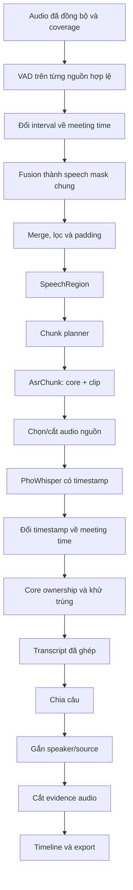

# Kế hoạch triển khai VAD, phân đoạn và chép lời theo timeline

**Phiên bản:** 1.0 — 24/09/2026  
**Trạng thái:** Đã chốt thiết kế, chờ triển khai  
**Phạm vi:** Phân đoạn tiếng nói và ASR cho các đoạn không nói chồng  
**Tài liệu cấp trên:** [`../PIPELINE_IMPLEMENTATION_SPEC.md`](../PIPELINE_IMPLEMENTATION_SPEC.md)

## 0. Cách sử dụng tài liệu

Tài liệu này là yêu cầu triển khai chính thức cho hạng mục:

```text
audio đã đồng bộ
→ VAD đa nguồn
→ speech regions
→ ASR chunks có ngữ cảnh
→ PhoWhisper có timestamp
→ ghép transcript
→ chia câu
→ timeline và audio bằng chứng
```

Agent thực hiện phải đọc theo thứ tự:

1. `AGENTS.md` nếu repository có file này.
2. `PIPELINE_IMPLEMENTATION_SPEC.md`.
3. Toàn bộ tài liệu này.
4. Mã hiện tại trong `src/meeting_pipeline/pipeline/prototype.py`, schema, config và test liên quan.

Quy ước:

- `BẮT BUỘC` là điều kiện nghiệm thu.
- `Khởi điểm` là tham số ban đầu, phải cấu hình được và có thể thay đổi sau đánh giá.
- Nếu tài liệu này khác với đặc tả tổng thể về thứ tự VAD/ASR, tài liệu này là quyết định mới hơn cho riêng hạng mục phân đoạn và ASR.
- Việc hoãn cải thiện nói chồng chỉ áp dụng cho hạng mục này. Yêu cầu xử lý tối đa hai người nói đồng thời của sản phẩm tổng thể vẫn còn hiệu lực cho giai đoạn sau.
- Không âm thầm thay đổi hợp đồng. Mọi sai khác bắt buộc do thư viện hoặc checkpoint phải được ghi tại mục “Sai khác khi triển khai”, kèm bằng chứng.

## 1. Quyết định kiến trúc

### 1.1. Quyết định đã chốt

Không chép lời toàn bộ bản ghi rồi mới chia câu. Pipeline phải:

1. Đồng bộ các nguồn về cùng timeline cuộc họp.
2. Phát hiện các vùng có tiếng nói bằng VAD.
3. Hợp nhất VAD của các nguồn thành `SpeechRegion` dùng chung.
4. Ghép khoảng gần nhau và chia vùng dài thành `AsrChunk` có ngữ cảnh.
5. Chạy ASR trên từng chunk và lấy timestamp thực từ mô hình.
6. Đưa timestamp cục bộ về timeline cuộc họp.
7. Ghép kết quả các chunk và loại trùng tại biên.
8. Chia transcript đã ghép thành câu để hiển thị.
9. Gắn người nói, nguồn và cắt audio bằng chứng cho từng câu.

VAD xác định nơi có tiếng nói, không xác định ranh giới câu về mặt ngữ nghĩa. Ranh giới câu được tạo sau ASR từ dấu câu, khoảng nghỉ, ranh giới người nói và giới hạn độ dài.

### 1.2. Ba lớp interval bắt buộc

Mọi interval dùng quy ước nửa mở `[start_sec, end_sec)`.

| Interval | Ý nghĩa |
|---|---|
| `speech_interval` | Vùng có tiếng nói sau hợp nhất và hậu xử lý VAD |
| `core_interval` | Phần timeline mà một ASR chunk sở hữu kết quả transcript |
| `clip_interval` | Audio thật sự đưa vào ASR, gồm core và ngữ cảnh hai bên |

Ví dụ:

```text
SpeechRegion: [10.00, 50.00)

Chunk 1:
  core: [10.00, 32.00)
  clip: [10.00, 32.75)

Chunk 2:
  core: [32.00, 50.00)
  clip: [31.25, 50.00)
```

Audio của hai chunk được phép chồng để giữ ngữ cảnh. Core của các chunk không được chồng và phải phủ đúng speech region.

## 2. Phạm vi

### 2.1. Đầu vào

- Các nguồn đã decode thành mono float32 16 kHz.
- Time mapping và audio đã đồng bộ trên timeline cuộc họp.
- Coverage hợp lệ của từng nguồn.
- Trạng thái alignment của từng nguồn.
- Kết quả chọn nguồn hiện có, khi cần tạo ASR clip.
- Speaker turn hoặc kết quả nhận diện người nói hiện có, nếu có.

### 2.2. Đầu ra

- Danh sách speech region chung của cuộc họp.
- Kế hoạch ASR chunk có core và clip interval.
- Transcript thô theo chunk.
- Transcript có timestamp tuyệt đối đã ghép.
- Timeline theo câu.
- Audio bằng chứng cho từng câu.
- Provenance từ timeline về region, chunk, nguồn, sample gốc và model revision.
- Artifact trung gian để kiểm tra và tái lập.

### 2.3. Ngoài phạm vi của hạng mục

Agent không được mở rộng hạng mục sang:

- Cải thiện hoặc thay SepFormer.
- Thay đổi thuật toán phát hiện nói chồng.
- Thay đổi ECAPA, MFCC/KNN hoặc ngưỡng nhận diện người nói.
- Thiết kế lại source fusion hoặc trọng số đa nguồn.
- Cải thiện offset/drift synchronization.
- Chuyển FastAPI BackgroundTasks sang worker/SQLite queue.
- Thiết kế lại toàn bộ giao diện.
- Tải model hoặc dataset mới.

Đoạn có `speaker_count == 2` tiếp tục dùng hành vi hiện tại và phải có `needs_review=true`. Không xóa hoặc vô hiệu hóa nhánh overlap hiện có.

## 3. Luồng xử lý mục tiêu



## 4. Hợp đồng dữ liệu

Các hợp đồng nội bộ nên đặt trong:

```text
src/meeting_pipeline/domain/transcription.py
```

Có thể dùng Pydantic model hoặc dataclass bất biến có validation rõ ràng. Dữ liệu ghi ra artifact phải qua Pydantic trước khi serialize.

### 4.1. SpeechRegion

```python
class SpeechRegion(BaseModel):
    region_id: str
    start_sec: float
    end_sec: float
    supporting_source_ids: list[str]
    source_intervals: dict[str, Interval]
    confidence: float | None = None
    speaker_count: int | None = None
    warnings: list[str] = Field(default_factory=list)
```

Ràng buộc:

- `end_sec > start_sec`.
- `supporting_source_ids` không chứa source alignment lỗi.
- `source_intervals` chỉ chứa phần giao với coverage thật.
- `confidence` không được tạo giả nếu adapter hiện tại không cung cấp xác suất có ý nghĩa.

### 4.2. AsrChunk

```python
class AsrChunk(BaseModel):
    chunk_id: str
    region_id: str
    source_id: str
    core_interval: Interval
    clip_interval: Interval
    clip_artifact_id: str
```

Ràng buộc:

- `core_interval` nằm trong `clip_interval`.
- `clip_interval` không vượt meeting duration và coverage nguồn.
- Thời lượng clip không vượt `asr.max_chunk_seconds` ngoài dung sai một sample.
- Các core cùng region phải liên tục, đúng thứ tự, không giao nhau.

### 4.3. TimedWord

```python
class TimedWord(BaseModel):
    text: str
    start_sec: float
    end_sec: float
    confidence: float | None = None
```

Ràng buộc:

- Timestamp là meeting time sau khi ra khỏi ASR adapter/application stage.
- `text` sau trim không rỗng.
- Không suy diễn timestamp bằng cách chia đều thời lượng câu.
- Nếu model không cung cấp confidence đáng tin cậy, dùng `None`.

### 4.4. ChunkTranscript

```python
class ChunkTranscript(BaseModel):
    chunk_id: str
    raw_text: str
    words: list[TimedWord]
    status: Literal["transcribed", "empty", "failed"]
    warnings: list[str] = Field(default_factory=list)
```

### 4.5. Timeline sentence

Đầu ra cuối vẫn phải chuyển thành `TimelineSegment` trong schema hiện có. Nếu cần thêm tham chiếu nội bộ, mở rộng schema theo hướng tương thích:

```python
speech_region_id: str | None = None
asr_chunk_ids: list[str] = Field(default_factory=list)
evidence_clip_artifact_id: str | None = None
```

Không đổi tên hoặc xóa trường hiện có mà không có migration/backward compatibility.

## 5. Cấu hình

### 5.1. Cấu hình khởi điểm

```yaml
segmentation:
  vad_threshold: 0.5
  minimum_speech_ms: 250
  minimum_silence_ms: 200
  merge_gap_ms: 400
  speech_pad_ms: 250
  context_seconds: 10
  step_seconds: 2.5
  max_local_speakers: 3
  max_simultaneous_speakers: 2

asr:
  model_id: vinai/PhoWhisper-small
  model_revision: a86b604c346caf7148c37512eafe783a16420adb
  language: vi
  target_core_seconds: 22
  max_chunk_seconds: 25
  chunk_context_seconds: 0.75
  boundary_search_seconds: 2
  sentence_pause_seconds: 0.8
  max_sentence_seconds: 15
  evidence_pad_seconds: 0.2
```

### 5.2. Typed config

`segmentation` và `asr` không tiếp tục là `dict[str, object]`. Tạo `SegmentationConfig` và `AsrConfig` trong `config.py`.

Validation bắt buộc:

- Các thời lượng không âm; các giới hạn chính lớn hơn 0.
- `vad_threshold` nằm trong `[0, 1]`.
- `target_core_seconds < max_chunk_seconds`.
- `target_core_seconds + 2 * chunk_context_seconds <= max_chunk_seconds`.
- `boundary_search_seconds < target_core_seconds / 2`.
- `sentence_pause_seconds > 0`.
- Cấu hình sai bị từ chối khi load, không chờ đến khi xử lý audio.

Mọi giá trị thuật toán phải đọc từ config, không hard-code lại trong stage.

## 6. Stage A — Activity detection đa nguồn

Tạo:

```text
src/meeting_pipeline/pipeline/stages/activity_detection.py
```

### 6.1. Quy trình

1. Chỉ xét nguồn có alignment hợp lệ.
2. Chạy Silero VAD trên waveform cục bộ của từng nguồn.
3. Chuyển interval cục bộ sang meeting time bằng time mapping hiện có.
4. Cắt interval theo coverage thật của nguồn.
5. Biểu diễn kết quả trên một lưới thời gian chung hoặc bằng phép hợp interval chính xác.
6. Hợp nhất thành mask tiếng nói chung.
7. Loại vùng ngắn hơn `minimum_speech_ms`.
8. Ghép vùng cách nhau không quá `merge_gap_ms`.
9. Thêm `speech_pad_ms` hai đầu.
10. Clamp vào `[0, meeting_duration)` và coverage hợp lệ.
11. Ghi nguồn hỗ trợ cho mỗi region.

### 6.2. Quy tắc fusion khởi điểm

Với phiên bản đầu của hạng mục:

- Một frame được coi có tiếng nói nếu ít nhất một nguồn alignment hợp lệ phát hiện tiếng nói tại frame đó.
- Region phải lưu số nguồn và danh sách nguồn hỗ trợ.
- Zero padding ngoài coverage không được tính là một phiếu “không có tiếng nói”.
- Nếu chỉ một nguồn hỗ trợ và các nguồn còn lại có coverage tại thời điểm đó, thêm warning `single_source_vad_support`; không tự loại region.
- Không dùng mức RMS đơn thuần thay VAD.
- Pyannote tiếp tục cung cấp `speaker_count` hoặc overlap evidence nếu pipeline hiện có cần, nhưng không thay Silero làm bộ phát hiện speech chính trong task này.

Quy tắc fusion này phải nằm sau một hàm thuần để có thể thay thế và unit test mà không cần load model.

### 6.3. Artifact

Ghi:

```text
activity_regions.json
```

Artifact phải chứa config liên quan, meeting duration, danh sách nguồn hợp lệ và các `SpeechRegion` đã validate.

## 7. Stage B — Chunk planning

Tạo:

```text
src/meeting_pipeline/pipeline/stages/chunking.py
```

### 7.1. Region ngắn

Nếu speech region cộng ngữ cảnh không vượt `max_chunk_seconds`, tạo một chunk:

- Core bằng speech region.
- Clip mở rộng theo `chunk_context_seconds`.
- Clamp theo meeting boundary và source coverage.

### 7.2. Region dài

Nếu region dài hơn giới hạn:

1. Bắt đầu từ `target_core_seconds`.
2. Tìm điểm chia trong cửa sổ ±`boundary_search_seconds`.
3. Ưu tiên theo thứ tự:
   - khoảng VAD im lặng;
   - vị trí có xác suất speech thấp nhất nếu có probability;
   - vị trí có năng lượng cục bộ thấp nhất;
   - mốc tối đa nếu không có lựa chọn tốt hơn.
4. Tạo core liên tục và không chồng.
5. Mở rộng clip hai bên để cung cấp ngữ cảnh.
6. Nếu clip vượt giới hạn, thu context tại biên; không cắt core đã phân công.

### 7.3. Invariant

Với từng region:

```text
union(core_intervals) == speech_region
intersection(core_i, core_j) == empty với i != j
clip_duration <= max_chunk_seconds
core_interval nằm trong clip_interval
```

So sánh theo sample index hoặc có dung sai tối đa một sample 16 kHz, tránh lỗi float.

### 7.4. Artifact

Ghi:

```text
asr_chunks.json
clips/asr-input/<chunk_id>.wav
```

Audio đưa vào ASR phải là đúng artifact đã lưu. Không dùng một waveform khác âm thầm trong RAM so với file dùng để đối chiếu.

## 8. Stage C — PhoWhisper adapter có timestamp

Tạo:

```text
src/meeting_pipeline/adapters/phowhisper_asr.py
```

### 8.1. Trách nhiệm

- Lazy-load processor/model một lần cho mỗi pipeline instance hoặc worker process.
- Chỉ dùng snapshot local đúng model revision đã cấu hình.
- Nhận mono float32 16 kHz.
- Trả raw text và timestamp thật từ model/processor.
- Không tải model khi import module.
- Không chứa logic chia region hoặc chia câu.
- Có interface có thể fake/mock trong test.

### 8.2. Timestamp

Ưu tiên word timestamp nếu checkpoint và Transformers thực sự hỗ trợ. Nếu chỉ có timestamp theo segment:

- Giữ đơn vị timestamp thật mà model trả về.
- Không nội suy đều timestamp cho từng từ.
- Ghi warning `word_timestamps_unavailable`.
- Timeline câu không có biên đủ tin cậy phải có `needs_review=true`.

Công thức đổi sang meeting time:

```python
absolute_start = chunk.clip_interval.start_sec + local_start
absolute_end = chunk.clip_interval.start_sec + local_end
```

Sau khi đổi, chỉ nhận từ/đơn vị timestamp có trung điểm thuộc `core_interval`:

```python
midpoint = (absolute_start + absolute_end) / 2
keep = core_start <= midpoint < core_end
```

### 8.3. Context giữa chunk

Phiên bản đầu giữ ngữ cảnh bằng audio overlap. Không đưa transcript chunk trước vào prompt của chunk sau vì lỗi nhận dạng có thể lan truyền. Nếu sau này muốn dùng prompt, phải có ablation riêng.

### 8.4. Lỗi

- Audio rỗng: `empty`, không gọi model.
- Model thiếu: lỗi rõ model ID/revision; không tự tải mạng.
- ASR exception: giữ artifact đầu vào, ghi `failed`, warning/error ổn định.
- Không được trả chuỗi giả hoặc transcript placeholder như kết quả thành công.

## 9. Stage D — Transcript stitching

Tạo:

```text
src/meeting_pipeline/pipeline/stages/transcript_stitching.py
```

### 9.1. Core ownership

Core ownership là cơ chế khử trùng chính. Audio context được mô hình nghe nhưng token có midpoint ngoài core không thuộc output của chunk.

### 9.2. Khử trùng dự phòng

Nếu timestamp model vẫn làm hai token biên trùng nhau:

1. Chuẩn hóa chữ thường và bỏ dấu câu ngoài token chỉ để so sánh.
2. Kiểm tra token giống nhau hoặc chuỗi ngắn giống nhau.
3. Chỉ loại nếu timestamp giao nhau hoặc cách nhau trong dung sai biên nhỏ.
4. Không xóa hai từ giống nhau ở các thời điểm khác nhau.
5. Giữ phiên bản có timestamp hợp lệ hơn; nếu confidence có nghĩa thì dùng confidence làm tie-breaker.

### 9.3. Validation

- Timestamp output không giảm.
- Token rỗng bị loại có ghi count vào diagnostics.
- Timestamp đảo hoặc giao bất thường tạo warning.
- Không sửa chính tả hay diễn giải lại nội dung trong stage này.

### 9.4. Artifact

Ghi:

```text
chunk_transcripts.json
stitched_transcript.json
```

`chunk_transcripts.json` giữ nguyên output thô từng chunk. `stitched_transcript.json` chứa output sau core ownership và khử trùng.

## 10. Stage E — Chia câu

Tạo:

```text
src/meeting_pipeline/pipeline/stages/sentence_segmentation.py
```

### 10.1. Thứ tự ưu tiên ranh giới

1. Ranh giới thay đổi người nói đã được cung cấp và đủ tin cậy.
2. Dấu kết thúc câu `.`, `?`, `!`, `…`.
3. Khoảng nghỉ giữa hai từ từ `sentence_pause_seconds`.
4. Vượt `max_sentence_seconds`.
5. Kết thúc speech region.

### 10.2. Quy tắc

- Không chia chỉ vì dấu phẩy.
- Không tạo câu rỗng.
- Không để một câu đi qua ranh giới người nói đã biết.
- Mảnh ngắn có thể ghép với câu lân cận khi cùng speaker, khoảng nghỉ nhỏ và không vượt giới hạn.
- Nếu chưa có speaker turn tin cậy, không tự phát minh boundary; giữ người nói hiện có hoặc `unknown` và đánh dấu review phù hợp.
- Text hiển thị có thể chuẩn hóa khoảng trắng, nhưng phải giữ raw ASR text trong artifact khác.
- Start/end câu lấy từ timestamp thật của đơn vị đầu/cuối.

### 10.3. Speaker integration

Hạng mục này không cải thiện diarization. Sentence builder nhận speaker turn như input tùy chọn:

- Có turn: chia câu tại boundary và gắn speaker theo midpoint/token coverage.
- Không có turn: kế thừa speaker của speech region hiện tại.
- Xung đột hoặc thiếu bằng chứng: `speaker_status=unknown` hoặc `needs_review=true`; không đoán.

## 11. Stage F — Audio bằng chứng và provenance

Mỗi timeline sentence phải tạo:

```text
clips/evidence/<segment_id>.wav
```

Quy trình:

1. Timeline start là timestamp đơn vị đầu tiên.
2. Timeline end là timestamp đơn vị cuối cùng.
3. Evidence interval mở thêm `evidence_pad_seconds` hai đầu.
4. Clamp evidence theo coverage nguồn và meeting boundary.
5. Cắt từ nguồn đã chọn cho sentence.
6. Không thay timeline interval bằng evidence interval có padding.

Provenance phải nối được:

```text
TimelineSegment
→ SpeechRegion
→ một hoặc nhiều AsrChunk
→ ASR input artifact
→ selected source
→ original sample span
→ time mapping
→ model revision
```

Nếu không thể tạo evidence clip, giữ timeline row nhưng thêm warning cụ thể và `needs_review=true`.

## 12. Tích hợp vào PrototypePipeline

`PrototypePipeline.run()` chỉ điều phối. Hình dạng mục tiêu:

```python
sources = prepare_sources(...)
alignments = synchronize(...)
activity_regions = activity_detector.detect(...)
chunks = chunk_planner.plan(...)
chunk_transcripts = asr_service.transcribe(chunks, ...)
stitched_transcript = transcript_stitcher.stitch(chunk_transcripts, chunks)
sentences = sentence_segmenter.segment(stitched_transcript, ...)
timeline = timeline_builder.attach_identity_source_and_evidence(sentences, ...)
write_artifacts(...)
```

Các hàm `_detect_activity`, `_transcribe` và `_transcribe_window` hiện tại phải được di chuyển hoặc thay bằng lời gọi adapter/stage. Không để lại hai thuật toán song song có thể cho kết quả khác nhau.

Đường API web hiện tại phải tiếp tục hoạt động. Hạng mục này không thay job storage hoặc background execution.

## 13. Artifact và tương thích dữ liệu

Một run mới dự kiến có:

```text
run/
├── activity_regions.json
├── asr_chunks.json
├── chunk_transcripts.json
├── stitched_transcript.json
├── timeline.json
├── coverage.json
├── aligned/
├── clips/
│   ├── original/
│   ├── processed/
│   ├── asr-input/
│   └── evidence/
└── exports/
    ├── result.json
    ├── result.csv
    ├── result.txt
    └── result.zip
```

BẮT BUỘC:

- Không sửa hoặc xóa run cũ.
- Trang kết quả vẫn đọc được timeline cũ thiếu trường mới.
- Timeline mới phải qua `TimelineSegment.model_validate()`.
- JSON, CSV và TXT phải được sinh từ cùng một danh sách timeline cuối.
- CSV phải phân biệt `speaker_id` và `speaker_label`; không ghi label vào cột ID.
- ZIP gồm artifact trung gian và evidence clip mới.

## 14. Kế hoạch thay đổi file

### 14.1. File mới dự kiến

```text
src/meeting_pipeline/domain/transcription.py
src/meeting_pipeline/adapters/phowhisper_asr.py
src/meeting_pipeline/pipeline/stages/activity_detection.py
src/meeting_pipeline/pipeline/stages/chunking.py
src/meeting_pipeline/pipeline/stages/transcript_stitching.py
src/meeting_pipeline/pipeline/stages/sentence_segmentation.py
tests/unit/test_activity_detection.py
tests/unit/test_chunking.py
tests/unit/test_transcript_stitching.py
tests/unit/test_sentence_segmentation.py
tests/integration/test_transcription_pipeline.py
```

Tên có thể điều chỉnh nhỏ nếu repository đã có convention khác, nhưng trách nhiệm module không được trộn lại vào một file lớn.

### 14.2. File sửa dự kiến

```text
configs/default.yaml
src/meeting_pipeline/config.py
src/meeting_pipeline/domain/schemas.py
src/meeting_pipeline/pipeline/prototype.py
src/meeting_pipeline/web/app.py       # chỉ khi cần đọc trường/artifact mới
tests/integration/test_web_demo.py
```

Không sửa web nếu timeline mới vẫn tương thích. Không kết hợp redesign UI vào hạng mục này.

## 15. Kế hoạch kiểm thử

### 15.1. Unit test activity detection

- Hai vùng cách nhau 300 ms được ghép với `merge_gap_ms=400`.
- Hai vùng cách nhau 500 ms không được ghép.
- Vùng ngắn hơn giới hạn bị loại.
- Padding không tạo timestamp âm.
- Vùng cuối không vượt meeting duration.
- Nguồn alignment lỗi không tham gia fusion.
- Phần ngoài coverage không được coi là phiếu im lặng.
- Supporting source IDs đúng theo mask đầu vào.

Các test trên gọi hàm fusion/hậu xử lý thuần; không load Silero.

### 15.2. Unit test chunk planner

- Region ngắn tạo đúng một chunk.
- Region dài 70 giây tạo nhiều chunk.
- Mỗi clip không vượt 25 giây.
- Core phủ đúng region trong dung sai một sample.
- Core không giao nhau và không tạo gap.
- Context được clamp đúng ở đầu/cuối.
- Điểm chia ưu tiên silence/minimum energy.
- Không tạo chunk rỗng.
- Cấu hình mâu thuẫn bị Pydantic từ chối.

### 15.3. Unit test ASR/timestamp

Dùng fake ASR adapter:

- Timestamp local đổi đúng sang meeting time.
- Token có midpoint ngoài core bị loại.
- Token tại biên chỉ thuộc một core.
- Audio rỗng không gọi model.
- ASR exception tạo trạng thái failed và warning ổn định.
- Không có timestamp không dẫn đến timestamp nội suy giả.

### 15.4. Unit test transcript stitching

- Token trùng tại overlap chỉ xuất hiện một lần.
- Hai từ giống nhau ở hai thời điểm khác nhau vẫn được giữ.
- Output được sắp theo thời gian.
- Timestamp đảo tạo warning.
- Text thô không bị ghi đè.

### 15.5. Unit test sentence segmentation

- Chia theo dấu kết thúc câu.
- Chia theo khoảng nghỉ 0,8 giây.
- Chia tại speaker boundary.
- Không chia tại dấu phẩy.
- Không vượt `max_sentence_seconds` khi có thể chọn boundary hợp lệ.
- Không tạo câu rỗng.
- Mảnh ngắn cùng speaker được ghép đúng.
- Sentence thiếu timestamp tin cậy được đánh dấu review.

### 15.6. Integration test không cần model thật

- Fake VAD và fake ASR chạy xuyên suốt từ aligned waveform đến timeline.
- Tất cả timeline rows qua schema.
- Mỗi sentence có region/chunk provenance.
- Evidence clips được tạo và có duration hợp lệ.
- JSON/CSV/TXT cùng số dòng và cùng nội dung cốt lõi.
- Web đọc timeline cũ và timeline mới.

### 15.7. Model/dataset smoke test

Tạo một file kiểm thử từ VIVOS:

```text
silence → utterance A → silence → utterance B → silence
```

Giữ transcript và thời gian ghép làm tham chiếu. Kiểm tra:

- Cả hai utterance được VAD phát hiện.
- Khoảng im lặng không trở thành timeline sentence dài.
- Không mất từ tại biên chunk.
- Timeline tăng dần.
- Evidence clip nghe được và phủ câu tương ứng.
- Ghi CER/WER trước và sau trên cùng input; không tuyên bố cải thiện nếu chưa có số đo.

Smoke test model thật phải có marker phù hợp, không chạy trong unit test mặc định.

## 16. Tiêu chí nghiệm thu

Hạng mục chỉ hoàn thành khi tất cả điều kiện sau đạt:

### 16.1. Chất lượng code

```bash
uv run pytest -q
uv run mypy src/meeting_pipeline
uv run ruff check .
uv run ruff format --check .
```

- Bốn lệnh đều thành công.
- Không có model download trong import hoặc unit test.
- Không thêm `# type: ignore` rộng nếu có thể định kiểu chính xác.
- Logic thuật toán có docstring mô tả invariant, không chú thích lại từng dòng hiển nhiên.

### 16.2. Hợp đồng dữ liệu

- 100% `SpeechRegion`, `AsrChunk`, `ChunkTranscript` và timeline mới qua validation.
- Core intervals phủ đúng region và không giao nhau.
- Không clip ASR nào vượt giới hạn cấu hình.
- Timestamp cuối cùng là meeting time và không giảm.
- Không có timestamp được nội suy giả.

### 16.3. Sản phẩm

- Mỗi timeline sentence liên kết được với speech region và ASR chunk.
- Mỗi sentence có evidence clip hoặc warning rõ lý do không có.
- API và trang kết quả hiện tại vẫn hoạt động.
- Run cũ không bị thay đổi.
- Overlap branch hiện tại không bị xóa và vẫn đánh dấu review.
- Có báo cáo so sánh trước/sau trên cùng file kiểm thử.

## 17. Thứ tự triển khai và checkpoint

Agent thực hiện theo thứ tự sau. Không tích hợp model thật trước khi các hàm thuần có test.

- [ ] P0 — Ghi baseline: pytest, mypy, Ruff, format và một output hiện tại.
- [ ] P1 — Thêm typed config và domain contracts.
- [ ] P2 — Tách activity detection và viết unit test fusion/interval.
- [ ] P3 — Viết chunk planner và kiểm chứng invariant.
- [ ] P4 — Viết PhoWhisper adapter có interface fake được.
- [ ] P5 — Viết timestamp mapping, core ownership và stitching.
- [ ] P6 — Viết sentence segmentation.
- [ ] P7 — Tạo evidence clip và provenance.
- [ ] P8 — Tích hợp vào PrototypePipeline, export và web compatibility.
- [ ] P9 — Chạy integration test bằng fake adapter.
- [ ] P10 — Chạy model smoke test và so sánh trước/sau.
- [ ] P11 — Chạy toàn bộ cổng chất lượng và viết báo cáo hoàn tất.

Nếu một checkpoint thất bại, agent sửa tại checkpoint đó trước khi tiếp tục. Không dùng việc test cũ đang lỗi làm lý do bỏ qua test mới; phải phân biệt lỗi baseline và regression do thay đổi.

## 18. Báo cáo hoàn tất bắt buộc

Agent phải trả về:

1. Tóm tắt hành vi trước và sau.
2. Danh sách file tạo mới và sửa.
3. Quyết định thư viện/API timestamp thực tế của PhoWhisper.
4. Kết quả từng lệnh kiểm tra.
5. Kết quả smoke test với transcript tham chiếu.
6. Ví dụ một `SpeechRegion`, `AsrChunk`, `ChunkTranscript` và `TimelineSegment` thực tế.
7. Đường dẫn artifact để người review nghe và đối chiếu.
8. Sai khác so với tài liệu này.
9. Giới hạn còn lại, nhất là:
   - overlap chưa được cải thiện;
   - speaker change không có khoảng nghỉ;
   - timestamp hoặc confidence mà checkpoint không cung cấp;
   - lỗi ASR do nguồn được chọn chưa tối ưu.

Không dùng câu “đã hoàn thành” nếu chưa chạy model smoke test hoặc còn cổng chất lượng thất bại. Nếu môi trường thiếu model/dữ liệu, báo rõ phần nào đã hoàn thành bằng fake integration và phần nào bị chặn.

## 19. Sai khác khi triển khai

Agent ghi các sai khác cần thiết tại đây theo mẫu:

```text
Ngày:
Checkpoint:
Yêu cầu gốc:
Thay đổi thực tế:
Lý do và bằng chứng:
Ảnh hưởng:
Kiểm thử bổ sung:
```

Hiện chưa có sai khác được chấp nhận.

## 20. Lệnh giao việc ngắn cho agent

```text
Hãy triển khai toàn bộ kế hoạch trong
docs/TRANSCRIPTION_SEGMENTATION_IMPLEMENTATION_PLAN.md.

Đọc AGENTS.md nếu có, PIPELINE_IMPLEMENTATION_SPEC.md và toàn bộ plan trước khi sửa.
Thực hiện lần lượt các checkpoint P0–P11, giữ phần overlap ngoài phạm vi cải thiện,
không thay identity/source-fusion/synchronization/worker architecture và không xóa run cũ.
Mỗi checkpoint phải có test tương ứng. Chỉ báo hoàn thành khi toàn bộ Definition of Done
và bốn cổng pytest, mypy, Ruff check, Ruff format đều đạt. Nếu buộc phải khác plan,
ghi bằng chứng vào mục “Sai khác khi triển khai” thay vì âm thầm đổi thiết kế.
```
