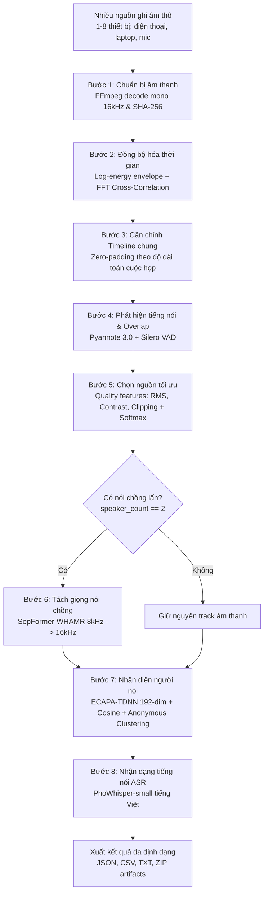

# Kiến Trúc Pipeline Xử Lý Hội Nghị Đa Thiết Bị (Offline Meeting Pipeline)

> Sơ đồ dưới đây mô tả kiến trúc đầy đủ dự kiến. Bản demo hiện tại tạm bỏ qua xử lý
> vùng nói chồng: chỉ giữ một dòng timeline và clip gốc của từng nguồn; không chạy
> SepFormer, nhận diện người nói hoặc ASR trên các vùng đó. Xem `docs/demo.md` để biết
> hành vi hiện hành.

Tài liệu giải thích toàn bộ quy trình xử lý âm thanh hội nghị đa thiết bị, từ các file ghi âm riêng lẻ đến biên bản hội nghị hoàn chỉnh có nhận diện danh tính người nói và văn bản tiếng Việt.

---

## 1. Sơ Đồ Tổng Quan Luồng Xử Lý (End-to-End Workflow)



---

## 2. Bảng Tra Cứu Nhanh: Phần Nào Dùng Cái Gì?

| Bước | Tên Công Đoạn | Công Cụ / Mô Hình / Thư Viện | Đầu Vào (Input) | Đầu Ra (Output) | Vai Trò Cốt Lõi |
| :--- | :--- | :--- | :--- | :--- | :--- |
| **1** | **Chuẩn bị âm thanh** | `ffmpeg`, `soundfile`, `hashlib.sha256` | Các file audio định dạng bất kỳ (1–8 files) | WAV Mono 16kHz Float32, SHA-256 checksum | Chuẩn hóa định dạng kỹ thuật, lọc file trùng lặp |
| **2** | **Đồng bộ hóa** | Trích bao năng lượng + Cross-Correlation (`numpy`, `scipy.fft`) | Mảng sóng âm 16kHz của các nguồn | `offset_sec` (độ trễ), `peak_ratio` | Tìm độ lệch thời gian giữa các máy ghi âm độc lập |
| **3** | **Căn chỉnh Timeline** | `numpy`, `soundfile` | Các mảng sóng + `offset_sec` | File WAV đồng bộ có cùng timeline meeting | Zero-pad để tất cả thiết bị chạy trên 1 đồng hồ thời gian chung |
| **4** | **Phát hiện hoạt động** | **pyannote/segmentation-3.0** + **Silero VAD v6** | Âm thanh đồng bộ của từng nguồn | `ActivityRegion(start, end, count)` | Tìm khoảng thời gian có tiếng nói và phát hiện chồng lấn giọng (1 hay 2 người) |
| **5** | **Chọn nguồn tối ưu** | Thuật toán đánh giá chất lượng + Softmax nhiệt độ | Đoạn âm thanh của từng nguồn khả dụng | Trọng số $\alpha$ từng nguồn, nguồn thu sạch nhất | Chọn mic gần người nói nhất, loại bỏ nhiễu/vang/méo tiếng |
| **6** | **Tách giọng chồng lấn** | **speechbrain/sepformer-whamr** + `torchaudio.functional.resample` | Đoạn âm thanh có 2 người nói (16kHz) | 2 track âm thanh tách biệt cho từng người | Phân tách giọng nói khi 2 người cướp lời nhau |
| **7** | **Nhận diện người nói** | **speechbrain/spkrec-ecapa-voxceleb** (192 chiều) + Cosine Distance | Đoạn âm thanh của từng người nói | Danh tính (`identified` hoặc `Speaker 1, 2...`), điểm số, lý do | Xác định ai đang nói (khớp hồ sơ đăng ký hoặc gom cụm tự động) |
| **8** | **Chuyển tiếng thành chữ** | **vinai/PhoWhisper-small** (Hugging Face Transformers) | Track âm thanh từng người sau chuẩn hóa biên độ | Văn bản tiếng Việt, timestamp, timeline segments | Phiên âm tiếng Việt có dấu, sinh văn bản hội nghị |

---

## 3. Chi Tiết Từng Bước & Cơ Chế Hoạt Động (Dùng Như Thế Nào?)

### Bước 1: Chuẩn bị âm thanh (Prepare Sources)
- **Công cụ:** `ffmpeg` (gọi ngầm qua `adapters/audio_io.py`), `soundfile`, `hashlib.sha256`.
- **Dùng như thế nào:**
  - Nhận vào từ 1 đến 8 file âm thanh ghi âm từ các thiết bị khác nhau (điện thoại, máy tính, máy ghi âm).
  - Kiểm tra độ dài: tối đa 1200 giây (20 phút).
  - Tính mã SHA-256 của từng file; từ chối xử lý nếu có file nội dung trùng nhau.
  - Sử dụng FFmpeg để giải mã và chuyển đổi toàn bộ về định dạng thống nhất: **Mono, tần số lấy mẫu 16,000 Hz, định dạng số thực 32-bit (PCM float32)**.

### Bước 2: Đồng bộ hóa thời gian (Synchronization)
- **Công cụ:** Bao năng lượng (Log-energy envelope) ở tần số 100Hz + Tương quan chéo chuẩn hóa (Normalized Cross-Correlation qua FFT trong `stages/synchronize.py`).
- **Dùng như thế nào:**
  - Do các thiết bị bật ghi âm ở các thời điểm khác nhau, hệ thống tự động chọn file có thời lượng dài nhất làm **mốc tham chiếu** (`reference`, offset = 0.0s).
  - Trích xuất đường bao năng lượng (envelope) của tín hiệu âm thanh để giảm tải tính toán và tăng độ kháng nhiễu pha.
  - Chạy tương quan chéo trong cửa sổ tìm kiếm tối đa ±120s (`max_offset_seconds`). Điểm cực đại của hàm tương quan chính là độ lệch thời gian (`offset_sec`).
  - Đánh giá độ tin cậy: nếu tỷ số đỉnh cao nhất so với đỉnh thứ nhì (`peak_ratio`) $< 1.05$, đánh dấu là không chắc chắn (`ambiguous`) hoặc thất bại.
  - Dịch chuyển mốc 0 chung (`origin_shift`) sao cho toàn bộ các thiết bị đều có thời gian bắt đầu $\ge 0$.

### Bước 3: Căn chỉnh Timeline chung (Write Aligned Audio)
- **Công cụ:** `numpy`, `soundfile`.
- **Dùng như thế nào:**
  - Tính tổng thời lượng cuộc họp (`meeting_duration`) dựa trên điểm kết thúc muộn nhất của tất cả các nguồn.
  - Khởi tạo mảng mốc thời gian chung chứa các giá trị 0 (zeros).
  - Đặt từng file âm thanh vào đúng vị trí `offset_sec` của nó trên trục thời gian chung.
  - Lưu các file đã căn chỉnh vào thư mục `aligned/` để phục vụ cắt ghép đồng bộ.

### Bước 4: Phát hiện hoạt động tiếng nói & Chồng lấn (VAD & Segmentation)
- **Mô hình kết hợp (Ensemble):** 
  - **pyannote/segmentation-3.0**: Mô hình phân đoạn giọng nói tiên tiến sử dụng cơ chế powerset classification (nhận diện 0, 1, 2 hoặc 3+ người nói).
  - **Silero VAD v6**: Mô hình VAD gọn nhẹ, tốc độ cao, nhận diện biên tiếng nói cực nhạy.
- **Dùng như thế nào:**
  - Chia toàn bộ timeline cuộc họp thành các khung thời gian 50ms (`bin_sec = 0.05`).
  - Pyannote trượt cửa sổ 10s (bước nhảy 2.5s) trên từng nguồn, bỏ phiếu số người nói cho từng khung 50ms.
  - Silero VAD bắt các đoạn có tiếng nói (ngưỡng kích hoạt 0.5, đệm thêm 100ms để tránh nuốt âm cuối).
  - **Logic kết hợp:**
    - Khung có tiếng nói: khi `pyannote >= 0.5` HOẶC `silero_vad >= 0.5`.
    - Khung có cướp lời / chồng lấn (2 người nói): khi bằng chứng trung bình `evidence >= 1.5`.
  - Hợp nhất các khung liên tiếp thành danh sách các vùng `ActivityRegion(start_sec, end_sec, speaker_count)`.

### Bước 5: Chọn nguồn thu tối ưu (Source Selection & Quality Weighting)
- **Công cụ:** Thuật toán đánh giá chất lượng đa tiêu chí + Phân phối xác suất Softmax có nhiệt độ (`stages/fuse.py`).
- **Dùng như thế nào:**
  - Trong mỗi vùng có tiếng nói (`ActivityRegion`), mỗi thiết bị ghi âm sẽ có chất lượng thu khác nhau (do khoảng cách tới người nói, tiếng ồn xung quanh, tiếng gõ phím).
  - Hệ thống tính toán 3 chỉ số chất lượng khách quan cho từng nguồn khả dụng:
    1. `speech_presence` (độ hiện diện âm thanh): Tính qua năng lượng hiệu dụng RMS ($1 - e^{-\text{RMS}/0.04}$).
    2. `speech_noise_contrast` (độ tương phản tiếng ồn): Phân vị 80% trừ phân vị 20% của RMS trên các khung 20ms, đo mức độ nổi bật của giọng nói so với nền tĩnh.
    3. `clipping_avoidance` (chống rè/vỡ tiếng): Đếm tỷ lệ mẫu tiệm cận biên độ tối đa ($\ge 0.999$), trừ điểm nếu mic bị thu quá lớn dẫn đến méo tiếng.
  - Kết hợp 3 chỉ số theo trọng số cấu hình `[0.4, 0.4, 0.2]`, chia cho nhiệt độ ($T=0.25$) và đưa qua hàm Softmax để tính trọng số $\alpha$ (thể hiện bằng phần trăm trên giao diện web).
  - Thiết bị có trọng số $\alpha$ lớn nhất được chọn làm bản thu sạch nhất cho phân đoạn đó.

### Bước 6: Tách giọng nói chồng lấn (Speech Separation)
- **Mô hình:** **speechbrain/sepformer-whamr** (kiến trúc SepFormer huấn luyện trên tập WHAMR).
- **Dùng như thế nào:**
  - Chỉ kích hoạt khi đoạn âm thanh được xác định có 2 người nói đồng thời (`speaker_count == 2`). Nếu chỉ có 1 người nói, bỏ qua bước này để tiết kiệm tài nguyên.
  - Cắt đoạn âm thanh từ nguồn tốt nhất đã chọn, mở rộng biên ngữ cảnh thêm ±1.0 giây (`context_seconds`) để mô hình bắt nhịp ngữ điệu tốt hơn.
  - Giảm tần số lấy mẫu (resample) từ 16kHz về 8kHz (định dạng chuẩn của mô hình SepFormer-WHAMR).
  - Chạy mô hình phân tách để tách thành 2 luồng âm thanh độc lập (Track 1 và Track 2).
  - Tăng tần số lấy mẫu ngược lại 16kHz bằng đa thức đa pha (`scipy.signal.resample_poly`) và cắt bỏ phần ngữ cảnh ±1s để khớp chính xác timeline.

### Bước 7: Nhận diện danh tính & Gom cụm người nói (Speaker ID & Clustering)
Hệ thống hỗ trợ 2 cơ chế nhận diện linh hoạt thông qua kiến trúc Strategy Pattern:
- **Tùy chọn 1: Deep Learning ECAPA-TDNN (`method: prototype_cosine` - Mặc định)**
  - **Mô hình:** **speechbrain/spkrec-ecapa-voxceleb** (mô hình trích xuất giọng nói ECAPA-TDNN cho ra vector 192 chiều).
  - Trích xuất embedding 192 chiều cho mỗi đoạn âm thanh. So sánh độ tương đồng Cosine với hồ sơ đăng ký.
- **Tùy chọn 2: Đặc trưng âm học MFCC + Máy học KNN (`method: mfcc_knn` - Siêu nhẹ, truyền thống)**
  - **Công cụ:** `librosa` trích xuất vector 120 chiều (20 MFCC tĩnh + 20 Delta vận tốc + 20 Delta-Delta gia tốc, gom tụ Mean và Std toàn đoạn) + `sklearn.neighbors.KNeighborsClassifier`.
  - Phân lớp theo $K$ láng giềng gần nhất có trọng số khoảng cách (`weights='distance'`, `metric='cosine'`).
- **Quy trình phân lớp chung cho cả 2 tùy chọn:**
  - **Nhánh 1: Khớp hồ sơ đã đăng ký (Enrollment Matching)**
    - Điều kiện nhận diện: Điểm tương đồng cao nhất phải $\ge 0.25$ (`identity_threshold`) VÀ phải bỏ xa người về nhì ít nhất $0.05$ (`identity_margin`).
    - Nếu thỏa mãn: Gán danh tính người thật (`identified`), hiển thị tên người dùng và gắn nhãn xanh lục.
  - **Nhánh 2: Gom cụm vô danh trực tuyến (Online Anonymous Centroid Clustering)**
    - Nếu không khớp hồ sơ nào: Đưa vào thuật toán gom cụm vô danh thời gian thực.
    - So sánh với các tâm cụm vô danh hiện có. Nếu độ tương đồng $\ge 0.10$ (`anonymous_cluster_threshold`), gán vào cụm cũ và cập nhật trọng tâm cụm (`cluster_reuse`, ví dụ `Speaker 1`).
    - Nếu $< 0.10$: Khởi tạo người nói vô danh mới (`new_cluster`, ví dụ `Speaker 2`).
  - **Minh bạch hóa quyết định:** Hệ thống ghi lại toàn bộ lý do quyết định (`identity_decision_reason`), danh sách top ứng viên và điểm số để người dùng xem trực tiếp trên giao diện web.

### Bước 8: Chuyển giọng nói tiếng Việt thành văn bản & Xuất kết quả (ASR & Export)
- **Mô hình:** **vinai/PhoWhisper-small** (mô hình ASR chuyên biệt cho tiếng Việt phát triển bởi VinAI Research).
- **Dùng như thế nào:**
  - Đoạn âm thanh được chuẩn hóa biên độ bằng hàm `_peak_limit` (hạ gain nếu âm lượng vượt đỉnh, không dùng nén động học làm biến dạng âm) và chuyển về định dạng PCM16.
  - Nếu đoạn nói kéo dài hơn 25 giây (`max_chunk_seconds=25`), thuật toán tự động chia nhỏ thành các cửa sổ 25s để ASR nhận diện chính xác và tránh hiện tượng lặp từ / ảo giác âm thanh của Whisper.
  - Đưa vào PhoWhisper với tham số bắt buộc: `language="vi"`, `task="transcribe"`.
  - Xuất ra kết quả đồng thời trên 4 định dạng tại thư mục `exports/`:
    - `result.json`: Chi tiết từng segment kèm bằng chứng chọn nguồn, điểm người nói, transform chain.
    - `result.csv`: Bảng dữ liệu dạng bảng phục vụ thống kê, phân tích.
    - `result.txt`: Biên bản cuộc họp văn bản thuần theo mốc thời gian.
    - `result.zip`: Gói nén toàn vẹn bao gồm các file kết quả, timeline, độ phủ mic (`coverage.json`), manifest kiểm toán (`manifest.json`) và toàn bộ file âm thanh đã xử lý.

---

## 4. Các Tham Số Cốt Lõi Trong Cấu Hình (`configs/default.yaml`)

```yaml
audio:
  analysis_sample_rate: 16000     # Tần số chuẩn hóa toàn bộ pipeline (16kHz)
  separator_sample_rate: 8000      # Tần số dành riêng cho SepFormer (8kHz)
  max_sources: 8                   # Hỗ trợ tối đa 8 thiết bị ghi âm đồng thời

sync:
  envelope_rate_hz: 100            # Tần số lấy mẫu bao năng lượng để căn chỉnh (100Hz)
  max_offset_seconds: 120          # Độ lệch tối đa cho phép giữa các thiết bị (±2 phút)

segmentation:
  vad_threshold: 0.5               # Ngưỡng kích hoạt tiếng nói của Silero VAD
  context_seconds: 10              # Cửa sổ phân đoạn của Pyannote (10s)
  step_seconds: 2.5                # Bước trượt phân đoạn (2.5s)

identity:
  method: prototype_cosine         # Tùy chọn: "prototype_cosine" (ECAPA) hoặc "mfcc_knn" (MFCC+KNN)
  identity_threshold: 0.25         # Ngưỡng tối thiểu để nhận diện giọng người đã đăng ký
  identity_margin: 0.05            # Khoảng cách điểm bắt buộc giữa hạng 1 và hạng 2
  anonymous_cluster_threshold: 0.10 # Ngưỡng để gom chung vào cùng 1 người nói vô danh (Speaker X)
  quality_weights: [0.4, 0.4, 0.2] # Trọng số chọn nguồn: [speech_presence, noise_contrast, clipping]
  temperature: 0.25                # Độ sắc nhọn của phân phối xác suất Softmax chọn nguồn
  mfcc:
    n_mfcc: 20                     # Số hệ số MFCC
    window_sec: 1.5                # Cửa sổ cắt mẫu huấn luyện cho KNN
    step_sec: 0.5                  # Bước trượt cắt mẫu
  knn:
    n_neighbors: 5                 # Số láng giềng gần nhất k
    metric: cosine                 # Độ đo khoảng cách: cosine hoặc euclidean
    weights: distance              # Trọng số theo nghịch đảo khoảng cách

asr:
  max_chunk_seconds: 25            # Cắt nhỏ đoạn nói dài tối đa 25s cho PhoWhisper
```

---

## 5. Luồng Biểu Mẫu và Biên Bản Cuộc Họp (Meeting Minutes & Template Workflow v1.0)

Luồng biểu mẫu và biên bản hoạt động trên kết quả timeline của pipeline âm thanh mà không sửa đổi hoặc chạy lại VAD/ASR/Diarization:

1. **Chuẩn hóa Biểu mẫu Word (Normalization):**
   - Hỗ trợ cả `.doc` Word 97-2003 binary (chuyển đổi native qua `textutil` trên macOS hoặc LibreOffice `soffice`) và `.docx` native.
   - Thao tác hoàn toàn trên bản sao (`normalized.docx`), bảo toàn nguyên vẹn file gốc và lưu mã băm SHA-256.
2. **Phân tích Cấu trúc & Vị trí Neo (OOXML Parsing & DocGraph):**
   - Duyệt qua đoạn văn bản và bảng biểu, tự động tìm kiếm các `CandidateAnchor`: dòng chấm lửng (`...`), gạch dưới (`___`), ô bảng trống (`empty_cell`), prompt văn bản có hướng dẫn hoặc dấu `:` và khối chữ ký.
3. **Ánh xạ Schema (Schema Mapping):**
   - **M0 Baseline (Rule-based):** Ánh xạ ngữ cảnh văn bản hành chính Việt Nam (ngày tháng, thời gian bắt đầu/kết thúc, địa điểm, chủ tọa, thư ký, ý kiến thảo luận, biểu quyết, kết luận, và các trường chi bộ đặc thù).
   - **M1 Adapter (Qwen3 LLM):** Adapter tạo prompt JSON có cấu trúc cho Qwen3-4B-Instruct-2507 kèm bộ kiểm chứng `SchemaValidator` (chặn anchor bịa đặt, chặn trùng lặp).
4. **Truy xuất Bằng chứng & Trích xuất Fact (Evidence Retrieval & Fact Extraction):**
   - Đánh chỉ mục BM25 trên timeline turns và liên kết audio clips thực tế.
   - **M2 Baseline (Rule-based):** Trích xuất giờ họp tiếng Việt, tóm tắt thảo luận, chủ tọa.
   - **Quy tắc Quyết định (Decision Gating):** Chỉ ghi nhận khi có từ khóa chốt ("thống nhất", "quyết định", "kết luận"), loại trừ đề xuất suông.
   - **Bảo toàn Bất biến Chi bộ:** Các trường đảng phí, học tập đạo đức HCM khi âm thanh không đề cập giữ nguyên trạng thái `unknown`, không bịa đặt cuộc họp giả.
5. **Điền Bản sao & Xuất bản (Rendering & Traceability Manifest):**
   - Điền trực tiếp vào bản sao `completed.docx`, bảo toàn font, cỡ chữ, viền bảng và định dạng gốc.
   - Xuất `manifest.json` truy vết đầy đủ từ Field $\to$ Value $\to$ Evidence Turn/Clip/Time $\to$ Anchor.
   - Cho phép sửa trực tiếp Fact hoặc sửa Transcript mà **không gọi lại ASR**.
   - Xuất ảnh Visual QA trước/sau để kiểm tra bố cục trang.

