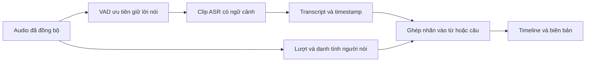

# Chẩn đoán mất từ trên run gần nhất — 09/10/2026

## Kết luận kiểm tra

Run “test ngày 9/10”, ID `e7657b55-243d-49d9-81e2-0328b1529a37`, có mất từ đáng kể.
Hai điểm cần cải thiện là lấy lượt người nói làm đơn vị ASR quá chặt và dùng midpoint
timestamp để loại từ. Việc giảm số đoạn ở lần sửa trước chưa giải quyết đầy đủ hai điểm này.

Đợt kiểm tra này chỉ đọc artifact, replay pyannote cache và thử quy tắc trên các kết quả
ASR đã lưu. Chưa đổi code chạy demo, chưa chạy model ASR lại, chưa sửa timeline/DOCX.

## Dữ liệu và số đoạn

SHA-256 của cả ba audio tải lên khớp `device_03.wav`, `device_02.wav`, `device_01.wav`
trong `data/generated/smoke/meeting_test_001`. Nguồn này có transcript tham chiếu,
27 lượt nói, 3 giọng VIVOS và không có nói chồng. Audio dài khoảng 126,24 giây.
Nó khác ca FPT dùng để replay trong báo cáo sửa trước.

| Bước | Số khoảng/hàng |
| --- | ---: |
| Lượt trong dữ liệu tham chiếu | 27 |
| Vùng hoạt động VAD | 21 |
| Lượt người nói thô | 35 |
| Sau gộp lượt | 34 |
| Timeline cuối | 33 |

Timeline gồm 28 dòng `transcribed`, 3 dòng `empty`, 1 dòng `unreliable`, 1 dòng
`not_run` vì overlap. Có 6 dòng dưới một giây. Replay bộ phát hiện lượt nói với code
hiện tại tái tạo đúng các biên và track đã lưu: không có bằng chứng demo dùng bản cũ.

Số đoạn không đủ để chấm chất lượng. Nhiều lượt ngắn trong mẫu là câu và người nói
khác nhau thật; mục tiêu cần là giữ lời nói và nội dung, đồng thời tránh clip vụn do
hụt nhận diện hoặc đổi nhãn cục bộ.

## Mất từ sau khi ASR đã đọc được

`src/meeting_pipeline/asr/segment_asr.py` đang loại từ nếu midpoint nằm ngoài core
của lượt người nói. Timestamp từ Whisper có sai số; từ đầu/cuối thường được gán
cả khoảng im lặng dẫn hoặc đuôi vào timestamp, nên midpoint có thể vượt biên.

Ví dụ lưu trong `source_hypotheses.json`:

| Từ ASR đã nhận được | Khoảng timestamp tuyệt đối | Core lượt nói | Lý do bị loại |
| --- | --- | --- | --- |
| muốn | 0,00–1,06 s | 0,55–3,50 s | midpoint 0,53 < 0,55 |
| bạn | 3,90–5,12 s | 4,65–7,70 s | midpoint 4,51 < 4,65 |
| còn | 8,70–9,70 s | 9,45–12,60 s | midpoint 9,20 < 9,45 |
| hết | 12,36–13,30 s | 9,45–12,60 s | midpoint 12,83 > 12,60 |
| hà | 12,70–14,02 s | 13,45–17,45 s | midpoint 13,36 < 13,45 |

Do đó câu “muốn có bằng lái…” đã được ASR đọc đầy đủ nhưng transcript cuối mất “muốn”.
Chỉ tăng padding audio chưa giải quyết lỗi loại từ này: từ đã tồn tại trong kết quả ASR.
Hugging Face mô tả timestamp theo từ của Whisper là xấp xỉ từ DTW trên cross-attention,
không phải nhãn thời gian tuyệt đối chính xác.
[Nguồn Transformers v4.49.0](https://github.com/huggingface/transformers/blob/v4.49.0/src/transformers/pipelines/automatic_speech_recognition.py).

## Overlap do một nguồn và bỏ toàn bộ ASR

Ở khoảng 89,40–90,25 s, `source-1` và `source-2` báo một người nói, `source-3`
báo hai. Code lấy số người lớn nhất giữa các nguồn rồi chuyển vùng này thành overlap
và không chạy ASR. Dữ liệu tham chiếu không có overlap; khoảng này thuộc câu
“tôi đã nhiều lần phản đối quyết liệt việc nước thải tuồn ra ngoài”.

Một nguồn báo overlap cần được xem là bằng chứng có độ tin cậy để kiểm tra.
Không đủ để suy ra phải bỏ nội dung ở tất cả nguồn. Ngược lại, yêu cầu hai nguồn
luôn đồng ý cũng có thể bỏ sót overlap thật chỉ nghe rõ ở một mic; cần lưu bất đồng
và chọn nguồn còn đọc được, hoặc giữ nội dung có nhãn cần xác nhận.

## Đo lỗi và thử nghiệm trên kết quả ASR đã lưu

Chuẩn hóa văn bản về Unicode NFC, chữ thường, bỏ dấu câu, gộp khoảng trắng.
WER tính theo đơn vị tách bằng khoảng trắng; đây không phải phân tách từ vựng tiếng Việt.
Transcript tham chiếu có 349 đơn vị; so sánh toàn bộ văn bản nối theo thời gian.

| Phương án kiểm tra | WER | CER | Thiếu | Thay thế | Thêm |
| --- | ---: | ---: | ---: | ---: | ---: |
| Transcript hiện tại | 16,62% | 14,72% | 48 | 9 | 1 |
| Nguồn được chọn sau lọc hiện tại | 16,62% | 14,72% | 48 | 9 | 1 |
| Giữ toàn bộ candidate ASR được chấp nhận của nguồn được chọn | 15,19% | 12,94% | 6 | 15 | 32 |
| Giữ từ có khoảng thời gian giao với core | 8,02% | 5,39% | 8 | 14 | 6 |

Thử nghiệm cuối chỉ chứng minh quy tắc midpoint đang bỏ từ có ích trên ca này.
Nó vẫn giữ một số từ sai, trùng hoặc thuộc ngữ cảnh; chưa phải bản sửa đủ an toàn
để triển khai. Các candidate trên clip vụn có thể chứa hallucination, kể cả khi
kiểm tra ASR ban đầu đánh dấu accepted. Không được giữ mọi candidate vô điều kiện.

Giữ nguyên transcript ASR trước/sau lọc và lý do bỏ từng từ sẽ giúp phát hiện loại lỗi này.
Khi chưa chắc người nói, giữ từ với nhãn chưa xác định sẽ bảo toàn nội dung hơn xóa từ.

## Mức bao phủ khoảng lời nói

Sau quy đổi khoảng tham chiếu sang đồng hồ của `device_03` bằng offset 0,1157 s
và drift −0,57 ppm, mức bao phủ xấp xỉ:

- Vùng VAD: 97,03% thời gian lời nói tham chiếu.
- Các core lượt người nói: 90,12%.
- Core có transcript trạng thái transcribed: 88,36%.
- Hợp các clip đưa vào ASR, tính cả ngữ cảnh: 97,87%.

Đây là kiểm tra khoảng thời gian tổng hợp, chưa căn chỉnh thủ công độ trễ room impulse
response, không phải tỷ lệ từ giữ lại. Nó cho thấy khoảng ASR đã nghe rộng hơn vùng
được phép giữ từ và gán người nói.

## Phương pháp cải thiện đề xuất

### 1. Sửa đường giữ từ trước

- Phân biệt biên cắt ASR nội bộ với biên gán người nói.
- Từ giao với lời nói nhưng timestamp vượt nhẹ biên cần được giữ để đối chiếu,
  không bị loại chỉ vì midpoint. Timestamp suy biến hoặc hallucination cần kiểm tra riêng.
- Căn hàng các từ ở hai clip liền kề để giữ một bản của từ trùng do ngữ cảnh.
  Không xóa lặp có ý nghĩa trong cùng lời nói chỉ vì hai từ giống nhau đứng gần nhau.
- Bất đồng nhãn người nói tạo trạng thái cần xác nhận, không làm mất từ đã nhận được.
- Với overlap chỉ một nguồn báo, thử nguồn khác có speech đơn; lưu cảnh báo và nguồn bằng chứng.

### 2. Tách đơn vị ASR khỏi đơn vị diarization

ASR có thể dùng cửa sổ khoảng 15–25 giây, với khoảng chồng thử nghiệm 1–2 giây,
chọn điểm cắt tại khoảng ngừng có bằng chứng. Cửa sổ có thể chứa nhiều lượt nói;
nhãn người nói được ghép sau khi giữ transcript. Tham số này là phạm vi thử nghiệm,
chưa được hiệu chỉnh. Chọn nguồn ASR vẫn cần xét chất lượng theo khoảng; không mặc
định một mic tốt cho toàn bộ cuộc họp hoặc tất cả người nói.

Thử gộp **các vùng VAD đã lưu** để lập lịch ASR, chưa chạy ASR lại:

| Khoảng trống cho phép gộp thêm | Nhóm âm thanh | Clip ASR theo planner hiện tại |
| --- | ---: | ---: |
| 0,4 s | 13 | 13 |
| 0,8 s | 4 | 7 |
| 1,2 s | 3 | 7 |

Đây là số clip dự kiến, không phải số dòng timeline tương lai hay chất lượng transcript.
Lịch ASR khoảng 7–13 clip là phương án để đo; timeline vẫn có thể giữ đủ 27 lượt thật.
Không dùng transcript tham chiếu để tạo biên cắt trong vận hành.

### 3. Tối ưu VAD sau khi sửa đường giữ nội dung

- Thử thời gian ngừng để kết thúc vùng và padding theo vài cấu hình, dùng development
  để chọn cấu hình; ca test hiện tại dùng chẩn đoán, không dùng để chọn ngưỡng.
- Đo phần lời nói bị bỏ và số từ đầu/cuối còn giữ, bên cạnh WER/CER và S/D/I.
- Có thể so Silero làm speech gate với pyannote đang có, vẫn giữ pyannote cho speaker
  và overlap; chỉ đổi model khi phép đo cho thấy cần thiết. Runtime hiện chưa áp dụng
  `minimum_silence_ms` vào hàm trích VAD pyannote: tham số được truyền trong VadConfig
  nhưng hàm threshold/merge chỉ dùng threshold, merge_gap và padding.
- Pyannote chuẩn gồm segmentation, embedding và global clustering. Việc track local
  đổi giữa cửa sổ không tự chứng minh có người mới hoặc cần một clip ASR mới.
  [Nguồn pyannote 3.3.2](https://github.com/pyannote/pyannote-audio/blob/3.3.2/pyannote/audio/pipelines/speaker_diarization.py).

## Giới hạn và quyết định còn cần thảo luận

Các kết quả là một ca mô phỏng VIVOS; cần kiểm tra thêm development, FPT và một số
đoạn người dùng ghi thật trước khi kết luận tổng quát. Chưa có phép đo ASR mới cho
cửa sổ dài và chưa có phép đo RAM/runtime cho lịch mới.

Ưu tiên đề xuất: sửa giữ từ và xử lý bất đồng overlap, sau đó thử kiến trúc ASR riêng
với diarization. Mục tiêu nghiệm thu là giảm từ thiếu, giữ lời nói ngắn và gán người
nói rõ ràng; số clip là chỉ số hiệu năng phụ.

Các số liệu và ví dụ đầy đủ nằm trong `LATEST_RUN_WORD_LOSS_DIAGNOSTIC_2026-10-09.json`
ở cùng thư mục. Báo cáo trước `PIPELINE_FRAGMENTATION_PARTICIPANTS_FIX_2026-10-09.md`
chỉ xác nhận logic và replay FPT, không xác nhận chất lượng end-to-end của run này.
