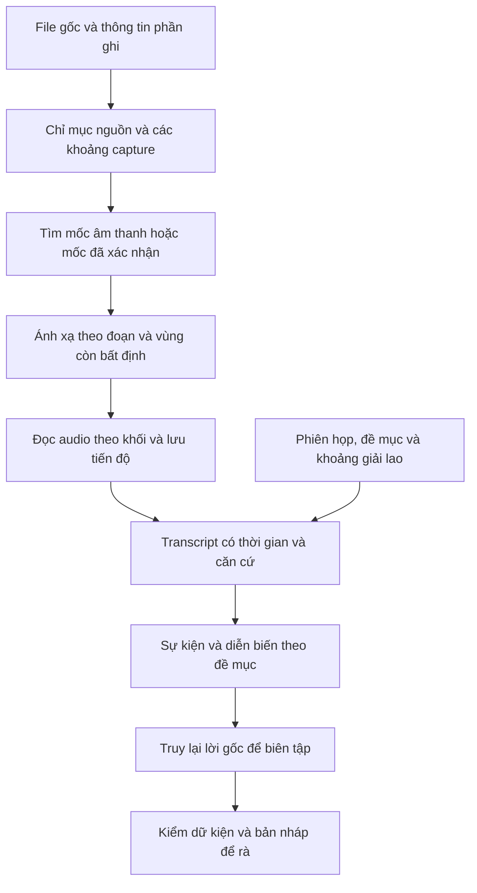

# Minda — nghiên cứu xử lý họp dài và dừng/ghi tiếp

Ngày đối chiếu: 27/10/2026. Phạm vi: cuộc họp dài, giải lao, dừng rồi ghi tiếp thành file mới hoặc trong cùng file; đồng bộ nhiều thiết bị và giữ diễn biến khi lập biên bản. Không nghiên cứu xử lý nhiều người nói đồng thời trong tài liệu này.

**Đề xuất ưu tiên: quản lý phần ghi và khoảng trống thời gian → đồng bộ theo từng đoạn liên tục → xử lý có lưu tiến độ → tổng hợp theo đề mục với căn cứ truy về lời gốc.** Huấn luyện LLM tiếp có ích cho phần biên tập, nhưng không khôi phục có căn cứ âm thanh bị thiếu hoặc thời gian đã mất trước khi đến model.

Đây là nghiên cứu và thiết kế đề xuất, chưa phải thay đổi đã triển khai. Không chạy benchmark audio nhiều giờ hoặc huấn luyện model trong lần này. Căn cứ hiện trạng là [báo cáo kiểm tra pipeline](</Users/thien/Documents/School/Luận văn/web_app/docs/reports/REAL_MEETING_PIPELINE_AUDIT_2026-10-27.md>) cùng đối chiếu lại mã tại HEAD `27c67aa01e53e046388e195da9a329b4376f2e4a`. Các kết quả công bố dưới đây không phải điểm chất lượng của Minda trên tiếng Việt.

## 1. Phân biệt tình huống trước khi chọn thuật toán

Trong nghiên cứu đồng bộ, “có đoạn thời gian cùng được ghi” nghĩa là hai thiết bị thu cùng một sự kiện âm thanh. Điều này khác với nhiều người nói đồng thời. Các phương pháp đồng bộ bên dưới vẫn cần được xem xét trong phạm vi yêu cầu hiện tại.

| Tình huống | Thông tin có thể dùng | Cách xử lý đề xuất | Điều không được tự suy ra |
| --- | --- | --- | --- |
| Ghi liên tục 1–3 giờ, có nghỉ im lặng | Đồng hồ mẫu âm thanh liên tục | Giữ trục thời gian; bỏ qua xử lý ASR ở vùng không có lời; đọc file theo đoạn | Im lặng không tự chứng minh đó là giải lao chính thức |
| Ghi liên tục, có nói chuyện riêng trong giờ nghỉ | Audio còn đầy đủ; có thể có thông báo nghỉ và tiếp tục | Đánh dấu khoảng giải lao/ngoài nội dung biên bản, cho người dùng xác nhận | Có tiếng nói không đồng nghĩa phải đưa vào biên bản |
| Dừng rồi tạo file mới, biết thứ tự và giờ bắt đầu | Thông tin phần ghi, nhật ký ghi hoặc mốc do người dùng xác nhận | Xếp các phần nối tiếp, giữ khoảng chưa ghi; dùng âm thanh để kiểm nếu có đoạn chung | Không coi các file nối tiếp là nhiều micro thu đồng thời |
| Một máy pause rồi resume trong cùng file, máy khác còn ghi | Các mốc âm thanh trước và sau điểm pause | Tìm mốc cục bộ, tách ánh xạ thời gian ở chỗ nhảy offset | Một offset/drift toàn file không đủ |
| Tất cả máy đều dừng, chỉ còn các file trước/sau nghỉ | Có thể biết thứ tự; có thể không biết độ dài khoảng nghỉ | Giữ thứ tự đã xác nhận; ghi khoảng trống chưa xác định hoặc dùng giờ thực đáng tin cậy | Không thể suy chính xác độ dài nghỉ hay nội dung không được ghi chỉ từ hai file rời |
| Các file không có đoạn chung trực tiếp nhưng có nguồn trung gian | Mốc khớp A–B và B–C | Ghép quan hệ qua đồ thị các phần ghi, kèm kiểm nhất quán | Nếu đồ thị bị tách rời và không có mốc thời gian ngoài, không ép tất cả vào một đồng hồ chắc chắn |

Đặc biệt: nếu một file đã nối bỏ khoảng pause và không còn nhật ký, mốc ngoài hoặc nguồn đối chiếu, ngay cả vị trí nối cũng có thể chưa xác định được. Hệ thống phải trình bày giới hạn này thay vì tự tạo khoảng nghỉ.

## 2. Các nghiên cứu nên dùng

Các mục “ứng dụng” trong bảng là đề xuất của chúng ta; chúng không có nghĩa tác giả đã thử giải pháp đó trên Minda.

| Nghiên cứu, nguồn gốc | Phương pháp được công bố | Ứng dụng phù hợp / giới hạn |
| --- | --- | --- |
| **R1. Tsai & Stolcke, 2016 — [Robust and Efficient Multiple Alignment of Unsynchronized Meeting Recordings](https://www.microsoft.com/en-us/research/publication/robust-and-efficient-multiple-alignment-of-unsynchronized-meeting-recordings/)** | Dấu vân tay âm thanh thích nghi cho bản ghi cuộc họp; tìm căn thô bằng chỉ mục rồi tinh chỉnh. Thử trên các tình huống tạo từ ICSI. | Cơ sở sát bài toán nhiều điện thoại bật khác lúc. Dùng làm ứng viên tìm mốc trên toàn cuộc thay vì chỉ tìm lệch gần đầu. Không coi bài này là lời giải đầy đủ cho pause hoặc độ trôi biến thiên. |
| **R2. Six & Leman, 2015 — [Synchronizing Multimodal Recordings Using Audio-To-Audio Alignment](https://0110.be/files/publications/2015/2015.synchronized-recording.author.pdf)** | Fingerprint rồi tinh chỉnh bằng cross-covariance; theo dõi nhiều offset. Offset đổi từ từ biểu hiện drift; hai nhóm offset có thể biểu hiện mất mẫu. Mô tả luồng có một nguồn liên tục và nguồn khác dừng/bật. | Cơ sở trực tiếp nhất cho tìm mốc trước/sau gián đoạn. Cần kiểm lại với micro điện thoại, tiếng Việt và khoảng nghỉ dài; kết quả thử nghiệm của bài không bảo đảm độ chính xác trên Minda. |
| **R3. Gburrek và cộng sự, ICASSP 2022 — [On Synchronization… Time-varying Sampling Rate Offsets and Speaker Changes](https://ris.uni-paderborn.de/record/33807)** | DWACD theo dõi sai lệch tốc độ lấy mẫu thay đổi theo thời gian. Chỉ cập nhật các đoạn đáp ứng điều kiện hoạt động âm thanh; cần căn thô trước. | Tham khảo cách cập nhật drift có điều kiện trong cuộc họp dài. Toàn bộ bài có giả thiết nút nhiều micro và phần ước lượng khoảng cách; không phải giải pháp cắm thẳng cho file điện thoại mono. Không dùng drift để “giải thích” bước nhảy pause. |
| **R4. Bain và cộng sự, 2023 — [WhisperX: Time-Accurate Speech Transcription of Long-Form Audio](https://arxiv.org/abs/2303.00747)** | VAD Cut & Merge, nhận dạng theo batch và forced alignment để căn từ với audio. | Tham khảo chia đoạn theo lời nói, tránh cắt giữa từ và kiểm thời gian. Minda đã có ASR theo đoạn 22–25 giây; không cần thay toàn bộ bằng WhisperX. Forced alignment không sửa mọi chữ nhận sai và không đồng bộ hai đồng hồ thiết bị. |
| **R5. Zhang và cộng sự, ACL 2022 — [Summᴺ](https://aclanthology.org/2022.acl-long.112/)** | Chia đầu vào dài, tạo biểu diễn tóm tắt qua nhiều tầng, rồi tổng hợp cuối; giữ cửa sổ đầu vào của model cố định. | Cơ sở cho xử lý nội dung vượt cửa sổ Qwen hiện tại. Với biên bản, đề xuất dùng sự kiện có căn cứ ở tầng trung gian thay cho chỉ truyền các đoạn văn tóm tắt; đây là phần thích nghi của chúng ta. |
| **R6. Zhong và cộng sự, NAACL 2021 — [QMSum](https://aclanthology.org/2021.naacl-main.472/)** | Tập đánh giá hỏi–tóm tắt cuộc họp và phương pháp locate-then-summarize: tìm đoạn liên quan trước khi viết. | Mỗi đề mục hoặc trường biên bản truy lại các lượt lời liên quan. Cần kiểm độ phủ truy xuất, vì bỏ sót căn cứ sẽ ảnh hưởng phần viết dù model viết trôi chảy. |
| **R7. Hu và cộng sự, ACL 2023 — [MeetingBank](https://aclanthology.org/2023.acl-long.906/)** | Chia biên bản chuyên nghiệp thành các đoạn và căn với từng phần cuộc họp; có transcript, agenda và metadata. | Mẫu thiết kế dữ liệu gần với biên bản hành chính: theo đề mục, có đoạn nguồn cụ thể. Ngôn ngữ và thể thức khác Việt Nam, nên dùng để học cách tổ chức bài toán và đánh giá. |
| **R8. Liu và cộng sự, TACL 2024 — [Lost in the Middle](https://aclanthology.org/2024.tacl-1.9/)** | Thử truy xuất thông tin trong ngữ cảnh dài; hiệu quả thay đổi theo vị trí thông tin ở các model được khảo sát. | Lý do cần thử quyết định nằm đầu/giữa/cuối cuộc họp, kể cả khi tăng context. Không phải kết quả đo trên Qwen của Minda và không chứng minh mọi model dài ngữ cảnh đều thất bại. |

Nguồn toàn văn bổ sung cho [R1](https://www.microsoft.com/en-us/research/wp-content/uploads/2016/02/p833-tsai.pdf), [R3](https://ris.uni-paderborn.de/download/33807/48990/gburrek_icassp22.pdf), [R4](https://www.robots.ox.ac.uk/~vgg/publications/2023/Bain23/bain23.pdf). Không lấy phần trăm chính xác hay hệ số tăng tốc trong các bài này làm cam kết cho Minda.

## 3. Đối chiếu với các điểm nghẽn hiện tại

| Điểm hiện tại đã đối chiếu | Vì sao ảnh hưởng yêu cầu | Cải tiến cần có |
| --- | --- | --- |
| `max_duration_seconds: 1200`; core từ chối file vượt giới hạn | Cuộc họp dài chưa qua được đầu vào theo cấu hình này | Nâng khả năng xử lý theo đoạn rồi mới thay giới hạn sản phẩm và kiểm tài nguyên |
| Decode xong dùng `sf.read` cả file; tạo nhiều waveform đã căn và đệm cùng chiều dài | Tăng bộ nhớ theo số nguồn × thời lượng; khoảng không có dữ liệu vẫn tốn mảng đệm | Đọc theo khối, ánh xạ thời gian ảo, chỉ dựng audio cần dùng |
| Hàm đồng bộ được gọi không truyền các tham số sync trong cấu hình; căn thô hard-code 10 giây | Máy bật muộn có thể không tìm được mốc; tăng 120 giây cũng chưa đủ cho mọi trường hợp | Sửa đường truyền cấu hình; thêm tìm mốc toàn cục bằng chỉ mục |
| Một offset và drift cho toàn nguồn; offset âm cắt đầu nguồn | Không biểu diễn được pause; có thể bỏ phần đầu chỉ một máy ghi được | Ánh xạ theo đoạn và giữ hợp vùng có bản ghi |
| Metadata chưa mô tả phần ghi, thứ tự nối, mốc capture, khoảng dừng | Không phân biệt hai file nối tiếp với hai micro cùng lúc | Thêm thông tin phần ghi và trạng thái mốc thời gian |
| ASR đã có đoạn 22–25 giây, ngữ cảnh biên, đối soát từ biên, adaptive routing và cache | Có nền tảng để mở rộng; chia nhỏ file đơn thuần vẫn chưa có resume toàn pipeline | Tái sử dụng phần đang có, bổ sung điều phối và lưu kết quả từng công đoạn |
| Writer dùng budget 6.144 token, có nhánh rút context theo trùng từ; `coverage_complete` kiểm ID | Có thể thiếu lần đính chính ở xa dù đã xử lý hết các ID | Chỉ mục nguồn theo đề mục, sổ diễn biến và kiểm dữ kiện/trạng thái |
| Giờ kết thúc lấy lần đầu có cụm “kết thúc” trong probe đã rà | Kết thúc phiên trước nghỉ có thể bị lấy làm kết thúc toàn cuộc | Xác định sự kiện và phạm vi phiên/toàn cuộc trước khi điền trường |

Căn cứ mã: [giới hạn](</Users/thien/Documents/School/Luận văn/web_app/configs/default.yaml:12>), [decode và nạp waveform](</Users/thien/Documents/School/Luận văn/web_app/src/meeting_pipeline/pipeline/multi_source_fusion.py:994>), [lời gọi sync](</Users/thien/Documents/School/Luận văn/web_app/src/meeting_pipeline/pipeline/multi_source_fusion.py:302>), [căn offset](</Users/thien/Documents/School/Luận văn/web_app/src/meeting_pipeline/audio/synchronization.py:154>), [schema cuộc họp](</Users/thien/Documents/School/Luận văn/web_app/src/meeting_backend/modules/meetings/schemas.py:4>), [cấu hình ASR](</Users/thien/Documents/School/Luận văn/web_app/src/meeting_pipeline/config.py:61>), [context writer](</Users/thien/Documents/School/Luận văn/web_app/src/meeting_pipeline/minutes/text_engine.py:487>), [điền giờ](</Users/thien/Documents/School/Luận văn/web_app/src/meeting_pipeline/minutes/structured_fields.py:105>).

## 4. Thiết kế thời gian: tách phiên họp khỏi phần ghi

Không nên bắt buộc một cây cứng “phiên → thiết bị → file”. Một điện thoại có thể ghi xuyên nhiều phiên và giờ nghỉ; một phiên có thể cần nhiều file của cùng điện thoại.

Hai nhóm dữ liệu liên kết qua thời gian:

- **Nội dung cuộc họp:** phiên, đề mục, giải lao, thời điểm kết thúc toàn cuộc, khoảng được xác nhận không đưa vào biên bản.
- **Nguồn ghi:** thiết bị/luồng → file → các khoảng capture liên tục trong file; mỗi khoảng có mốc, vùng mẫu gốc và ánh xạ thời gian riêng.

Thông tin tối thiểu nên có: `device_id`, `file_id`, `capture_span_id`, thứ tự đã xác nhận, vùng mẫu gốc, mốc capture kèm nguồn gốc/độ tin cậy, danh sách vùng có dữ liệu, trạng thái căn và khoảng chưa ghi. Phiên/đề mục liên kết nhiều–nhiều với các khoảng nguồn. Một file có pause có thể chứa nhiều khoảng capture; không bắt buộc cắt sửa file gốc.

Phải phân biệt **thời lượng file**, **thời lượng có bản ghi trên toàn cuộc** và **thời gian cuộc họp trôi qua kể cả nghỉ**. Không cộng thời lượng tất cả điện thoại để tính thời lượng cuộc họp.

### 4.1. Khi có thông tin từ lúc ghi

Ưu tiên nhật ký bắt đầu/dừng/pause/resume, thời gian thực có múi giờ, đồng hồ đơn điệu trong phiên ghi và số mẫu/khung audio. Nhật ký cung cấp mốc ban đầu và giới hạn bất định; âm thanh dùng để đối chiếu khi có thể. Không coi giờ sửa file hoặc tên file là giờ ghi được xác nhận.

Web hiện tại chủ yếu nhận file tải lên; nếu bổ sung chức năng tự ghi sau này, ghi nhật ký ngay ở phía thu sẽ dễ kiểm soát hơn suy ngược mọi khoảng dừng từ file đã xuất. Ví dụ, [đặc tả MediaStream Recording của W3C](https://w3c.github.io/mediacapture-record/#dom-mediarecorder-pause) mô tả pause ngừng thu vào blob và resume thu tiếp vào blob hiện tại. Không nên chỉ dựa vào độ dài file xuất để suy độ dài khoảng pause. Đây là tài liệu dự thảo; cách lưu mốc thực tế còn phải kiểm trên từng trình duyệt/thiết bị.

Với file ngoài hệ thống: cho xác nhận “cùng thiết bị, phần tiếp theo”, thứ tự và giờ bắt đầu nếu biết. Khi không biết giờ, vẫn có thể tạo transcript theo thứ tự và giữ mốc cục bộ cho mỗi phần.

### 4.2. Khi phải tìm mốc bằng âm thanh

Đề xuất kết hợp R1–R2 với mô hình thời gian theo đoạn:

1. Tạo chỉ mục fingerprint theo thời gian cho các phần ghi. Tìm những đoạn khớp trên toàn bản ghi, không chỉ trong cửa sổ vài giây quanh đầu file.
2. Lưu các cặp mốc thời gian cục bộ ↔ thời gian nguồn đối chiếu cùng chất lượng và độ phủ. Không lấy một mốc đơn lẻ làm bằng chứng cho cả file.
3. Tinh chỉnh gần các mốc tốt bằng tương quan cục bộ; loại vùng im lặng dài, nền lặp lại hoặc mốc có nhiều vị trí khớp cạnh tranh. Có thể thử GCC-PHAT, nhưng không mặc định tốt nhất ở mọi phòng.
4. Ước lượng riêng mỗi đoạn liên tục bằng hồi quy vững, chẳng hạn RANSAC hoặc Huber. Theo dõi sai số theo thời gian; khi offset nhảy rõ và có đủ mốc hai phía, tạo ranh giới ánh xạ mới.
5. Ghép các quan hệ thành đồ thị. Kiểm mâu thuẫn khi đi qua các đường nối khác nhau; giữ thành phần chưa nối được ở trạng thái chưa xác định.
6. Chỉ công bố đã căn ở phạm vi có bằng chứng; không chuyển `drift_unresolved` thành `aligned`. Bên ngoài vùng có mốc, độ bất định phải tăng hoặc yêu cầu đối chiếu.

Mô hình đề xuất cho đoạn liên tục k: `t = a_k × τ + b_k`, với τ là thời gian trong file gốc. `a_k` biểu diễn chênh tốc độ đồng hồ; `b_k` biểu diễn lệch vị trí. Bước nhảy do pause làm thay đổi ánh xạ giữa các đoạn. Nếu drift thay đổi trong đoạn dài, cần cập nhật cục bộ hoặc thêm đoạn mô hình với ràng buộc liên tục; không nhầm thay đổi từ từ với pause.

Ví dụ minh họa, chưa gồm drift: máy A ghi liên tục 75 phút; máy B ghi 30 phút, dừng 15 phút rồi ghi thêm 30 phút vào cùng file. File B dài 60 phút. Trước pause: `t=τ`; sau pause: `t=τ+15 phút`. Ép một đường thẳng cho toàn B sẽ sai ít nhất một phía. Nếu cả A và B cùng tắt, không còn mốc ngoài, con số 15 phút không thể suy chắc từ phần audio còn lại.

Phần kết hợp đồ thị, kiểm mâu thuẫn, lựa chọn hồi quy và quy tắc tách đoạn là **thiết kế kỹ thuật cần thử của Minda**, không phải gói thuật toán đã được các bài báo xác nhận sẵn. R2 hỗ trợ cơ sở nhiều offset/mất mẫu; pause dài, nhiều lần nghỉ và file điện thoại vẫn cần bộ thử riêng.

### 4.3. Drift trong cuộc họp dài

Sau khi đã căn thô và tách gián đoạn, thử hai mức: hồi quy vững trên các mốc cục bộ làm mốc so sánh đơn giản; rồi thử ý tưởng DWACD từ R3 khi dữ liệu đáp ứng điều kiện. Không ước lượng drift từ im lặng; không kéo resample xuyên khoảng mất dữ liệu. Nếu chưa đủ mốc trải đều theo thời gian, giữ trạng thái chưa đo chắc drift.

Cần tách sai lệch đồng hồ khỏi thời gian âm truyền trong phòng. R3 có phần xử lý khoảng cách micro–người nói; Minda không nên sao chép toàn bộ giả thiết đó sang file mono. Ngưỡng residual 20 ms trong một số cổng chất lượng hiện tại là ràng buộc kỹ thuật cần đánh giá lại theo mục đích dùng nguồn, không phải mức chính xác được chứng minh cho họp thực tế hay yêu cầu bắt buộc của biên bản.

### 4.4. Giữ toàn bộ vùng có dữ liệu

Lấy gốc trục thời gian ở mốc sớm nhất của thành phần đã căn được, thay vì cắt audio có offset âm. Lưu hợp các khoảng thật sự có bản ghi; phân biệt rõ:

- Không có file nào ghi: thiếu dữ liệu.
- Có audio nhưng không có lời: khoảng yên lặng đã được ghi.
- Có lời nhưng được xác nhận ngoài nội dung: vùng loại khỏi biên bản.
- Có audio nhưng chưa căn được: nội dung còn dùng được ở mốc cục bộ, chưa được ghép chắc vào đồng hồ chung.

Không tạo các mảng zero dài để giả làm dữ liệu đã ghi. Timeline có thể mô tả khoảng trống ảo; khi phát lại/xuất audio mới dựng phần cần thiết.

## 5. Xử lý dài nhưng bộ nhớ và tiến độ có giới hạn

Minda đã có các đơn vị ASR ngắn; cần thêm tầng điều phối ở ngoài, thay vì tăng độ dài một lần gọi ASR.

**Đọc audio theo khối.** Decode một lần ra PCM trên đĩa hoặc định dạng làm việc có truy cập ổn định; đọc đúng vùng cần dùng bằng seek/read hoặc [soundfile.blocks](https://python-soundfile.readthedocs.io/en/latest/#block-processing). Không giữ cả tám bản ghi và tám bản đã đệm trong RAM. Seek trên nguồn nén cần kiểm mốc mẫu, bộ đệm codec và phần đọc trước; không mặc định cắt theo giây luôn chính xác tới mẫu.

**Giữ hai cỡ đoạn riêng.** Đoạn điều phối có thể khởi đầu thử ở 2–5 phút để quản lý VAD, đặc trưng và tiến độ. Bên trong giữ đoạn ASR 22–25 giây, biên ngữ cảnh và đối soát từ biên đang có. Các cỡ 2–5 phút là tham số thử nghiệm, không phải “tối ưu” do bài báo kết luận. Giữ trạng thái cần thiết của lọc/resample và nối lượt lời qua biên điều phối; không làm mỗi đoạn thành một cuộc họp độc lập.

VAD/segmentation cũng cần vùng ngữ cảnh ở biên khối và quy tắc mỗi vùng kết quả chỉ thuộc một khối, để không sinh hai lượt cho cùng lời nói. Lưu đặc trưng giọng theo lượt rồi liên kết toàn cuộc ở lượt xử lý tiếp theo; khi cần audio chỉ đọc lại vùng nguồn. Không chỉ thay `sf.read` bằng đọc khối rồi để công đoạn kế tiếp ghép lại toàn bộ waveform trong RAM.

**Lưu tiến độ từng công đoạn.** Mỗi kết quả hoàn tất gắn hash nguồn, vùng mẫu, phiên bản ánh xạ thời gian, model/cấu hình và phiên bản bước xử lý. Chỉ đánh dấu hoàn tất sau khi ghi kết quả bền vững. Khi worker bị ngắt, tiếp tục phần chưa xong; không xuất biên bản đầy đủ nếu còn công đoạn bắt buộc chưa hoàn tất. Tận dụng cache ASR hiện có; checkpoint công đoạn có vai trò rộng hơn cache từng lời gọi model.

Tách cache âm học theo vùng audio gốc khỏi kết quả gắn đồng hồ chung. Nếu chỉ sửa giờ bắt đầu mà audio cấp cho ASR không đổi, có thể tính lại timestamp mà dùng lại chữ đã nhận dạng. Nếu vùng cắt, waveform sau resample hoặc cách ghép lượt đổi, phải kiểm lại các kết quả phụ thuộc. Tương tự, sửa một đề mục chỉ nên buộc tạo lại phần biên bản có liên quan, sau khi xác định đầy đủ quan hệ với các lần đính chính ở xa.

**Duy trì danh tính qua các phần.** Lưu đặc trưng giọng/lượt và gom danh tính nhất quán trên toàn cuộc; không cấp lại danh tính từ đầu sau nghỉ hoặc ở mỗi khối xử lý. Đây là bài toán liên kết người nói qua thời gian, trong phạm vi lời nói lần lượt.

**Giới hạn batch theo tài nguyên đo được.** So sánh adaptive routing hiện tại với nhận dạng mọi nguồn trên một bộ nhỏ để đo đánh đổi chất lượng–thời gian. Thử batch 1, 2, 4 nếu bộ nhớ cho phép; không giả định tăng batch luôn tốt. Chỉ dùng forced alignment nếu có model/ngữ liệu tiếng Việt phù hợp và kết quả thời gian thực sự cải thiện.

Phép tính dung lượng, không phải đo RAM: 8 nguồn × 2 giờ × 16.000 mẫu/giây × float32 ≈ **3,69 GB cho một bộ waveform**. Hai bộ decoded/aligned khoảng 7,37 GB, chưa gồm model và buffer. Đọc 5 phút mỗi nguồn tương ứng khoảng 154 MB cho một bộ; peak RAM thực phải đo vì những công đoạn khác vẫn có thể giữ dữ liệu. Cũng cần dự trù PCM trên đĩa, không chuyển toàn bộ gánh nặng sang ổ lưu mà không giới hạn.

## 6. Giữ được nội dung và thay đổi quyết định trong họp dài

Đề xuất thích nghi R5–R7: **xử lý từng đoạn → lập sổ sự kiện có nguồn → liên kết theo đề mục → lấy lại lời gốc để viết**. Các bản tóm tắt trung gian hỗ trợ định hướng; lời gốc vẫn là căn cứ để viết và kiểm tra.

Mỗi sự kiện nên có đề mục/phiên, thứ tự và mốc nguồn, loại sự kiện, chủ thể, nội dung, điều kiện, người được giao việc, trạng thái và các `unit_id`/vùng audio làm căn cứ. Sự kiện đính chính/rút lại/thay thế cần liên kết tới sự kiện trước. Trường không có bằng chứng phải để chưa rõ. Những thông tin này có thể được trích bằng quy tắc kết hợp LLM và cho rà; chưa được coi là sự thật chỉ vì LLM trả JSON đúng.

Ví dụ tình huống kiểm: đầu giờ đề nghị phòng Hành chính thực hiện; sau giải lao đổi sang phòng Kỹ thuật; cuối giờ chỉ chấp thuận khi có phê duyệt kinh phí. Đầu ra phải thể hiện đúng đơn vị nhận việc và điều kiện cuối, đồng thời giữ diễn biến cần thiết theo chế độ biên bản. Không tự coi phát biểu sau cùng là quyết định: đó có thể là đề xuất chưa được chấp thuận.

Khi viết một đề mục, context cần chứa căn cứ của đề xuất, các lần thay đổi/phản đối liên quan, kết luận được xác nhận và điều kiện đi kèm; mở rộng sang lượt lân cận khi có tham chiếu như “cách thứ hai”. Ưu tiên cấu trúc quan hệ và thời gian, đồng thời dùng truy xuất từ khóa/ngữ nghĩa để tìm bổ sung. FCM hiện có hỗ trợ nhóm nội dung, nhưng cụm tương đồng không tự xác định được phiên họp hay trạng thái quyết định.

Nên tách đo **độ phủ của đoạn nguồn tìm được** với **độ đúng khi viết từ nguồn**. Giữ timestamp, người nói và phiên trong context. Kiểm từng mệnh đề có căn cứ, người–việc–điều kiện và các mục bắt buộc; không dùng `coverage_complete` theo ID làm chứng nhận đầy đủ về nghĩa.

Giờ bắt đầu/kết thúc phải gắn sự kiện mở phiên, đóng phiên hoặc kết thúc toàn cuộc. Kết quả phiếu phải gắn đề mục/vòng biểu quyết. Nếu hai nguồn mâu thuẫn hoặc không đủ căn cứ thì chuyển cần rà. Không chọn số đầu/cuối trên toàn transcript rồi điền cho mọi đề mục.

Tăng context hoặc thay model lớn là phương án đối chứng có thể thử sau; bằng chứng R8 chỉ là động lực thiết kế bài kiểm vị trí thông tin. Cần đo trực tiếp trên model và nhiệm vụ Minda để quyết định có đáng đổi tài nguyên hay không.

## 7. Luồng đề xuất

Các phiên nội dung và các khoảng capture được quản lý độc lập rồi liên kết; một file có thể đi qua nhiều phiên. Luồng không đòi hỏi mọi nguồn phải được căn chắc mới cho phép rà transcript từng phần.

## 8. So sánh phương án và thứ tự làm

| Phương án | Lợi ích | Giới hạn / quyết định đề xuất |
| --- | --- | --- |
| Chỉ nâng 1.200 giây hoặc tăng cửa sổ offset | Ít sửa ban đầu | Chưa giải quyết RAM, mất đầu file, pause, resume hoặc nghĩa xuyên phiên; không đủ làm bản phát hành họp dài |
| Metadata phần ghi + căn theo đoạn | Giải quyết đúng mô hình dừng/ghi lại; tận dụng mốc có sẵn | Nên làm trước; thiếu mốc thì vẫn phải giữ bất định |
| Fingerprint toàn cục + tương quan cục bộ | Tìm được mốc xa và nhiều offset với chi phí tìm kiếm có kiểm soát | Ứng viên chính để thử theo R1–R2; cần từ chối khớp giả ở nền lặp/ít lời chung |
| DWACD hoặc bộ theo dõi drift nâng cao | Theo dõi đồng hồ thay đổi trong bản ghi dài | Thử sau căn thô và mô hình gián đoạn; chưa chọn làm bắt buộc cho mọi file |
| DTW toàn bộ hai waveform dài | Có thể biểu diễn co giãn đường căn | Không chọn làm mặc định: DTW không ràng buộc có chi phí lớn và đường căn liên tục có thể ép ghép qua khoảng thiếu; nếu thử chỉ dùng vùng ứng viên, có ràng buộc và đánh giá riêng |
| Chỉ tóm tắt rồi tiếp tục tóm tắt | Giảm đầu vào mỗi lần gọi | Dùng làm đối chứng; với biên bản cần thêm nguồn gốc, điều kiện và lịch sử thay đổi |
| Sổ sự kiện + truy xuất lời gốc + biên tập theo tầng | Phù hợp quyết định/điều kiện xuyên phiên, dùng được model cửa sổ nhỏ | Phương án nội dung đề xuất; cần kiểm sai ở cả bước trích xuất, liên kết và viết |

**Đợt A — sửa nền dữ liệu và thời gian.** Sửa mất đầu nguồn, truyền cấu hình sync và trạng thái chưa chắc đúng; thống nhất probe định dạng giữa API/worker. Thêm phần ghi, thứ tự, mốc có nguồn gốc, khoảng chưa ghi và quan hệ với phiên. Nghiệm thu bằng các tình huống đã biết offset, file nối tiếp và khoảng nghỉ chưa rõ. Đây là điều kiện trước khi quảng bá hỗ trợ pause/resume.

**Đợt B — xử lý dài bền vững.** Đọc theo khối, giữ biên ASR, lưu kết quả công đoạn và tiếp tục sau ngắt; tránh mảng đệm toàn cuộc. Nâng giới hạn thời lượng có điều kiện sau khi đo 30/60/120 phút. Kiểm chuyển nhận diện người nói qua phần ghi và cả trường hợp nguồn không nối được vào đồng hồ chung.

**Đợt C — tăng chất lượng căn và nội dung.** So sánh các ứng viên R1–R3 trên audio thật; chọn theo sai số, tỷ lệ khớp giả, thời gian và bộ nhớ. Thêm sổ sự kiện và truy xuất nguồn cho writer; sửa phạm vi giờ kết thúc/biểu quyết, thống nhất định dạng đầu ra của model đã huấn luyện với ứng dụng. Sau đó mới tinh chỉnh tham số và dữ liệu huấn luyện dựa trên lỗi đo được.

Các đợt là thứ tự phụ thuộc kỹ thuật, chưa phải ước lượng số ngày hoàn thành.

## 9. Bộ đánh giá cần có trước khi kết luận “tối ưu”

### Dữ liệu và tình huống

Tạo một bộ audio tiếng Việt có lời nói lần lượt và mốc đối chiếu đã biết. Từ bản liên tục tạo các biến thể có kiểm soát để biết chính xác phần đã xóa/dịch; bổ sung ghi nhiều điện thoại thật vì biến thể số không mô phỏng hết môi trường phòng. Không dùng dữ liệu sinh bằng văn bản làm bằng chứng hệ thống đã xử lý tốt tín hiệu audio.

| Nhóm | Các biến thể cần thử |
| --- | --- |
| Độ dài | 30, 60, 120 phút; nếu đạt mới mở rộng 180 phút |
| Nghỉ | Không nghỉ; nghỉ 5/15 phút; yên lặng hoặc nói chuyện ngoài nội dung; nhiều lần nghỉ |
| Kiểu gián đoạn | File mới; pause trong cùng file làm mất khoảng thời gian; có im lặng được giữ nguyên; một nguồn còn ghi hoặc tất cả đều dừng |
| Mốc thời gian | Nhật ký đầy đủ; chỉ có thứ tự; metadata sai; không có mốc; các nguồn phải nối qua nguồn trung gian |
| Đồng hồ | Nguồn sớm 3 giây, muộn 45 giây/vài phút; drift cố định/biến đổi; bước nhảy do pause |
| Chất lượng | Micro gần/xa, tiếng quạt, thay vị trí máy, lời chung ngắn, âm nền lặp; không cần dùng nói đồng thời |
| Nội dung | Quay lại đề mục cũ; đổi đơn vị phụ trách/điều kiện sau nghỉ; rút đề xuất; chưa chốt; đóng phiên rồi mới kết thúc toàn cuộc |
| Vận hành | Ngắt worker giữa các công đoạn; chạy lại sau sửa mốc; hủy job; tải lại kết quả mà không mất tiến độ |

Tách theo cuộc họp gốc khi chia phát triển/kiểm tra. Mọi biến thể của cùng một cuộc họp nằm cùng phần; nếu không, có thể đánh giá quá lạc quan. Thử thay đổi vị trí dữ kiện đầu/giữa/cuối mà giữ ý nghĩa, nhưng phải có người rà tính hợp lý của hội thoại.

### Chỉ số và yêu cầu nghiệm thu

- **Vùng có bản ghi:** giữ đủ mẫu âm thanh gốc thuộc đầu vào; không cắt phần đầu riêng hoặc coi zero đệm là audio đã ghi. Tỷ lệ vùng lời chưa được xử lý phải được báo riêng.
- **Đồng bộ:** median/P95 sai số mốc trên các vùng có căn cứ; tỷ lệ khớp sai, tỷ lệ từ chối đúng khi không có mốc; sai số sau từng lần pause và theo thời gian. Báo độ phủ cùng sai số, không chỉ chọn các đoạn căn tốt.
- **Khoảng chưa ghi:** phân biệt gap biết độ dài và gap chưa biết; không tự tạo giờ hoặc nội dung cho trường hợp thiếu chứng cứ. Không cộng gap chưa biết vào một thời lượng tổng chắc chắn.
- **Transcript:** WER/CER toàn cuộc và riêng các vùng sát biên xử lý, trước/sau nghỉ; đếm lặp/mất từ ở biên. Kiểm liên kết danh tính xuyên phần ghi độc lập với điểm đúng chữ.
- **Biên bản:** độ phủ quyết định/nhiệm vụ/điều kiện bắt buộc; gán đúng người/đơn vị; phân biệt đề xuất–được chấp thuận–rút lại; đúng phạm vi giờ/phiếu; tỷ lệ mệnh đề thiếu căn cứ; công sửa tay. ROUGE hoặc JSON hợp lệ không thay được các chỉ số này.
- **Tài nguyên và phục hồi:** peak RAM/đĩa, thời gian trên mỗi giờ audio, số lần gọi model; sau khi ngắt chỉ chạy lại phần chưa hoàn tất hoặc có phụ thuộc bị đổi, không nhân đôi transcript/kết quả.

Các yêu cầu không mất dữ liệu đầu vào và không bịa khoảng trống là bất biến phải kiểm. Ngưỡng WER, thời gian chạy và mức RAM chấp nhận cần chốt theo máy thử và nhu cầu người dùng sau pilot; chưa có số đo để cam kết hiện tại.

So sánh tách lớp: với đồng bộ, dùng tương quan có sửa lỗi làm mốc, rồi fingerprint + tinh chỉnh, rồi thêm mô hình theo đoạn/drift; với biên bản, dùng writer hiện tại, tóm tắt theo tầng thuần túy, truy xuất nguồn, và sổ sự kiện + nguồn gốc. Giữ cùng ASR/model và dữ liệu khi so sánh từng lớp để biết cải thiện đến từ đâu. Chưa áp dụng được baseline lên file dài thì ghi rõ là không hỗ trợ, không tự bỏ giới hạn rồi gọi đó là bản hiện tại.

## 10. Liên hệ với đợt huấn luyện LLM tiếp theo

Thêm các mẫu có nhiều phiên, quay lại đề mục, đính chính sau nghỉ, đại từ/chỉ dẫn phụ thuộc lượt trước, kết thúc phiên khác kết thúc toàn cuộc và khoảng thiếu không thể biết. Đầu ra cần kèm căn cứ nhiều `unit_id`, trạng thái quyết định và mục cần rà. Tăng độ dài thông qua hội thoại có tiến triển ý nghĩa, tránh kéo dài bằng lặp tên hoặc lặp số liệu.

Tuy nhiên, cần thống nhất trước hợp đồng đầu ra: dữ liệu huấn luyện hiện có `paragraphs` gắn nhiều `unit_ids` và `review_notes`, còn writer hiện yêu cầu `items` gắn từng `unit_id`. Thêm tầng sự kiện/truy xuất sẽ thay đổi dữ liệu mà writer thực sự nhìn thấy. Nên chốt giao diện này rồi mới sinh một đợt dữ liệu lớn cho pipeline mới. Không đưa các mẫu kiểm tra cố định vào huấn luyện.

Năng lực hiểu diễn biến có thể cải thiện bằng huấn luyện và truy xuất. Các việc giữ mẫu âm thanh, biết file nào nối tiếp, đo đồng hồ và tiếp tục sau ngắt phải do pipeline và dữ liệu thời gian đảm nhiệm.
