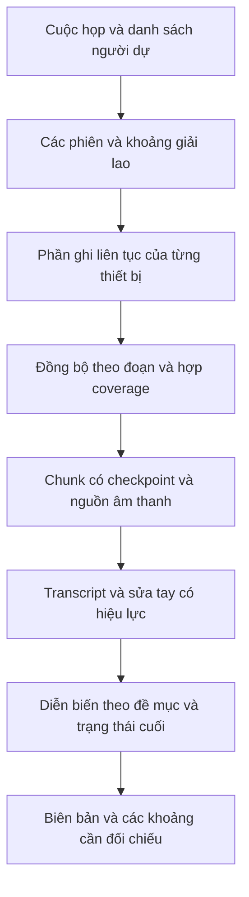

# Minda — khả năng xử lý điều kiện họp thực tế

Ngày rà: 27/10/2026. Phạm vi: bản web tại `web_app`, HEAD `27c67aa01e53e046388e195da9a329b4376f2e4a`; cấu hình backend đang trỏ `configs/default.yaml`. Tài liệu bàn giao 22/10 chỉ dùng làm bối cảnh, kết luận dưới đây đối chiếu lại mã hiện tại. Nếu đổi file cấu hình qua môi trường, cần kiểm lại giới hạn tương ứng.

## Kết luận chính

**Pipeline hiện được thiết kế quanh một tập bản ghi có thời gian chung, tối đa 20 phút mỗi file theo cấu hình đang đọc. Chưa đủ kiến trúc phiên/thời gian và kiểm ngữ nghĩa để khẳng định xử lý tốt cuộc họp dài có giải lao, dừng/ghi lại, nhiều lần biểu quyết hoặc thay đổi kết luận.**

Có việc cần làm song song với huấn luyện LLM: giữ đầy đủ coverage âm thanh, truyền đúng bản sửa tay, xác định đúng phạm vi thời gian/biểu quyết, rồi mới biên tập. Model không được cung cấp lại những phần mà pipeline đã cắt hoặc loại thì không thể dùng fine-tune để khôi phục chúng một cách có căn cứ.

Lần rà này lập **30 tình huống**, chạy **10 phép kiểm tập trung**: hàm thực, luồng dữ liệu có kho lưu giả lập, tín hiệu tổng hợp, một file WebM thật do FFmpeg tạo và tokenizer production đã cache. **Không nạp model ASR/diarization/LLM, không dùng MongoDB thật, không chạy cuộc họp nhiều giờ end-to-end.** Tỷ lệ lỗi ngoài thực tế chưa được đo. Không sửa code/config ứng dụng hoặc dữ liệu cuộc họp.

## Những lỗi đã tái hiện cần ưu tiên

| Vấn đề | Kết quả kiểm | Hậu quả khi gặp họp thực tế |
| --- | --- | --- |
| File dài | 1.200,01 giây bị từ chối trước decode; 1.200 giây đi tới decode | File 30–120 phút chưa chạy được ở cấu hình hiện tại; upload còn nhận trước khi worker từ chối |
| Máy ghi muộn | Offset thật +45 giây: cửa sổ 10 giây thất bại, 120 giây tìm được +45 | Runtime không dùng đúng giới hạn 120 giây đang ghi trong cấu hình |
| Máy ghi sớm hơn máy chuẩn | Nguồn 13 giây có phần đầu riêng 3 giây chỉ còn 10 giây sau offset -3 | Có thể mất lời mở đầu chỉ có ở máy ghi sớm; file gốc vẫn còn |
| Drift chưa rõ | Helper trả drift_unresolved nhưng metadata ra aligned/5 ms trong nhánh đã thử | Thể hiện chắc chắn hơn bằng chứng thực có, ảnh hưởng chọn nguồn và nhận người |
| Người dùng nhập lời cho đoạn overlap | user_edited=true, chữ có, nhưng asr_status vẫn not_run; 0 units vào writer | Nội dung nghe lại và sửa có thể biến mất khỏi biên bản LLM |
| Kết thúc phiên và kết thúc cuộc họp | Phiên đầu 09:30, toàn cuộc 11:45; ô giờ/phút lại nhận 09:30, supported | Biên bản ghi sai giờ kết thúc và có trạng thái căn cứ không phù hợp |
| Biểu quyết A/B | A=3, B=4 phiếu tán thành; cả hai ô đều nhận 4, supported, căn cứ B | Trộn kết quả các nội dung hoặc các vòng biểu quyết |
| WebM hợp lệ | Backend đọc được 2,008 giây, core báo Cannot probe audio | File trình duyệt thuộc danh sách được nhận nhưng job vẫn có thể thất bại trước ASR |
| Context họp dài | 91 units, context lượt đầu còn 45 và thiếu câu chốt cuối; coverage_complete vẫn true | Chỉ số phủ ID không chứng minh đã đối chiếu đủ diễn biến hoặc trạng thái cuối |

Phép kiểm thứ 10 xác nhận **8 hồ sơ giọng được chọn, hồ sơ thứ 9 bị schema từ chối**. Đây không phải giới hạn tổng số người mà nhánh gom giọng ẩn danh có thể phát hiện. Probe context dùng generator giả trả đúng chữ nguồn, nên chỉ chứng minh cách chọn context, chưa chứng minh một lần LLM cụ thể kết luận sai.

Mã tái hiện và chi tiết phụ thuộc được ghi trong [probe_real_meeting_cases.py](</Users/thien/Documents/School/Luận văn/web_app/data/evaluations/real-meeting-pipeline-audit-20261027/probe_real_meeting_cases.py>) và [probes.json](</Users/thien/Documents/School/Luận văn/web_app/data/evaluations/real-meeting-pipeline-audit-20261027/probes.json>). Không đưa các fixture tổng hợp này thành WER/DER hoặc điểm chất lượng thực tế.

## Giải lao cần tách thành các trường hợp khác nhau

1. **Vẫn ghi liên tục, phòng yên lặng:** VAD có thể để trống đoạn nghỉ và các mốc sau nghỉ vẫn theo đồng hồ gốc. Không có căn cứ nói hệ thống hỏng với mọi cuộc họp có giải lao. Tuy vậy file dài vẫn bị giới hạn, và mức bỏ im lặng đúng/sai cần audio thật để đo.
2. **Vẫn ghi nhưng có trò chuyện riêng:** có speech nên có thể vào transcript/biên bản. Chưa có khoảng loại khỏi nội dung theo phiên/giải lao. Người dùng có thể sửa/xóa chữ từng đoạn, nhưng đó chưa phải quy trình loại một khoảng thời gian rõ ràng.
3. **Dừng rồi tạo file mới:** cần coi là các recording part nối tiếp, có khoảng chưa ghi. Hiện hệ thống coi chúng là nguồn cần căn âm thanh chung; không có âm thanh chồng thời gian để suy được khoảng nghỉ hoặc thứ tự chắc chắn.
4. **Chỉ một máy pause, máy khác vẫn ghi:** quan hệ đồng hồ đổi sau chỗ pause. Một offset và một drift tuyến tính không biểu diễn được bước nhảy này; cần mapping theo đoạn và kiểm coverage.
5. **Có câu “kết thúc phiên” trước nghỉ:** không được lấy câu đó làm “kết thúc toàn cuộc”. Đây là lỗi chuẩn hóa đã tái hiện, riêng với các ô giờ/phút đơn trong nhánh hiện tại.

## Ma trận 30 tình huống

Mức căn cứ: **R** = đã tái hiện ở hàm/luồng nhỏ, có mô tả phần giả lập; **C** = xác nhận mã/cấu hình; **V** = rủi ro cần audio hoặc tải thật để đo. P0 là lỗi mất/sai dữ kiện cần sửa trước khi mở rộng; P1 là năng lực cốt lõi cần hoàn thiện; P2 là độ bền/chất lượng/quy mô cần đo; P3 là phạm vi bổ sung nếu sản phẩm cần.

| ID | Tình huống | Hiện trạng / khoảng trống | Ưu tiên | Căn cứ |
| --- | --- | --- | --- | --- |
| M01 | Họp 30 phút đến vài giờ | Mỗi file dài hơn 1.200 giây bị core từ chối. API upload chỉ probe metadata, chưa chặn thời lượng theo cùng quy tắc ngay lúc nhận. | P1 | C/R |
| M02 | Giải lao nhưng vẫn ghi liên tục | VAD có khoảng im lặng và không cần tạo lời cho im lặng; chưa có nhãn giải lao/ngoài biên bản để loại nói chuyện riêng trong thời gian nghỉ. File vẫn chịu giới hạn 20 phút. | P1 | C/V |
| M03 | Dừng ghi khi nghỉ, tải file trước/sau nghỉ | Các file được đưa vào nhánh đồng bộ nhiều nguồn, không có khai báo là các phần nối tiếp của cùng thiết bị. Phần không có âm thanh chung có thể bị loại vì alignment_failed. | P1 | C |
| M04 | Một máy pause/cắt giữa file, máy khác ghi liên tục | Đồng bộ hiện dùng một offset và một drift tuyến tính cho toàn nguồn. Một khoảng bị cắt làm offset đổi đột ngột sau chỗ pause; một ánh xạ toàn cục không biểu diễn được cả hai phía. | P1 | C/V |
| M05 | Thiết bị bật muộn 45 giây hoặc vài phút | Cấu hình ghi max_offset=120 giây nhưng hàm đồng bộ được pipeline gọi lại hard-code 10 giây. Probe offset thật +45 giây: cửa sổ 10 giây bị từ chối, 120 giây tìm được +45. | P0 | R/C |
| M06 | Máy chuẩn bật sau một máy đã ghi lời mở đầu | Offset âm được áp dụng bằng cắt đầu nguồn. Với offset -3 giây đã biết, probe giữ 10/13 giây và bỏ cả 3 giây đầu riêng của nguồn sớm. File gốc còn, nhưng timeline xử lý không giữ phần đó. | P0 | R |
| M07 | Ít lời chung hoặc nghỉ lâu nên không đo chắc drift | Khi helper trả drift_unresolved với drift=0, nhánh gọi có thể vẫn công bố aligned và residual của coarse estimator. Probe tái hiện helper chưa giải được nhưng metadata vẫn aligned/5 ms. | P0 | R |
| M08 | Nhiều thiết bị có coverage đầu/cuối khác nhau | Thời lượng công bố trên meeting lấy max thời lượng file gốc, không lấy chiều dài timeline đã căn. Ví dụ nguồn 10 giây bắt đầu muộn 3 giây tạo hợp coverage 13 giây nhưng max file vẫn 10. | P2 | C |
| M09 | Tranh luận, chen ngang, hai hay ba người nói cùng lúc | Luồng hiện chủ động bỏ separation/ASR/nhận diện tại overlap, chỉ giữ clip cần rà. Bộ đếm còn gộp từ ba người trở lên về tối đa hai. Không có transcript tự động đầy đủ cho vùng này. | P1 | C |
| M10 | Người dùng nghe lại và nhập lời vào đoạn bị bỏ | Edit đánh dấu user_edited nhưng giữ asr_status=not_run. Khi materialize rồi tạo units, chữ vừa nhập vẫn bị loại. Probe đi đủ các hàm này cho 0 units; nếu effective status là user_edited thì có 1 unit. | P0 | R |
| M11 | Có kết thúc phiên trước giải lao và kết thúc toàn cuộc | Chuẩn hóa giờ thấy cụm kết thúc rồi dùng giá trị đầu tiên. Probe phiên đầu kết thúc 09:30, toàn cuộc 11:45: hai ô giờ/phút bị điền 09:30 và đánh dấu supported. | P0 | R |
| M12 | Biểu quyết nhiều nội dung hoặc nhiều vòng | Kết quả phiếu nằm trong một bộ values toàn cuộc. Probe A có 3 phiếu tán thành, B có 4: cả hai ô A/B đều nhận 4, cùng căn cứ B, cùng supported. | P0 | R |
| M13 | Bàn đầu giờ, rút lại hoặc đổi người/điều kiện cuối giờ | Writer cắt context theo trùng từ khi quá budget; không có sổ diễn biến/quyết định chung. Probe 91 units: lượt đầu chỉ thấy 45 context và thiếu câu chốt cuối, dù coverage_complete vẫn true. | P1 | R/C/V |
| M14 | Họp nhiều đề mục, quay lại chủ đề cũ sau giải lao | FCM tự chọn tối đa 4 nhóm theo cấu hình hiện tại; có thể đặt tay đến 12, nên đây không phải giới hạn cứng 4 chủ đề. Gom theo tương đồng chưa phải nhận diện phiên/agenda hoặc trạng thái quyết định. | P2 | C/V |
| M15 | Hai người bị gom nhầm, hoặc một người thành nhiều nhãn | API/giao diện hiện đổi nhãn theo speaker_key của cả nhóm; TextEdit chỉ sửa chữ. Chưa có thao tác gán lại một lượt, chia lượt, gộp/tách danh tính để sửa nhầm cục bộ. | P1 | C/V |
| M16 | Hơn 8 người có hồ sơ giọng cần chọn sẵn | MeetingCreate/Update giới hạn participant_ids ở 8. Đây là cap hồ sơ đăng ký được chọn, không chứng minh hệ thống chỉ phát hiện tối đa 8 người: nhánh clustering ẩn danh mặc định không đặt cap đó. | P2 | R/C |
| M17 | Người vào muộn, ra sớm, người dự nhưng không nói | Hồ sơ người tham gia tĩnh, không có attendance theo thời gian. Danh sách trích tự động chính là người đã phát biểu và đã được đánh dấu cần rà; không đủ xác nhận tổng số dự hoặc tư cách tại lúc biểu quyết. | P1 | C/V |
| M18 | Một file stereo hoặc video có nhiều luồng âm thanh riêng | Decode lấy a:0 rồi downmix mono. Các kênh hoặc audio stream riêng cho từng người có thể mất cấu trúc; luồng a:1 không được đưa vào pipeline. | P1 | C |
| M19 | Họp kết hợp trực tuyến/phòng họp, loa vọng, micro di chuyển | Có kiểm chất lượng nguồn nhưng chưa có bước AEC/nhãn đường loa trực tuyến rõ ràng; máy chuẩn được chọn bằng RMS và tỷ lệ có tín hiệu, không phải độ rõ lời. Chưa có benchmark thực cho tỷ lệ nhận nhầm/echo. | P2 | C/V |
| M20 | Câu không/đồng ý rất ngắn, tiếng địa phương, tên hiếm và thuật ngữ | Ngưỡng speech tối thiểu mặc định 250 ms, ASR đặt tiếng Việt. Có guard lỗi ASR và bảo vệ số/tên nhưng không thể xác định từ thật chỉ từ câu ASR đã sai. Chưa đo lỗi các nhóm này ở lần rà hiện tại. | P2 | C/V |
| M21 | Tất cả máy mất âm thanh hoặc có vùng chưa chép được | Các lượt không có chữ/trạng thái không hợp lệ bị loại khỏi units và lưu excluded_turns; UI biên bản đang hiển thị warnings, không trực tiếp liệt kê excluded_turns. Phủ đủ units không phải phủ đủ cuộc họp. | P1 | C/R |
| M22 | Bản ghi WebM/Opus từ trình duyệt | WebM được phép upload. Fixture WebM hợp lệ 2,008 giây được backend nhận metadata nhưng core từ chối vì core chỉ đọc duration ở audio stream, không fallback format duration. | P1 | R |
| M23 | Máy ngủ, worker dừng hoặc muốn hủy lúc xử lý họp dài | Có lease/heartbeat, trạng thái interrupted và retry an toàn. Retry tạo job/run mới; chưa có resume các stage hoàn tất. Cache ASR có thể tái dùng chunk giống nhau, nên không phải mọi bước đều bắt buộc tính lại. Check hủy nằm ở ranh giới handler/stage lớn. | P1 | C |
| M24 | Hàng nghìn lượt nói, nhiều lần sửa transcript | API lấy toàn bộ segments, React map toàn bộ phần lọc, mỗi lần sửa sao chép cả phiên bản transcript. Khả năng tăng độ trễ/dung lượng là rủi ro cấu trúc, chưa đo ngưỡng tải ở đây. | P2 | C/V |
| M25 | Nói như trên slide hoặc tham chiếu hồ sơ, ghi chú ngoài audio | Luồng dùng audio và mẫu biên bản; OCR mẫu không phải nhập slide làm căn cứ nội dung cuộc họp. Metadata truyền khi tạo biên bản chỉ gồm tên/ngày/địa điểm, chưa truyền meeting.notes. | P1 | C |
| M26 | Họp qua nửa đêm, nhiều múi giờ hoặc ngày chưa rõ | Nguồn hiện có giây tương đối và ngày cuộc họp dạng chuỗi; chưa có captured_at/timezone/session clock rõ ràng. Chuẩn hóa có quy tắc cùng ngày nhưng chưa phải bộ lịch nhiều phiên/múi giờ. | P2 | C/V |
| M27 | Bổ sung bản ghi sau khi đã sửa tay deadline/nhiệm vụ | Tạo lại biên bản ưu tiên giữ nguyên field có user_edited của bản trước theo field_id. Có thể giữ cả giá trị/căn cứ cũ dù nguồn mới đổi kết luận; chưa có đối chiếu hiệu lực từng field. | P1 | C/V |
| M28 | Đưa adapter mới vào để xử lý các tình huống trên | Ứng dụng vẫn tải snapshot MLX gốc; chưa nạp adapter đã train. Writer hiện yêu cầu items, một unit_id mỗi item; dữ liệu train mới dùng paragraphs nhiều unit_ids và review_notes. Chỉ đổi trọng số chưa làm hai hợp đồng này khớp. | P1 | C |
| M29 | Nhiều cuộc họp cùng xử lý và cần transcript khi đang họp | Worker serialize theo data root và công bố transcript sau khi chạy xong; luồng hiện là upload/batch, chưa có streaming/live partial transcript. Đây là lựa chọn phạm vi sản phẩm, không tự động là lỗi của bản hậu kỳ. | P3 | C |
| M30 | Phát video, trích lời người khác hoặc nói riêng khi vẫn thu âm | Speech detection chưa gắn vai trò lời của khách/âm thanh phát lại/trao đổi ngoài biên bản. Writer một item cho mỗi unit có thể giữ những câu này như nội dung họp nếu người dùng chưa loại. | P2 | C/V |

## Những gì đã có, cần giữ khi cải thiện

- Có đồng bộ offset và thử ước lượng drift, coverage đầu/cuối, lọc nguồn alignment_failed, chất lượng nguồn và nhãn người không chắc. Các lỗi nêu trên nằm ở việc ghép/nối các cơ chế đó, không phải toàn bộ phần đồng bộ chưa tồn tại.
- Có chia lượt dài thành clip ASR khoảng 22–25 giây, context hai bên và hòa giải từ ở biên; đây là chia clip nhận dạng, chưa phải hỗ trợ một cuộc họp nhiều giờ với nhiều phiên. Bài kiểm “long speech” hiện được đọc dùng tín hiệu 36 giây và FakeAsrAdapter, không phải benchmark họp dài thật: [test_multi_source_fusion_pipeline.py:18](</Users/thien/Documents/School/Luận văn/web_app/tests/integration/test_multi_source_fusion_pipeline.py:18>).
- Overlap giữ clip và needs_review thay vì bịa nội dung. Cần sửa đường nhập lời thủ công và đưa vùng thiếu sang màn biên bản, rồi mới đánh giá tách người nói tự động.
- Có bất biến phiên bản, revision/stale, lease/heartbeat, publish có điều kiện và cache ASR. Chưa có resume từng stage, nhưng không nên mô tả là hoàn toàn không có khôi phục hoặc lúc nào cũng tính lại ASR.
- Writer kiểm ID/số/từ trạng thái và có fallback về chữ nguồn. Đây là guard hữu ích; giữ đủ ID hoặc giữ đúng từ không/chưa vẫn chưa chứng minh đúng chủ thể/quan hệ điều kiện. Nhiều fallback còn giữ văn nói.
- Danh sách người đã phát biểu đã có reason cần xác nhận người dự không nói; không được nâng thành danh sách điểm danh đầy đủ hoặc căn cứ đủ số người biểu quyết.

## Thứ tự cải thiện đề xuất

### Đợt 1 — sửa dữ liệu đang bị sai hoặc bị loại, chưa cần train thêm

1. **Bản sửa tay có hiệu lực**: sửa đường edit → materialize → indexed turns → eligibility cho units/structured fields. Giữ trạng thái ASR gốc riêng làm provenance; không tự gán danh tính cho lời overlap chưa được xác nhận. Có kiểm hồi quy cho đoạn not_run, failed, empty, sửa thành chữ và xóa chữ.
2. **Bảo toàn timeline**: dùng origin/union coverage, đưa tham số sync vào đường chạy, truyền drift_unresolved đúng và hiển thị nguồn chưa căn được. Có kiểm mất đoạn đầu, nguồn muộn 45 giây và khoảng bị cắt giữa file. Không chỉ đổi 10 thành 120 rồi coi đã xử lý pause.
3. **Phạm vi thời gian và phiếu**: phân biệt kết thúc phiên/toàn cuộc, đính chính và giờ dự kiến; nhóm biểu quyết theo đề mục/vòng. Không chọn first/last toàn cuộc khi chưa biết phạm vi. Trường chưa rõ không đánh dấu supported.
4. **Nhận file nhất quán**: chung metadata probe giữa API và worker; báo giới hạn thời lượng sớm, kiểm WebM/Opus đã tái hiện. Giữ bản gốc và lý do từ chối rõ ràng.
5. **Cảnh báo có nguồn**: tạo danh sách khoảng thiếu/ngoài nguồn từ timeline bằng chương trình và mang sang trang biên bản; không trông chờ LLM tự phát hiện một đoạn đã bị loại khỏi prompt.

### Đợt 2 — hỗ trợ họp dài và nhiều phiên

Thêm cấu trúc **cuộc họp → phiên → thiết bị → phần ghi liên tục → chunk**. Mỗi phần có captured_at hoặc mốc do người dùng xác nhận, coverage và gap; chỉ đồng bộ các nguồn thật sự cùng thời gian. Giữ đồng hồ audio riêng với giờ thực. Không mặc định im lặng là nghỉ, hoặc mất bản ghi là không có sự kiện.

Đổi giới hạn 20 phút cần đi cùng đọc/xử lý theo chunk, checkpoint và quản lý bộ nhớ. Tính lý thuyết: 2 giờ × 16.000 mẫu/giây × float32 × 8 nguồn = **3,6864 GB (3,43 GiB) cho một bộ waveform**; chỉ hai bộ decoded/aligned đã khoảng 7,37 GB, chưa gồm model/buffer/embedding. Đây là phép tính dung lượng, không phải peak RAM đã đo; chưa kết luận chắc chắn OOM trên mọi máy.

### Đợt 3 — diễn biến nội dung, danh tính và nghiệm thu thực tế

- Giữ các sự kiện đề xuất/phản đối/đính chính/nhận việc/hoàn thành/chốt theo trình tự, nối lại khi quay về chủ đề cũ. Chọn context cần giữ quan hệ và thời gian, không chỉ trùng từ; kết luận cuối cần được đối chiếu qua các phiên.
- Cho sửa danh tính từng lượt, chia/gộp có lịch sử; danh sách tham dự và vào/ra là dữ liệu riêng. Đánh giá tiếng vọng, micro đổi vị trí, người trùng tên, câu phủ định ngắn và thuật ngữ trên audio tiếng Việt có nhãn.
- Trước khi đưa LoRA vào ứng dụng, thống nhất hợp đồng đầu ra và bằng chứng: bản train hiện viết paragraphs nhiều unit_ids + review_notes, trong khi writer đang yêu cầu items từng unit_id. Runtime hiện vẫn nạp snapshot MLX gốc, chưa phải adapter mới. Cần kiểm xuyên pipeline, không chỉ các cặp JSON trong Colab.
- Tải thật với hàng nghìn lượt, nhiều lần sửa, worker bị ngắt và nhiều job. Streaming là mở rộng sản phẩm riêng, không cần đưa thành yêu cầu bắt buộc của bản hậu kỳ nếu chưa có nhu cầu.

## Bộ nghiệm thu nên bổ sung

| Bộ thử | Điều cần chứng minh |
| --- | --- |
| 20:00 và 20:00,01; 30/60/120 phút | Giới hạn rõ từ lúc nhận; sau khi mở rộng thì chạy hết và resume được, không chỉ đổi cấu hình |
| Ghi liên tục có 5–15 phút nghỉ | Không sinh lời từ im lặng, giữ đúng mốc sau nghỉ, phân biệt chuyện riêng với nội dung cần ghi |
| Hai phần nối tiếp có/không có giờ thực | Không coi là micro đồng thời; giữ gap chưa ghi và không tự đoán giờ khi thiếu |
| Nguồn sớm 3 giây, muộn 45 giây; một nguồn pause | Giữ hợp coverage và lời đầu; mốc sau pause có căn cứ hoặc bị đánh dấu chưa căn được |
| Overlap, not_run và sửa tay | Clip còn nghe được; chữ người dùng nhập thực sự vào units/biên bản; trạng thái gốc và người chưa rõ vẫn được lưu |
| Kết thúc phiên rồi kết thúc toàn cuộc | Ô kết thúc không lấy nhầm lần đầu; trường hợp thật sự mâu thuẫn phải cần rà |
| Biểu quyết A/B, nhiều vòng và phiếu chưa công bố | Không trộn số giữa các đề mục, không tự điền phần thiếu hoặc dùng số giọng làm số người dự |
| Quyết định đổi ở cuối, đổi người và điều kiện | Giữ diễn biến, chủ thể/nhiệm vụ/điều kiện cuối và căn cứ; ID coverage không được dùng làm điểm đúng nghĩa |
| 10–20 hồ sơ, người im lặng, vào/ra | Không lẫn cap hồ sơ với số người dự; sửa nhầm một lượt không kéo theo đổi cả nhóm |
| WebM/OGG/AAC/M4A/WAV, stereo/track riêng | API và core cùng chấp nhận/từ chối; không làm mất track mà không có lựa chọn hoặc cảnh báo |
| Worker ngắt ở giữa ASR/LLM | Tiếp tục phần chưa hoàn tất, hủy có điểm kiểm rõ và không xuất nháp thiếu như đã xong |
| 1.000–5.000 lượt và sửa nhiều lần | Đo latency đọc/sửa, RAM/đĩa và thời gian xử lý; ngưỡng chấp nhận phải được chọn trước khi nghiệm thu |

Cần ground truth cả transcript, người nói, mốc thời gian và biên bản được rà. Đo lỗi mất/chèn/thay thế từ, nhận người, coverage nguồn, dữ kiện quan trọng và công sửa tay. Không lấy benchmark tiếng Anh hoặc các fixture của lần rà này làm điểm chất lượng cho họp hành chính tiếng Việt.

## Đối chiếu nghiên cứu

[MeetingBank, ACL 2023](https://aclanthology.org/2023.acl-long.906/) chia biên bản chuyên nghiệp thành các phần và căn với đoạn cuộc họp; đây là cơ sở tham khảo cho tổ chức đề mục/nguồn khi họp dài, không phải bằng chứng pipeline Minda đã làm được.

[AMI Corpus](https://groups.inf.ed.ac.uk/ami/corpus/) có khoảng 100 giờ dữ liệu đa phương thức với micro gần/xa, video, phần chiếu và bảng. Điều này giúp thiết kế bộ thử đa thiết bị và tham chiếu ngoài audio. AMI không thay bộ đánh giá tiếng Việt và không tự chứng minh tỷ lệ lỗi của hệ thống này.

## Mã và cải thiện theo từng tình huống

### M01 — Họp 30 phút đến vài giờ

Thiết kế xử lý theo phiên/chunk bền vững, đặt giới hạn theo tài nguyên và báo giới hạn từ lúc upload; không chỉ tăng số 1200.

Căn cứ: [default.yaml:12](</Users/thien/Documents/School/Luận văn/web_app/configs/default.yaml:12>), [multi_source_fusion.py:1001](</Users/thien/Documents/School/Luận văn/web_app/src/meeting_pipeline/pipeline/multi_source_fusion.py:1001>), [router.py:89](</Users/thien/Documents/School/Luận văn/web_app/src/meeting_backend/modules/meetings/router.py:89>).
Probe: `probe_duration` trong `probes.json`.

### M02 — Giải lao nhưng vẫn ghi liên tục

Thêm các khoảng phiên họp/giải lao/ngoài nội dung do người dùng xác nhận; giữ nguyên đồng hồ bản ghi và đánh giá false speech trong khoảng nghỉ.

Căn cứ: [shared_segmentation.py:224](</Users/thien/Documents/School/Luận văn/web_app/src/meeting_pipeline/pipeline/stages/shared_segmentation.py:224>), [text_engine.py:458](</Users/thien/Documents/School/Luận văn/web_app/src/meeting_pipeline/minutes/text_engine.py:458>).
Chưa có phép đo chất lượng trên audio thật cho riêng tình huống này.

### M03 — Dừng ghi khi nghỉ, tải file trước/sau nghỉ

Tách device_id, session_id và recording_part; khai báo thứ tự, giờ bắt đầu và khoảng chưa ghi thay vì coi mọi file là micro đồng thời.

Căn cứ: [router.py:92](</Users/thien/Documents/School/Luận văn/web_app/src/meeting_backend/modules/meetings/router.py:92>), [multi_source_fusion.py:301](</Users/thien/Documents/School/Luận văn/web_app/src/meeting_pipeline/pipeline/multi_source_fusion.py:301>), [shared_segmentation.py:188](</Users/thien/Documents/School/Luận văn/web_app/src/meeting_pipeline/pipeline/stages/shared_segmentation.py:188>).
Chưa có phép đo chất lượng trên audio thật cho riêng tình huống này.

### M04 — Một máy pause/cắt giữa file, máy khác ghi liên tục

Dùng ánh xạ thời gian theo từng đoạn liên tục và lưu discontinuity/gap; không đánh đồng mất tiếng với im lặng thật.

Căn cứ: [synchronization.py:116](</Users/thien/Documents/School/Luận văn/web_app/src/meeting_pipeline/audio/synchronization.py:116>), [synchronization.py:182](</Users/thien/Documents/School/Luận văn/web_app/src/meeting_pipeline/audio/synchronization.py:182>).
Chưa có phép đo chất lượng trên audio thật cho riêng tình huống này.

### M05 — Thiết bị bật muộn 45 giây hoặc vài phút

Nối cấu hình vào đường chạy thật; kiểm nguồn không căn được, yêu cầu mốc thời gian thủ công hoặc giữ rõ vùng chưa đồng bộ.

Căn cứ: [default.yaml:17](</Users/thien/Documents/School/Luận văn/web_app/configs/default.yaml:17>), [synchronization.py:156](</Users/thien/Documents/School/Luận văn/web_app/src/meeting_pipeline/audio/synchronization.py:156>), [multi_source_fusion.py:302](</Users/thien/Documents/School/Luận văn/web_app/src/meeting_pipeline/pipeline/multi_source_fusion.py:302>).
Probe: `probe_offset_window` trong `probes.json`.

### M06 — Máy chuẩn bật sau một máy đã ghi lời mở đầu

Chọn gốc thời gian bằng hợp coverage của mọi nguồn, dịch toàn cuộc họp để không có thời gian âm; không cắt âm thanh có thể chứa lời chỉ vì nó sớm hơn máy chuẩn.

Căn cứ: [synchronization.py:183](</Users/thien/Documents/School/Luận văn/web_app/src/meeting_pipeline/audio/synchronization.py:183>), [device.py:14](</Users/thien/Documents/School/Luận văn/web_app/src/meeting_pipeline/simulation/device.py:14>), [synchronize.py:93](</Users/thien/Documents/School/Luận văn/web_app/src/meeting_pipeline/pipeline/stages/synchronize.py:93>).
Probe: `probe_early_source` trong `probes.json`.

### M07 — Ít lời chung hoặc nghỉ lâu nên không đo chắc drift

Truyền trạng thái bất định xuyên các bước, chỉ ghi residual đã đo; không coi thiếu bằng chứng drift là đã đồng bộ chắc chắn.

Căn cứ: [synchronization.py:173](</Users/thien/Documents/School/Luận văn/web_app/src/meeting_pipeline/audio/synchronization.py:173>), [source_quality.py:129](</Users/thien/Documents/School/Luận văn/web_app/src/meeting_pipeline/speaker/source_quality.py:129>).
Probe: `probe_unresolved_drift` trong `probes.json`.

### M08 — Nhiều thiết bị có coverage đầu/cuối khác nhau

Lưu riêng duration từng file, coverage từng đoạn, thời lượng timeline và thời gian thực; dùng đúng đại lượng trên giao diện.

Căn cứ: [audio_pipeline.py:132](</Users/thien/Documents/School/Luận văn/web_app/src/meeting_backend/integrations/audio_pipeline.py:132>), [synchronization.py:201](</Users/thien/Documents/School/Luận văn/web_app/src/meeting_pipeline/audio/synchronization.py:201>).
Chưa có phép đo chất lượng trên audio thật cho riêng tình huống này.

### M09 — Tranh luận, chen ngang, hai hay ba người nói cùng lúc

Trước hết hoàn thiện nghe lại và nhập/sửa có nguồn; sau đó đánh giá tách lời trên bộ họp thật. Không để LLM bù lời không được ghi nhận.

Căn cứ: [multi_source_fusion.py:534](</Users/thien/Documents/School/Luận văn/web_app/src/meeting_pipeline/pipeline/multi_source_fusion.py:534>), [multi_source_fusion.py:920](</Users/thien/Documents/School/Luận văn/web_app/src/meeting_pipeline/pipeline/multi_source_fusion.py:920>), [speaker_turns.py:112](</Users/thien/Documents/School/Luận văn/web_app/src/meeting_pipeline/pipeline/speaker_turns.py:112>).
Chưa có phép đo chất lượng trên audio thật cho riêng tình huống này.

### M10 — Người dùng nghe lại và nhập lời vào đoạn bị bỏ

Định nghĩa transcript hiệu lực sau sửa tay, giữ trạng thái ASR gốc làm provenance riêng; cho nội dung đã sửa đi vào biên bản và vẫn giữ cảnh báo người nói chưa rõ.

Căn cứ: [service.py:59](</Users/thien/Documents/School/Luận văn/web_app/src/meeting_backend/modules/transcripts/service.py:59>), [minutes_pipeline.py:35](</Users/thien/Documents/School/Luận văn/web_app/src/meeting_backend/integrations/minutes_pipeline.py:35>), [text_engine.py:66](</Users/thien/Documents/School/Luận văn/web_app/src/meeting_pipeline/minutes/text_engine.py:66>).
Probe: `probe_manual_gap_edit` trong `probes.json`.

### M11 — Có kết thúc phiên trước giải lao và kết thúc toàn cuộc

Phân biệt kết thúc phiên với kết thúc cuộc họp, đính chính và dự kiến; nếu có nhiều ứng viên chưa rõ phạm vi thì để conflicting/needs_review.

Căn cứ: [structured_fields.py:105](</Users/thien/Documents/School/Luận văn/web_app/src/meeting_pipeline/minutes/structured_fields.py:105>), [structured_fields.py:117](</Users/thien/Documents/School/Luận văn/web_app/src/meeting_pipeline/minutes/structured_fields.py:117>), [structured_fields.py:192](</Users/thien/Documents/School/Luận văn/web_app/src/meeting_pipeline/minutes/structured_fields.py:192>).
Probe: `probe_break_end_time` trong `probes.json`.

### M12 — Biểu quyết nhiều nội dung hoặc nhiều vòng

Gắn phiếu với agenda_item và vote_round; giữ tổng/tán thành/không tán thành/không biểu quyết theo từng đợt, không trộn hàng hoặc suy phần chưa công bố.

Căn cứ: [structured_fields.py:137](</Users/thien/Documents/School/Luận văn/web_app/src/meeting_pipeline/minutes/structured_fields.py:137>), [structured_fields.py:157](</Users/thien/Documents/School/Luận văn/web_app/src/meeting_pipeline/minutes/structured_fields.py:157>), [structured_fields.py:192](</Users/thien/Documents/School/Luận văn/web_app/src/meeting_pipeline/minutes/structured_fields.py:192>).
Probe: `probe_multi_vote` trong `probes.json`.

### M13 — Bàn đầu giờ, rút lại hoặc đổi người/điều kiện cuối giờ

Tách sự kiện đề xuất/phản đối/đính chính/chốt và liên kết theo chủ đề; giữ trình tự, chủ thể, điều kiện và nguồn; kiểm kết luận cuối qua các phiên.

Căn cứ: [text_engine.py:487](</Users/thien/Documents/School/Luận văn/web_app/src/meeting_pipeline/minutes/text_engine.py:487>), [text_engine.py:589](</Users/thien/Documents/School/Luận văn/web_app/src/meeting_pipeline/minutes/text_engine.py:589>), [model_pipeline.py:104](</Users/thien/Documents/School/Luận văn/web_app/src/meeting_pipeline/minutes/model_pipeline.py:104>).
Probe: `probe_long_writer_context` trong `probes.json`.

### M14 — Họp nhiều đề mục, quay lại chủ đề cũ sau giải lao

Cho dùng agenda xác nhận, duy trì liên kết những lần quay lại cùng đề mục và cho người dùng chỉnh nhóm; kiểm cả bảo toàn diễn biến.

Căn cứ: [minutes.yaml:11](</Users/thien/Documents/School/Luận văn/web_app/configs/minutes.yaml:11>), [topic_clustering.py:41](</Users/thien/Documents/School/Luận văn/web_app/src/meeting_pipeline/minutes/topic_clustering.py:41>), [text_engine.py:425](</Users/thien/Documents/School/Luận văn/web_app/src/meeting_pipeline/minutes/text_engine.py:425>).
Chưa có phép đo chất lượng trên audio thật cho riêng tình huống này.

### M15 — Hai người bị gom nhầm, hoặc một người thành nhiều nhãn

Thêm speaker override theo từng lượt, split/merge có lịch sử và giữ căn cứ âm thanh; thử đổi chỗ ngồi, đổi micro, giọng bị khàn và người trùng tên.

Căn cứ: [router.py:14](</Users/thien/Documents/School/Luận văn/web_app/src/meeting_backend/modules/transcripts/router.py:14>), [service.py:89](</Users/thien/Documents/School/Luận văn/web_app/src/meeting_backend/modules/transcripts/service.py:89>), [transcript.tsx:271](</Users/thien/Documents/School/Luận văn/web_app/apps/web/src/features/meetings/transcript.tsx:271>).
Chưa có phép đo chất lượng trên audio thật cho riêng tình huống này.

### M16 — Hơn 8 người có hồ sơ giọng cần chọn sẵn

Tách số người tham dự, số hồ sơ đối chiếu và số nguồn; cấu hình/kiểm hiệu năng với 10–20 hồ sơ và danh tính chưa đăng ký.

Căn cứ: [schemas.py:10](</Users/thien/Documents/School/Luận văn/web_app/src/meeting_backend/modules/meetings/schemas.py:10>), [multi_source_fusion.py:448](</Users/thien/Documents/School/Luận văn/web_app/src/meeting_pipeline/pipeline/multi_source_fusion.py:448>), [clustering.py:660](</Users/thien/Documents/School/Luận văn/web_app/src/meeting_pipeline/speaker/clustering.py:660>).
Probe: `probe_profiles_limit` trong `probes.json`.

### M17 — Người vào muộn, ra sớm, người dự nhưng không nói

Nhập/xác nhận roster và mốc vào/ra độc lập với nhận diện giọng; giữ unknown cho người im lặng, không lấy số giọng làm số người dự.

Căn cứ: [schemas.py:4](</Users/thien/Documents/School/Luận văn/web_app/src/meeting_backend/modules/meetings/schemas.py:4>), [fact_extractor.py:391](</Users/thien/Documents/School/Luận văn/web_app/src/meeting_pipeline/minutes/fact_extractor.py:391>).
Chưa có phép đo chất lượng trên audio thật cho riêng tình huống này.

### M18 — Một file stereo hoặc video có nhiều luồng âm thanh riêng

Cho khai báo kênh/track là nguồn riêng, giữ channel mapping và chỉ downmix khi đó thực sự là bản trộn chung.

Căn cứ: [audio_io.py:69](</Users/thien/Documents/School/Luận văn/web_app/src/meeting_pipeline/adapters/audio_io.py:69>).
Chưa có phép đo chất lượng trên audio thật cho riêng tình huống này.

### M19 — Họp kết hợp trực tuyến/phòng họp, loa vọng, micro di chuyển

Tạo bộ thử tiếng vọng, nhiều đầu cầu, thay vị trí và âm lượng; so nguồn sạch với bản loa phòng, đo lỗi đồng bộ/nhận người trước khi chọn phương án lọc.

Căn cứ: [synchronization.py:27](</Users/thien/Documents/School/Luận văn/web_app/src/meeting_pipeline/audio/synchronization.py:27>), [source_quality.py:115](</Users/thien/Documents/School/Luận văn/web_app/src/meeting_pipeline/speaker/source_quality.py:115>).
Chưa có phép đo chất lượng trên audio thật cho riêng tình huống này.

### M20 — Câu không/đồng ý rất ngắn, tiếng địa phương, tên hiếm và thuật ngữ

Thu bộ audio tiếng Việt có nhãn, ưu tiên phủ định, tên, số và câu ngắn; đo mất/chèn/thay thế từ, sai chủ thể và sai trạng thái thay vì chỉ nhìn văn xuôi.

Căn cứ: [default.yaml:25](</Users/thien/Documents/School/Luận văn/web_app/configs/default.yaml:25>), [text_engine.py:102](</Users/thien/Documents/School/Luận văn/web_app/src/meeting_pipeline/minutes/text_engine.py:102>), [segment_asr.py:1](</Users/thien/Documents/School/Luận văn/web_app/src/meeting_pipeline/asr/segment_asr.py:1>).
Chưa có phép đo chất lượng trên audio thật cho riêng tình huống này.

### M21 — Tất cả máy mất âm thanh hoặc có vùng chưa chép được

Duy trì danh sách coverage/gap độc lập với LLM, đưa khoảng thiếu và clip nghe lại sang trang biên bản; không suy kết quả từ khoảng không có dữ liệu.

Căn cứ: [text_engine.py:66](</Users/thien/Documents/School/Luận văn/web_app/src/meeting_pipeline/minutes/text_engine.py:66>), [model_pipeline.py:160](</Users/thien/Documents/School/Luận văn/web_app/src/meeting_pipeline/minutes/model_pipeline.py:160>), [minutes.tsx:579](</Users/thien/Documents/School/Luận văn/web_app/apps/web/src/features/meetings/minutes.tsx:579>).
Probe: `probe_manual_gap_edit` trong `probes.json`.

### M22 — Bản ghi WebM/Opus từ trình duyệt

Dùng chung hợp đồng probe/chuẩn hóa định dạng giữa upload và worker; kiểm WebM, OGG, AAC, M4A trước khi nhận là nguồn sẵn sàng.

Căn cứ: [store.py:10](</Users/thien/Documents/School/Luận văn/web_app/src/meeting_backend/infrastructure/artifacts/store.py:10>), [media.py:20](</Users/thien/Documents/School/Luận văn/web_app/src/meeting_backend/infrastructure/artifacts/media.py:20>), [audio_io.py:36](</Users/thien/Documents/School/Luận văn/web_app/src/meeting_pipeline/adapters/audio_io.py:36>).
Probe: `probe_webm_metadata` trong `probes.json`.

### M23 — Máy ngủ, worker dừng hoặc muốn hủy lúc xử lý họp dài

Lưu checkpoint stage/chunk bền vững và input fingerprint; tiếp tục phần chưa xong, hủy giữa các chunk, giữ ID/bằng chứng và không công bố kết quả dở.

Căn cứ: [runner.py:31](</Users/thien/Documents/School/Luận văn/web_app/src/meeting_backend/worker/runner.py:31>), [context.py:30](</Users/thien/Documents/School/Luận văn/web_app/src/meeting_backend/worker/context.py:30>), [service.py:100](</Users/thien/Documents/School/Luận văn/web_app/src/meeting_backend/modules/jobs/service.py:100>), [cache.py:23](</Users/thien/Documents/School/Luận văn/web_app/src/meeting_pipeline/asr/cache.py:23>).
Chưa có phép đo chất lượng trên audio thật cho riêng tình huống này.

### M24 — Hàng nghìn lượt nói, nhiều lần sửa transcript

Đo với 1.000–5.000 lượt và nhiều lần sửa; phân trang/virtualize UI, cân nhắc lưu delta phiên bản có snapshot định kỳ.

Căn cứ: [service.py:10](</Users/thien/Documents/School/Luận văn/web_app/src/meeting_backend/modules/transcripts/service.py:10>), [service.py:14](</Users/thien/Documents/School/Luận văn/web_app/src/meeting_backend/modules/transcripts/service.py:14>), [transcript.tsx:169](</Users/thien/Documents/School/Luận văn/web_app/apps/web/src/features/meetings/transcript.tsx:169>).
Chưa có phép đo chất lượng trên audio thật cho riêng tình huống này.

### M25 — Nói như trên slide hoặc tham chiếu hồ sơ, ghi chú ngoài audio

Cho thêm tài liệu/agenda/notes làm nguồn có provenance riêng; không tự đoán các từ này/cái đó theo tài liệu không được cung cấp.

Căn cứ: [minutes_pipeline.py:154](</Users/thien/Documents/School/Luận văn/web_app/src/meeting_backend/integrations/minutes_pipeline.py:154>), [text_engine.py:302](</Users/thien/Documents/School/Luận văn/web_app/src/meeting_pipeline/minutes/text_engine.py:302>).
Chưa có phép đo chất lượng trên audio thật cho riêng tình huống này.

### M26 — Họp qua nửa đêm, nhiều múi giờ hoặc ngày chưa rõ

Tách wall clock và audio clock, xác nhận ngày/zone cho mỗi phiên; chỉ chuyển đổi khi có đủ metadata và giữ bất định khi thiếu.

Căn cứ: [schemas.py:7](</Users/thien/Documents/School/Luận văn/web_app/src/meeting_backend/modules/meetings/schemas.py:7>), [structured_fields.py:147](</Users/thien/Documents/School/Luận văn/web_app/src/meeting_pipeline/minutes/structured_fields.py:147>).
Chưa có phép đo chất lượng trên audio thật cho riêng tình huống này.

### M27 — Bổ sung bản ghi sau khi đã sửa tay deadline/nhiệm vụ

Giữ lịch sử chỉnh tay nhưng đánh dấu thay đổi căn cứ sau transcript revision; cho đối chiếu giá trị cũ/mới và lý do giữ ghi đè.

Căn cứ: [minutes_pipeline.py:163](</Users/thien/Documents/School/Luận văn/web_app/src/meeting_backend/integrations/minutes_pipeline.py:163>), [service.py:275](</Users/thien/Documents/School/Luận văn/web_app/src/meeting_pipeline/minutes/service.py:275>).
Chưa có phép đo chất lượng trên audio thật cho riêng tình huống này.

### M28 — Đưa adapter mới vào để xử lý các tình huống trên

Thiết kế lớp writer/validator/evidence tương thích, chuyển model đúng runtime rồi kiểm xuyên pipeline; giữ đường cũ để đối chiếu chất lượng.

Căn cứ: [minutes.yaml:4](</Users/thien/Documents/School/Luận văn/web_app/configs/minutes.yaml:4>), [minutes_model_worker.py:32](</Users/thien/Documents/School/Luận văn/web_app/scripts/minutes_model_worker.py:32>), [text_engine.py:458](</Users/thien/Documents/School/Luận văn/web_app/src/meeting_pipeline/minutes/text_engine.py:458>).
Chưa có phép đo chất lượng trên audio thật cho riêng tình huống này.

### M29 — Nhiều cuộc họp cùng xử lý và cần transcript khi đang họp

Nếu cần phục vụ đồng thời/live, tách queue tài nguyên, chunk ingest và cập nhật một phần có version; xác nhận nhu cầu trước khi mở rộng.

Căn cứ: [runner.py:98](</Users/thien/Documents/School/Luận văn/web_app/src/meeting_backend/worker/runner.py:98>), [audio_pipeline.py:121](</Users/thien/Documents/School/Luận văn/web_app/src/meeting_backend/integrations/audio_pipeline.py:121>), [router.py:71](</Users/thien/Documents/School/Luận văn/web_app/src/meeting_backend/modules/meetings/router.py:71>).
Chưa có phép đo chất lượng trên audio thật cho riêng tình huống này.

### M30 — Phát video, trích lời người khác hoặc nói riêng khi vẫn thu âm

Cho gắn nhãn nguồn/loại phát ngôn và khoảng ngoài nội dung; thử lời trích dẫn, video loa ngoài, câu đùa và chỉ dẫn lẫn trong transcript, giữ trích dẫn mà không biến thành quyết định.

Căn cứ: [text_engine.py:66](</Users/thien/Documents/School/Luận văn/web_app/src/meeting_pipeline/minutes/text_engine.py:66>), [text_engine.py:458](</Users/thien/Documents/School/Luận văn/web_app/src/meeting_pipeline/minutes/text_engine.py:458>).
Chưa có phép đo chất lượng trên audio thật cho riêng tình huống này.

## Tái hiện và phạm vi

- [probes.json](</Users/thien/Documents/School/Luận văn/web_app/data/evaluations/real-meeting-pipeline-audit-20261027/probes.json>): kết quả 10 phép kiểm và mô tả phụ thuộc giả lập.
- [probe_real_meeting_cases.py](</Users/thien/Documents/School/Luận văn/web_app/data/evaluations/real-meeting-pipeline-audit-20261027/probe_real_meeting_cases.py>): script chạy tại máy local, không dùng model/DB thật.
- [SCENARIO_MATRIX.md](</Users/thien/Documents/School/Luận văn/web_app/data/evaluations/real-meeting-pipeline-audit-20261027/SCENARIO_MATRIX.md>) và [scenario_matrix.json](</Users/thien/Documents/School/Luận văn/web_app/data/evaluations/real-meeting-pipeline-audit-20261027/scenario_matrix.json>): 30 tình huống và căn cứ.
- [source_sha256.json](</Users/thien/Documents/School/Luận văn/web_app/data/evaluations/real-meeting-pipeline-audit-20261027/source_sha256.json>): checksum nguồn đã đọc; không thay đổi trong các probe.

Không sửa các giới hạn hoặc hành vi pipeline trong lần rà này; đây là danh sách vấn đề có căn cứ và kế hoạch kiểm/cải thiện để triển khai tiếp.
