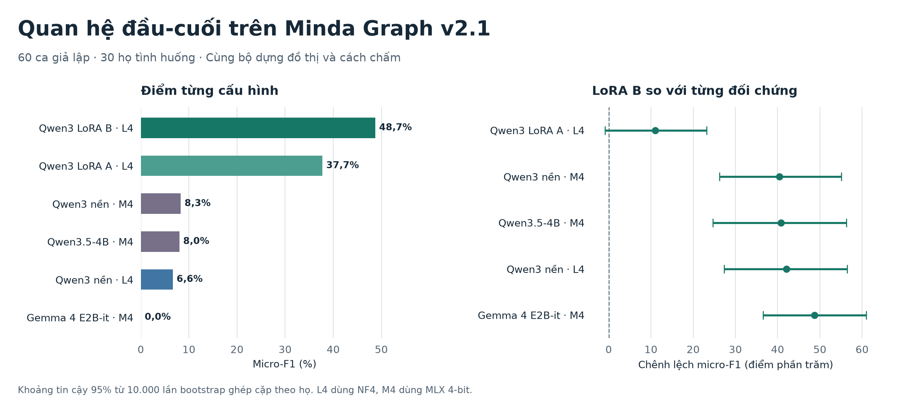

# So sánh Qwen3 sau tinh chỉnh với các mô hình nền

## Kết quả trên holdout Minda Graph v2.1

LoRA B có micro-F1 quan hệ đầu-cuối cao nhất trong sáu cấu hình đã đo. A và B đều cải thiện so với Qwen3 nền cùng chạy NF4 trên L4. Trong ba mô hình nền chạy cùng MLX trên M4, Qwen3 và Qwen3.5 gần nhau về F1 quan hệ đầu-cuối. Qwen3 trả đúng schema trích xuất ngay lần đầu ở 46/70 lô, so với 0/70 của Qwen3.5.

| Cấu hình | F1 sự kiện | F1 quan hệ đầu-cuối | F1 nối trên sự kiện chuẩn | Trạng thái khớp |
| --- | ---: | ---: | ---: | ---: |
| Qwen3-4B-Instruct-2507 · NF4 | 73,6% | 6,6% | 21,8% | 8/42 |
| Qwen3-4B-Instruct-2507 · MLX 4-bit | 69,2% | 8,3% | 27,1% | 5/42 |
| Qwen3.5-4B · MLX 4-bit | 69,5% | 8,0% | 27,5% | 8/42 |
| Gemma 4 E2B-it · MLX 4-bit | 36,8% | 0,0% | 20,0% | 1/42 |
| Qwen3 + LoRA A · NF4 | 80,6% | 37,7% | 33,9% | 15/42 |
| Qwen3 + LoRA B · NF4 | 82,3% | 48,7% | 54,5% | 16/42 |

## Chênh lệch F1 quan hệ đầu-cuối của B

| Đối chứng | Chênh lệch (điểm phần trăm) | Khoảng tin cậy 95% (điểm phần trăm) |
| --- | ---: | ---: |
| Qwen3-4B-Instruct-2507 · NF4 | +42,1 | +27,4 đến +56,5 |
| Qwen3-4B-Instruct-2507 · MLX 4-bit | +40,5 | +26,2 đến +55,0 |
| Qwen3.5-4B · MLX 4-bit | +40,7 | +24,7 đến +56,3 |
| Gemma 4 E2B-it · MLX 4-bit | +48,7 | +36,5 đến +61,0 |
| Qwen3 + LoRA A · NF4 | +11,0 | −0,9 đến +23,2 |

## Đọc kết quả

- Tác động tinh chỉnh được đo trong nhóm L4, nơi mô hình nền, A và B dùng chung Qwen3 và lượng tử hóa NF4. B có 58/110 cạnh đúng, 70 cạnh thừa và 52 cạnh thiếu. Chỉ số trạng thái của B là 16/42 ca.
- B cao hơn A 11,0 điểm phần trăm micro-F1 quan hệ đầu-cuối. Khoảng tin cậy 95% từ −0,9 đến +23,2 điểm phần trăm vẫn chứa 0. Điểm quan sát và mức độ chắc chắn của chênh lệch cần được đọc cùng nhau.
- Qwen3.5 và Gemma gặp lại lỗi định dạng ở bước trích xuất với schema mảng. Tỷ lệ đúng schema ngay lần sinh đầu là 0/70 lô ở cả hai. B đạt 69/70. Khi cấp sự kiện chuẩn, điểm nối của Qwen3.5 đạt 27,5% và của Gemma đạt 20,0%. Riêng Gemma có 258/296 sự kiện cuối luồng rơi về nguồn. Kết quả này mô tả khả năng làm việc với prompt và bộ dựng đồ thị v2.1.

## F1 quan hệ đầu-cuối theo kiểu cuộc họp

Mỗi kiểu có 10 ca, thuộc 5 họ. Chẳng hạn, A đạt 79,2% ở nhóm trình bày và hỏi đáp và B đạt 65,5% ở nhóm này. Cần đọc điểm theo kiểu cuộc họp cùng số cạnh chuẩn.

| Kiểu cuộc họp | Cạnh chuẩn | Qwen3 NF4 | Qwen3 MLX | Qwen3.5 | Gemma | A | B |
| --- | ---: | ---: | ---: | ---: | ---: | ---: | ---: |
| Một người trình bày | 7 | 0,0% | 0,0% | 0,0% | 0,0% | 36,4% | 55,6% |
| Trình bày và hỏi đáp | 24 | 0,0% | 0,0% | 0,0% | 0,0% | 79,2% | 65,5% |
| Nhiều người thảo luận | 22 | 9,5% | 25,6% | 37,0% | 0,0% | 29,8% | 54,2% |
| Quyết định hoặc biểu quyết | 17 | 0,0% | 0,0% | 0,0% | 0,0% | 32,6% | 50,0% |
| Theo dõi công việc | 24 | 11,8% | 0,0% | 0,0% | 0,0% | 5,3% | 24,4% |
| Nhiều phiên | 16 | 16,0% | 15,4% | 0,0% | 0,0% | 32,0% | 37,5% |

## Định dạng và thời gian

| Cấu hình | Lô trích xuất đúng schema lần đầu | Lượt thử lại trích xuất | Trung vị dựng đồ thị (giây/ca) |
| --- | ---: | ---: | ---: |
| Qwen3-4B-Instruct-2507 · NF4 | 56/70 | 26 | 39,2 |
| Qwen3-4B-Instruct-2507 · MLX 4-bit | 46/70 | 25 | 20,7 |
| Qwen3.5-4B · MLX 4-bit | 0/70 | 90 | 18,9 |
| Gemma 4 E2B-it · MLX 4-bit | 0/70 | 156 | 21,8 |
| Qwen3 + LoRA A · NF4 | 65/70 | 5 | 25,8 |
| Qwen3 + LoRA B · NF4 | 69/70 | 2 | 49,8 |

## Thiết kế phép đo

- Tập holdout Minda Graph v2.1 gồm 60 ca giả lập, ghép theo 30 họ tình huống. Mỗi mô hình nhận cùng lời chép. Phép chấm nối riêng cấp 70 lô sự kiện chuẩn. Tập có 110 cạnh ở cấp cuộc họp, 108 cạnh trong phạm vi các lô nối và 42 ca có trạng thái cần kiểm.
- Cả hai lượt LoRA hoàn tất ba epoch. `checkpoint-132` ở epoch 2 của mỗi lượt được chọn theo micro-F1 quan hệ đầu-cuối trên 48 ca dev. Gói Colab lưu Qwen3 nền, A và B dưới cấu hình NF4 trên NVIDIA L4. Phép đo chấm lại trực tiếp các tệp dự đoán đã lưu của ba lượt này.
- Các lượt mới dùng đúng snapshot MLX 4-bit của vòng chọn mô hình nền. Bộ dựng đồ thị giữ revision E5, prompt mảng, parser và giới hạn 6.144 token đầu vào, 2.048 token đầu ra của gói Colab. Các lượt MLX dùng giải mã greedy trên Apple M4, tắt thinking và kiểm SHA-256 trọng số đã dùng trước đây. Qwen3 chạy thêm trên MLX để đối chiếu với hai mô hình nền cùng runtime.
- Cùng bộ chấm ghép các dự đoán đã sinh với tham chiếu. Đối chiếu log xác nhận toàn bộ sáu cấu hình dùng cùng 70 gói trích xuất lần đầu và 70 lô nối trên sự kiện chuẩn. Khoảng tin cậy 95% lấy từ 10.000 lần bootstrap ghép cặp theo họ tình huống. Mỗi giá trị trạng thái biểu thị số ca khớp toàn bộ trạng thái cần kiểm trên 42 ca áp dụng.

Kết quả có thể được dùng để so sánh chất lượng của các cấu hình triển khai đã đo. Độ trễ nên được đọc trong từng nhóm phần cứng và runtime. Các mẫu là lời chép giả lập của Minda v2.1.

[Bảng điểm](comparison.csv) · [Khoảng tin cậy từng cặp](paired_bootstrap.json) · [Mã chạy](benchmark.py) · [Dấu kiểm SHA-256](protocol.json) · [Vòng chọn mô hình nền trước](../../20261117/llm_base_comparison/BAO_CAO.md)
